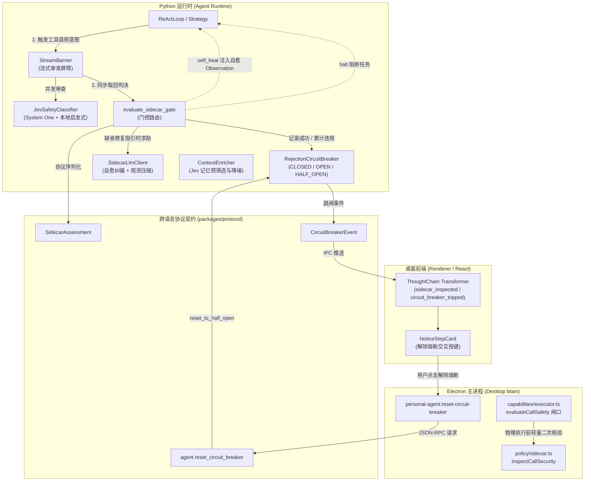
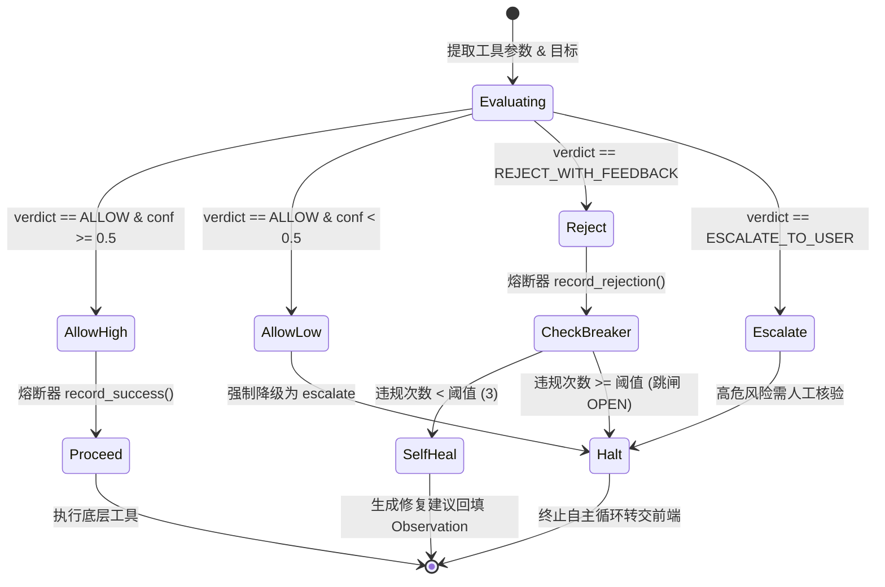

# Sidecar 系统

<cite>
**本文引用的文件**
- [packages/protocol/schemas/sidecar.ts](file://packages/protocol/schemas/sidecar.ts)
- [apps/desktop/src/main/policy/sidecar.ts](file://apps/desktop/src/main/policy/sidecar.ts)
- [apps/desktop/src/main/capabilities/executor.ts](file://apps/desktop/src/main/capabilities/executor.ts)
- [apps/desktop/src/main/index.ts](file://apps/desktop/src/main/index.ts)
- [apps/desktop/src/preload/index.ts](file://apps/desktop/src/preload/index.ts)
- [apps/desktop/src/renderer/src/thought-chain/transformer.ts](file://apps/desktop/src/renderer/src/thought-chain/transformer.ts)
- [apps/desktop/src/renderer/src/thought-chain/components/NoticeStepCard.tsx](file://apps/desktop/src/renderer/src/thought-chain/components/NoticeStepCard.tsx)
- [services/agent-runtime/src/personal_agent/conversation/sidecar/classifier.py](file://services/agent-runtime/src/personal_agent/conversation/sidecar/classifier.py)
- [services/agent-runtime/src/personal_agent/conversation/sidecar/barrier.py](file://services/agent-runtime/src/personal_agent/conversation/sidecar/barrier.py)
- [services/agent-runtime/src/personal_agent/conversation/sidecar/circuit_breaker.py](file://services/agent-runtime/src/personal_agent/conversation/sidecar/circuit_breaker.py)
- [services/agent-runtime/src/personal_agent/conversation/sidecar/gating.py](file://services/agent-runtime/src/personal_agent/conversation/sidecar/gating.py)
- [services/agent-runtime/src/personal_agent/conversation/sidecar/llm_client.py](file://services/agent-runtime/src/personal_agent/conversation/sidecar/llm_client.py)
- [services/agent-runtime/src/personal_agent/conversation/sidecar/enricher.py](file://services/agent-runtime/src/personal_agent/conversation/sidecar/enricher.py)
- [services/agent-runtime/src/personal_agent/conversation/sidecar/__init__.py](file://services/agent-runtime/src/personal_agent/conversation/sidecar/__init__.py)
- [services/agent-runtime/src/personal_agent/conversation/loop/react_loop.py](file://services/agent-runtime/src/personal_agent/conversation/loop/react_loop.py)
- [services/agent-runtime/src/personal_agent/conversation/loop/strategy.py](file://services/agent-runtime/src/personal_agent/conversation/loop/strategy.py)
- [services/agent-runtime/src/personal_agent/runtime.py](file://services/agent-runtime/src/personal_agent/runtime.py)
- [apps/desktop/tests/main/policy/sidecar.test.ts](file://apps/desktop/tests/main/policy/sidecar.test.ts)
- [apps/desktop/src/main/settings/model-settings.ts](file://apps/desktop/src/main/settings/model-settings.ts)
</cite>

## 目录
1. [简介与核心目标](#简介与核心目标)
2. [全链路架构总览](#全链路架构总览)
3. [Dual-Engine 双引擎安全分类器](#dual-engine-双引擎安全分类器)
4. [审查决策流转与动作分流](#审查决策流转与动作分流)
5. [自愈循环与人机协同熔断恢复](#自愈循环与人机协同熔断恢复)
6. [生命周期管理与通道装配](#生命周期管理与通道装配)
7. [协议契约与类型定义](#协议契约与类型定义)
8. [总结与演进方向](#总结与演进方向)

---

## 简介与核心目标

在自主智能体（Autonomous Agent）执行工具与外部环境交互的过程中，单纯依赖主决策模型的自我反思容易遭遇提示词注入（Prompt Injection）、越狱逃逸、高危破坏性指令以及无限死循环等系统级风险。

PersonalAgent 引入了独立的 **Sidecar 安全审查与记忆子系统**。Sidecar 作为一个轻量级、低延迟、与主执行回路并行的旁路监督与上下文增强中枢，承担以下核心职责：
1. **独立安全审查（Independent Security Inspection）**：在主模型生成工具调用意图之后、物理执行真正下发之前，通过双引擎分类器（轻量规则 + TypeSafe System One Jev 毫秒级语义分类）独立审查参数，阻断越权与高危行为。
2. **决策分流与闭环自愈（Self-Healing Loop）**：对轻微越界或参数错误的调用实施 `REJECT_WITH_FEEDBACK`，由 Sidecar 独立生成纠偏建议（Remediation）合成虚拟失败观测（Observation）喂回上下文，引导模型自我纠错。
3. **拒绝熔断保护与人机协同（Circuit Breaker & Human-in-the-loop）**：针对连续被拦截的异常重试，拒绝熔断器（RejectionCircuitBreaker）自动跳闸阻断执行，并通过跨进程协议向桌面端发出跳闸通知，由用户在前端思维链卡片中人工核验并一键「解除熔断（半开试探）」。
4. **上下文精炼与长输出压缩（Compaction & Pre-filtering）**：利用 Jev 多维评分从海量召回中精选黄金常驻记忆与查询记忆；并在工具执行产生超长输出时，自动落盘本地临时文件并生成结构化摘要，防止上下文窗口膨胀。

**章节来源**
- [classifier.py:1-20](file://services/agent-runtime/src/personal_agent/conversation/sidecar/classifier.py#L1-L20)
- [barrier.py:1-19](file://services/agent-runtime/src/personal_agent/conversation/sidecar/barrier.py#L1-L19)
- [circuit_breaker.py:1-17](file://services/agent-runtime/src/personal_agent/conversation/sidecar/circuit_breaker.py#L1-L17)
- [sidecar.ts:1-30](file://packages/protocol/schemas/sidecar.ts#L1-L30)

---

## 全链路架构总览

Sidecar 系统跨越了 Python 运行时、共享协议契约、Electron 主进程安全策略与 React 渲染层思维链四个层次，形成闭环纵深防御体系。



**图表来源**
- [react_loop.py:304-350](file://services/agent-runtime/src/personal_agent/conversation/loop/react_loop.py#L304-L350)
- [gating.py:29-100](file://services/agent-runtime/src/personal_agent/conversation/sidecar/gating.py#L29-L100)
- [barrier.py:20-75](file://services/agent-runtime/src/personal_agent/conversation/sidecar/barrier.py#L20-L75)
- [sidecar.ts:33-70](file://packages/protocol/schemas/sidecar.ts#L33-L70)
- [sidecar.ts:162-191](file://apps/desktop/src/main/policy/sidecar.ts#L162-L191)
- [executor.ts:88-91](file://apps/desktop/src/main/capabilities/executor.ts#L88-L91)
- [NoticeStepCard.tsx:66-86](file://apps/desktop/src/renderer/src/thought-chain/components/NoticeStepCard.tsx#L66-L86)

---

## Dual-Engine 双引擎安全分类器

系统实现了 **轻量确定性规则 + 外部极速语义模型** 的 Dual-Engine 审查架构，兼顾亚毫秒级拦截性能与复杂语义理解能力。

### 1. Tier 0：本地确定性规则兜底（Fail-Safe Deterministic Rules）
本地规则内置在 Python 侧 `classify_heuristic` 与 Electron 主进程 `inspectCallSecurity` 中，采用高灵敏度正则拦截三类高危行为：
- **Prompt 注入与越狱（Prompt Injection）**：如 `ignore previous instructions`、`developer mode`、`system override code`、`bypass all safety checks`。
- **敏感凭据与密钥窃取（Credential Exfiltration）**：如 `id_rsa`、`id_ed25519`、`.aws/credentials`、`/etc/shadow`、`Windows/System32/config/SAM`。
- **高危破坏性系统指令（Destructive Command）**：针对 `terminal_execute` 与 `code_interpreter`，严格拦截 `rm -rf /`、`mkfs`、`dd if=`、`format c:`、反弹 Shell（`nc -e`、`curl ... | bash`、`Invoke-Expression`）及关机指令。

### 2. Tier 1：TypeSafe System One (Jev) 毫秒级语义分类器
当配置了 `PERSONAL_AGENT_SIDECAR_JEV_API_KEY` 时，启动 `JevSafetyClassifier`。它通过 TypeSafe System One 的 `Choice` 语义问答，在毫秒级时间内对主任务目标（`taskGoal`）、目标能力（`capability`）与入参字典（`arguments`）进行语义评估：
- **`allow`**：操作安全合规，属于当前任务规划范围且无破坏性副作用。
- **`reject`**：参数逻辑存在缺陷、轻微越界或格式偏差，可通过纠偏指引引导自愈。
- **`escalate`**：高危不可逆操作或隐蔽逃逸行为，必须阻断并升级为人工审核。

### 3. Fail-Closed 降级与置信度熔断准则
- **网络/服务不可用降级**：若 Jev 客户端未配置或调用出现异常，自动捕获异常并平滑降级至 Tier 0 本地启发式规则，保障系统在无外网环境下依然安全可用。
- **置信度不可靠保护（Fail-Closed）**：在桌面端 `resolveSidecarAction` 中，若分类器给出的判决为 `ALLOW` 但置信度 `confidence < 0.5`，系统判定存在假阴性逃逸风险，强制推翻放行决定，将动作升级为 `escalate` 并上报人工确认。

**章节来源**
- [classifier.py:22-110](file://services/agent-runtime/src/personal_agent/conversation/sidecar/classifier.py#L22-L110)
- [classifier.py:153-216](file://services/agent-runtime/src/personal_agent/conversation/sidecar/classifier.py#L153-L216)
- [sidecar.ts:88-157](file://apps/desktop/src/main/policy/sidecar.ts#L88-L157)
- [sidecar.ts:53-67](file://apps/desktop/src/main/policy/sidecar.ts#L53-L67)
- [sidecar.test.ts:118-137](file://apps/desktop/tests/main/policy/sidecar.test.ts#L118-L137)

---

## 审查决策流转与动作分流

Sidecar 的审查结果通过强类型契约 `SidecarAssessment` 表征，并在运行时通过 `evaluate_sidecar_gate` 和桌面端的 `resolveSidecarAction` 映射为执行层的标准动作。

### 决策映射状态转换矩阵

| 判决 (verdict) | 风险级别 (riskCategory) | 置信度门槛 | 运行时动作 (SidecarGateResult) | 桌面执行层动作 (SidecarAction) | 后续流向说明 |
|:---|:---|:---|:---|:---|:---|
| **ALLOW** | `NONE` | $\ge 0.5$ | `proceed` | `allow` | 熔断器记录成功，放行物理能力调用 |
| **ALLOW** | `NONE` | $< 0.5$ | `halt` | `escalate` | 置信度不足，防假阴性，强制升级人工核验 |
| **REJECT_WITH_FEEDBACK** | `SCOPE_ESCAPING` 等 | 任意 | `self_heal` | `reject` | 熔断器计违规 1 次；若未跳闸则合成自愈 Observation |
| **REJECT_WITH_FEEDBACK** | 任意 | 任意 | `halt` | `reject` | 违规次数达到阈值（默认 3 次），熔断器跳闸阻断 |
| **ESCALATE_TO_USER** | `DESTRUCTIVE_COMMAND` 等 | 任意 | `halt` | `escalate` | 立即中断自主循环，上报前端等待人工审批 |



**图表来源**
- [gating.py:29-100](file://services/agent-runtime/src/personal_agent/conversation/sidecar/gating.py#L29-L100)
- [sidecar.ts:53-86](file://apps/desktop/src/main/policy/sidecar.ts#L53-L86)
- [circuit_breaker.py:51-131](file://services/agent-runtime/src/personal_agent/conversation/sidecar/circuit_breaker.py#L51-L131)

**章节来源**
- [gating.py:20-27](file://services/agent-runtime/src/personal_agent/conversation/sidecar/gating.py#L20-L27)
- [gating.py:50-96](file://services/agent-runtime/src/personal_agent/conversation/sidecar/gating.py#L50-L96)
- [sidecar.ts:9-25](file://apps/desktop/src/main/policy/sidecar.ts#L9-L25)
- [sidecar.ts:53-86](file://apps/desktop/src/main/policy/sidecar.ts#L53-L86)

---

## 自愈循环与人机协同熔断恢复

为了防止智能体在遇到拦截时陷入重复尝试相同错误参数的死循环，Sidecar 构建了 **自愈纠偏指引** 与 **人机协同熔断** 的双层保护环。

### 1. 自愈纠偏循环（Self-Healing Loop）
当 `evaluate_sidecar_gate` 返回 `self_heal` 时：
1. 若 `SidecarAssessment` 中未包含明确的 `remediation`，系统自动委托 `SidecarLlmClient.generate_remediation` 结合任务目标、能力契约和拦截理由生成精炼的修复指引。
2. 构造虚拟失败 Observation：
   ```json
   {
     "error": "sidecar_rejection",
     "riskCategory": "SCOPE_ESCAPING",
     "reason": "路径缺少授权前缀",
     "remediation": "请复核调用参数契约并纠正取值，推荐使用 downloads 目录前缀"
   }
   ```
3. 将该 Observation 记录至 ReAct 上下文并触发下一次思考，引导主模型依据纠偏建议自动修正入参，无需人工打断。

### 2. 人机协同熔断恢复（Human-in-the-Loop Recovery）
当连续拦截达到阈值（`threshold = 3`），`RejectionCircuitBreaker` 状态变迁为 `OPEN`，触发跳闸保护：
1. 运行时抛出 `circuit_breaker_tripped` 事件，通知前端阻断当前任务。
2. 渲染进程中的 `ThoughtChain Transformer` 将其映射为带有警告状态的 Notice 卡片。
3. `NoticeStepCard` 渲染出专属的 **「解除熔断 (半开试探)」** 操作按钮。
4. 用户人工复核确认后点击按钮，发起跨端链路：
   - 渲染层：`window.personalAgent.resetCircuitBreaker(taskId, reason)`
   - Preload：IPC 调用 `personal-agent:reset-circuit-breaker`
   - 主进程：向 Python 运行时发送 JSON-RPC 方法 `agent.reset_circuit_breaker`
   - Python 运行时：`handle_reset_circuit_breaker` 将熔断器切为 `HALF_OPEN` 状态并返回成功。
5. 熔断器进入半开试探态：下一次工具调用被允许执行，若成功则自动重置回 `CLOSED` 态，若再度违规被拦截则立即跌回 `OPEN` 态。

**章节来源**
- [llm_client.py:56-91](file://services/agent-runtime/src/personal_agent/conversation/sidecar/llm_client.py#L56-L91)
- [circuit_breaker.py:47-50](file://services/agent-runtime/src/personal_agent/conversation/sidecar/circuit_breaker.py#L47-L50)
- [runtime.py:462-489](file://services/agent-runtime/src/personal_agent/runtime.py#L462-L489)
- [index.ts:523-555](file://apps/desktop/src/main/index.ts#L523-L555)
- [index.ts:98-100](file://apps/desktop/src/preload/index.ts#L98-L100)
- [transformer.ts:288-308](file://apps/desktop/src/renderer/src/thought-chain/transformer.ts#L288-L308)
- [NoticeStepCard.tsx:66-86](file://apps/desktop/src/renderer/src/thought-chain/components/NoticeStepCard.tsx#L66-L86)
- [NoticeStepCard.tsx:172-185](file://apps/desktop/src/renderer/src/thought-chain/components/NoticeStepCard.tsx#L172-L185)

---

## 生命周期管理与通道装配

Sidecar 组件在任务生命周期中由顶层调度容器严格管理，确保跨子步骤状态连贯性与资源安全回收。

### 1. 运行时装配与跨步共享
在 `runtime.py` 的 `handle_run_task` 中：
- 为每个任务实例化专属的 `RejectionCircuitBreaker`，并缓存在 `deps.circuit_breakers[taskId]` 映射表中，使得跨多个规划子步骤（Plan Steps）共享同一个熔断器实例。
- 实例化并发流式屏障 `StreamBarrier` 与 `SidecarLlmClient`。
- 在 `finally` 块中显式执行 `barrier.close()`，关闭底层 `ThreadPoolExecutor` 线程池，防止孤魂线程或内存泄漏。

### 2. 宿主端 Policy 闸口接线
在 Electron 主进程的 `apps/desktop/src/main/capabilities/executor.ts` 中：
- 底层物理能力在经过权限审批与参数绑定后，统一通过 `evaluateCallSafety` 进行最后一道轻量级确定性规则核验，将安全违规转化为 `PERMISSION_DENIED`，彻底避免未经审查的代码孤岛。

### 3. 配置与环境变量映射
用户可通过系统设置面板对 Sidecar 进行独立模型和鉴权配置：
- `PERSONAL_AGENT_SIDECAR_MODEL` / `PERSONAL_AGENT_SIDECAR_API_KEY` / `PERSONAL_AGENT_SIDECAR_BASE_URL`：独立 LLM 配置（默认 `gpt-4o-mini`）。
- `PERSONAL_AGENT_SIDECAR_JEV_MODEL` / `PERSONAL_AGENT_SIDECAR_JEV_API_KEY` / `PERSONAL_AGENT_SIDECAR_JEV_BASE_URL`：TypeSafe System One 极速决策模型配置。

**章节来源**
- [runtime.py:266-285](file://services/agent-runtime/src/personal_agent/runtime.py#L266-L285)
- [runtime.py:351-356](file://services/agent-runtime/src/personal_agent/runtime.py#L351-L356)
- [strategy.py:294-318](file://services/agent-runtime/src/personal_agent/conversation/loop/strategy.py#L294-L318)
- [executor.ts:88-91](file://apps/desktop/src/main/capabilities/executor.ts#L88-L91)
- [model-settings.ts:29-36](file://apps/desktop/src/main/settings/model-settings.ts#L29-L36)

---

## 协议契约与类型定义

跨语言通信契约在 `packages/protocol/schemas/sidecar.ts` 中由 Zod Schema 严格定义，并在 Python 侧对齐 Pydantic 模型。

### 核心枚举与对象契约

```typescript
// 判决枚举
export const SIDECAR_VERDICTS = ["ALLOW", "REJECT_WITH_FEEDBACK", "ESCALATE_TO_USER"] as const;

// 风险类型
export const SIDECAR_RISK_CATEGORIES = [
  "NONE", "DESTRUCTIVE_COMMAND", "CREDENTIAL_EXFILTRATION",
  "PROMPT_INJECTION", "SCOPE_ESCAPING", "SYSTEM_RESOURCE_ABUSE"
] as const;

// 熔断器状态
export const CIRCUIT_BREAKER_STATES = ["CLOSED", "OPEN", "HALF_OPEN"] as const;

// 安全评估结果结构体
export const SidecarAssessment = z.object({
  callId: z.string().min(1),
  capability: z.string().min(1),
  verdict: SidecarVerdictEnum,
  riskCategory: SidecarRiskCategoryEnum.default("NONE"),
  confidence: z.number().min(0).max(1).default(1.0),
  reason: z.string().min(1),
  remediation: z.string().nullable().optional(),
  assessedBy: z.string().min(1),
  occurredAt: z.string(),
});
```

**章节来源**
- [sidecar.ts:3-28](file://packages/protocol/schemas/sidecar.ts#L3-L28)
- [sidecar.ts:33-44](file://packages/protocol/schemas/sidecar.ts#L33-L44)
- [sidecar.ts:49-70](file://packages/protocol/schemas/sidecar.ts#L49-L70)
- [sidecar.ts:88-140](file://packages/protocol/schemas/sidecar.ts#L88-L140)

---

## 总结与演进方向

Sidecar 安全审查与记忆子系统通过双引擎分类、流式异步拦截、断路自愈与人机协同，在保障 Agent 自主行动力的同时筑牢了安全防线。

未来演进计划包括：
1. **本地嵌入小模型边缘化部署**：探索将 Tier 0 规则扩展为本地轻量 ONNX / llama.cpp 小模型，在完全离线状态下实现高精度复杂语义判别。
2. **多模态 Sidecar 审查**：扩展支持截图、多模态输出与二进制文件的实时安全合规性审查。
3. **自适应熔断阈值**：基于任务敏感度（如读操作与写操作）动态调整连续拦截容忍度。

**章节来源**
- [sidecar.test.ts:20-98](file://apps/desktop/tests/main/policy/sidecar.test.ts#L20-L98)
- [sidecar.test.ts:100-221](file://apps/desktop/tests/main/policy/sidecar.test.ts#L100-L221)
