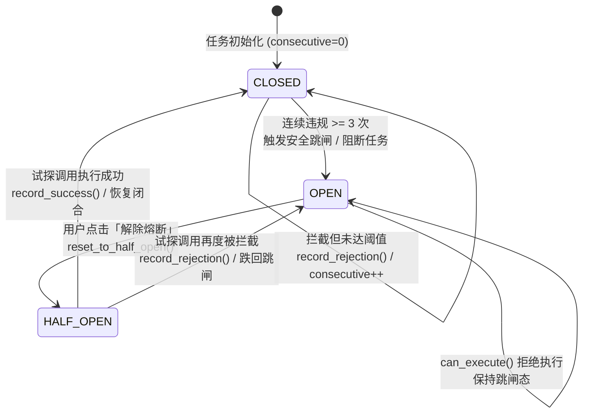
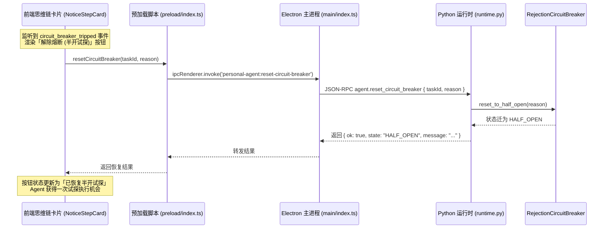

# 流式屏障与熔断机制

<cite>
**本文引用的文件**
- [packages/protocol/schemas/sidecar.ts](file://packages/protocol/schemas/sidecar.ts)
- [services/agent-runtime/src/personal_agent/conversation/sidecar/barrier.py](file://services/agent-runtime/src/personal_agent/conversation/sidecar/barrier.py)
- [services/agent-runtime/src/personal_agent/conversation/sidecar/circuit_breaker.py](file://services/agent-runtime/src/personal_agent/conversation/sidecar/circuit_breaker.py)
- [services/agent-runtime/src/personal_agent/conversation/sidecar/gating.py](file://services/agent-runtime/src/personal_agent/conversation/sidecar/gating.py)
- [services/agent-runtime/src/personal_agent/conversation/sidecar/classifier.py](file://services/agent-runtime/src/personal_agent/conversation/sidecar/classifier.py)
- [services/agent-runtime/src/personal_agent/conversation/loop/react_loop.py](file://services/agent-runtime/src/personal_agent/conversation/loop/react_loop.py)
- [services/agent-runtime/src/personal_agent/conversation/loop/strategy.py](file://services/agent-runtime/src/personal_agent/conversation/loop/strategy.py)
- [services/agent-runtime/src/personal_agent/runtime.py](file://services/agent-runtime/src/personal_agent/runtime.py)
- [apps/desktop/src/main/index.ts](file://apps/desktop/src/main/index.ts)
- [apps/desktop/src/preload/index.ts](file://apps/desktop/src/preload/index.ts)
- [apps/desktop/src/renderer/src/thought-chain/transformer.ts](file://apps/desktop/src/renderer/src/thought-chain/transformer.ts)
- [apps/desktop/src/renderer/src/thought-chain/components/NoticeStepCard.tsx](file://apps/desktop/src/renderer/src/thought-chain/components/NoticeStepCard.tsx)
</cite>

## 目录
1. [简介与设计背景](#简介与设计背景)
2. [StreamBarrier 动态拦截屏障](#streambarrier-动态拦截屏障)
3. [CircuitBreaker 熔断与恢复状态机](#circuitbreaker-熔断与恢复状态机)
4. [evaluate_sidecar_gate 安全闸口路由](#evaluate_sidecar_gate-安全闸口路由)
5. [人机协同熔断恢复链路](#人机协同熔断恢复链路)
6. [异常边界与容错测试覆盖](#异常边界与容错测试覆盖)

---

## 简介与设计背景

在大语言模型流式输出与自主工具执行回路中，存在两大典型的系统稳定性与安全风险：
1. **时序与延迟矛盾**：若在工具参数全部生成后才串行发起安全审查，会显著增加用户感知的端到端执行延迟；若不经审查直接下发物理执行，高危指令可能瞬间造成不可逆的本地数据损坏。
2. **死循环与重复违规**：当工具调用因参数越界或违规被安全系统拦截时，自主 Agent 容易受上下文惯性影响，陷入反复尝试相同违规参数的死循环，徒增 Token 消耗与系统负担。

为了化解上述矛盾，PersonalAgent 实现了 **StreamBarrier（流式审查门控屏障）** 与 **RejectionCircuitBreaker（拒绝熔断器状态机）**，构建了一套兼具低延迟异步并发、强一致安全门控与人机协同恢复能力的防护网。

**章节来源**
- [barrier.py:1-19](file://services/agent-runtime/src/personal_agent/conversation/sidecar/barrier.py#L1-L19)
- [circuit_breaker.py:1-17](file://services/agent-runtime/src/personal_agent/conversation/sidecar/circuit_breaker.py#L1-L17)

---

## StreamBarrier 动态拦截屏障

`StreamBarrier` 支持与主决策模型并发执行安全审查，并在物理工具真正执行前充当一道同步门控拦截屏障。

### 1. 异步并发提交 (`submit`)
在主模型流式输出解析出工具调用（Tool Call）意图的瞬间，主执行回路调用 `StreamBarrier.submit`：
- 使用内部专用的 `ThreadPoolExecutor`（线程前缀 `sidecar-barrier`，默认 2 个工作线程）异步并发派发审查任务。
- 将审查任务封装为 `Future[SidecarAssessment]` 并缓存在以 `callId` 为键的字典中。
- 此阶段不阻塞主模型的后续 Token 流式生成，实现审查计算与模型生成的最大化时序重叠。

### 2. 同步门控屏障与降级 (`wait_or_pass`)
在主模型完成当前步输出、准备下发底层物理执行前，必须调用 `wait_or_pass` 进行同步收口：
- **命中缓存**：若后台异步审查已提前完成或正在运行，调用 `future.result(timeout=timeout)`（默认超时 3.0 秒）等待并获取结果。
- **超时与异常降级（Fail-Safe）**：若在 3.0 秒内未能返回或网络异常，系统记录警告日志并立即调用 `classify_heuristic` 走本地确定性规则兜底，确保物理工具绝不在未受审查的情况下裸跑。
- **冷启动就地审查**：若先前因故未提前 `submit`，则在当前线程就地执行 `classifier.classify` 同步审查。

### 3. 线程池资源清理 (`close`)
在任务生命周期结束（`handle_run_task` 的 `finally` 块中），显式调用 `barrier.close()` 关闭线程池并释放底层资源。

### 4. 流式屏障执行时序

```mermaid
sequenceDiagram
    autonumber
    participant LLM as 主决策模型 (LiveModel)
    participant Loop as 循环控制器 (ReActLoop)
    participant Barrier as StreamBarrier
    participant Classifier as JevSafetyClassifier
    participant Host as 宿主执行体 (HostChannel)

    LLM->>Loop: 流式输出 ToolCall (callId, capability, args)
    Loop->>Barrier: submit(call_id, capability, arguments, goal)
    Barrier->>Classifier: 异步线程池执行 classify()
    LLM-->>Loop: 完成流式内容生成
    Loop->>Barrier: wait_or_pass(call_id, capability, arguments, timeout=3.0s)
    alt 审查按时完成
        Classifier-->>Barrier: 返回 SidecarAssessment
        Barrier-->>Loop: 返回评估结果
    else 等待超时或网络异常
        Barrier->>Classifier: classify_heuristic() 本地规则兜底
        Classifier-->>Barrier: 返回兜底 SidecarAssessment
        Barrier-->>Loop: 返回安全降级结果
    end

    Loop->>Loop: evaluate_sidecar_gate 判定
    alt 判定为 proceed (放行)
        Loop->>Host: 物理调用 host.execute_tool
        Host-->>Loop: 返回 Observation
    else 判定为 self_heal (自愈)
        Loop->>Loop: 合成自愈 Observation 回填上下文
    else 判定为 halt (阻断)
        Loop-->>Loop: 终止任务并上报
    end
```

**图表来源**
- [barrier.py:35-75](file://services/agent-runtime/src/personal_agent/conversation/sidecar/barrier.py#L35-L75)
- [react_loop.py:304-350](file://services/agent-runtime/src/personal_agent/conversation/loop/react_loop.py#L304-L350)
- [gating.py:50-96](file://services/agent-runtime/src/personal_agent/conversation/sidecar/gating.py#L50-L96)

**章节来源**
- [barrier.py:20-78](file://services/agent-runtime/src/personal_agent/conversation/sidecar/barrier.py#L20-L78)
- [runtime.py:351-356](file://services/agent-runtime/src/personal_agent/runtime.py#L351-L356)

---

## CircuitBreaker 熔断与恢复状态机

`RejectionCircuitBreaker` 实现了经典断路器模式的三态机（`CLOSED`、`OPEN`、`HALF_OPEN`），用以终结自主 Agent 的违规死循环。

### 1. 状态定义与阈值契约
- **`CLOSED`（闭合态 - 正常）**：系统正常放行合规调用，内部维护连续违规计数器 `consecutive_rejections`。
- **`OPEN`（跳闸态 - 阻断）**：连续违规次数达到阈值（`threshold`，默认为 3 次），阻断后续任何工具执行。
- **`HALF_OPEN`（半开态 - 试探）**：由用户在前端人工确认后复位，允许执行单次试探调用。

### 2. 滑动窗口违规记录 (`recent_rejections`)
每次发生违规拦截时，构造 `CircuitBreakerRejectionRecord(callId, capability, reason, riskCategory)` 并推入队列，窗口最大保留最近 `threshold` 条记录，确保跳闸事件能够完整向用户呈现触发熔断的历史证据链。

### 3. 状态转移规则



- **CLOSED $\to$ OPEN**：当连续拦截次数达到 `self.threshold`（默认 3 次），状态变为 `OPEN`，构造并返回包含违规证据链的 `CircuitBreakerEvent`。
- **OPEN $\to$ HALF_OPEN**：用户在前端确认恢复，调用 `reset_to_half_open()`，状态切为 `HALF_OPEN`。
- **HALF_OPEN $\to$ CLOSED**：半开状态下的下一次工具执行成功（安全审查通过），调用 `record_success()`，计数器清零，历史违规记录排空，状态彻底恢复为 `CLOSED`。
- **HALF_OPEN $\to$ OPEN**：若半开状态下的试探调用再次被拦截，判定自愈失败，立即重新跌回 `OPEN` 态并返回跳闸事件。

**图表来源**
- [circuit_breaker.py:18-50](file://services/agent-runtime/src/personal_agent/conversation/sidecar/circuit_breaker.py#L18-L50)
- [circuit_breaker.py:51-131](file://services/agent-runtime/src/personal_agent/conversation/sidecar/circuit_breaker.py#L51-L131)

**章节来源**
- [circuit_breaker.py:18-50](file://services/agent-runtime/src/personal_agent/conversation/sidecar/circuit_breaker.py#L18-L50)
- [circuit_breaker.py:58-88](file://services/agent-runtime/src/personal_agent/conversation/sidecar/circuit_breaker.py#L58-L88)
- [circuit_breaker.py:89-131](file://services/agent-runtime/src/personal_agent/conversation/sidecar/circuit_breaker.py#L89-L131)
- [sidecar.ts:22-28](file://packages/protocol/schemas/sidecar.ts#L22-L28)
- [sidecar.ts:49-70](file://packages/protocol/schemas/sidecar.ts#L49-L70)

---

## evaluate_sidecar_gate 安全闸口路由

在 `ReActLoop` 的执行主干中，`evaluate_sidecar_gate` 综合审查评估 `SidecarAssessment` 与熔断器状态，作出具体的三向分支路由：

### 1. 分支一：`proceed`（放行物理执行）
- **触发条件**：`assessment.verdict == "ALLOW"` 且熔断器状态允许执行（非 `OPEN`）。
- **后续处理**：调用 `circuit_breaker.record_success()`（若在 `HALF_OPEN` 则成功闭合）；下发真实物理能力调用，并向事件流发射 `sidecar_inspected`。

### 2. 分支二：`self_heal`（拦截并自愈）
- **触发条件**：`assessment.verdict == "REJECT_WITH_FEEDBACK"` 且累计违规未触发跳闸（返回 `tripped is None`）。
- **后续处理**：
  1. 累加熔断器违规计数；
  2. 提取判决中的 `remediation`（若缺失则调用 `SidecarLlmClient.generate_remediation` 动态生成）；
  3. 构造虚拟失败 `Observation`（携带 `error: "sidecar_rejection"` 与修复提示）；
  4. 触发 `tool_result` 事件回传，促使主模型基于该反馈重新调整参数重试。

### 3. 分支三：`halt`（熔断阻断或升级人工）
- **触发条件**：
  1. 熔断器当前已处于 `OPEN` 状态；
  2. 违规累加导致熔断器刚发生跳闸（`tripped is not None`）；
  3. 审查判决为高危 `ESCALATE_TO_USER`。
- **后续处理**：向事件流发射 `circuit_breaker_tripped` 事件，中断当前子步骤的循环执行，向桌面端返回阻塞终态。

**章节来源**
- [gating.py:29-100](file://services/agent-runtime/src/personal_agent/conversation/sidecar/gating.py#L29-L100)
- [react_loop.py:304-350](file://services/agent-runtime/src/personal_agent/conversation/loop/react_loop.py#L304-L350)

---

## 人机协同熔断恢复链路

当任务因熔断跳闸陷入阻塞时，系统提供了贯穿渲染层、IPC、协议层与运行时的完整人机协同解脱链路：



1. **前端状态渲染**：`ThoughtChain Transformer` 将 `circuit_breaker_tripped` 转换为 `noticeKind: 'circuit_breaker'` 的 Notice 步骤，`NoticeStepCard` 渲染出琥珀色醒目的警示卡片与「解除熔断 (半开试探)」交互按钮。
2. **跨进程 IPC 请求**：用户点击后，`window.personalAgent.resetCircuitBreaker` 将请求发送至主进程通道 `personal-agent:reset-circuit-breaker`。
3. **JSON-RPC 通道转发**：主进程校验 `taskId` 合法性后，向 Python 运行时派发 `agent.reset_circuit_breaker` 请求。
4. **运行时状态机复位**：`runtime.py` 中的 `handle_reset_circuit_breaker` 定位到对应任务的 `RejectionCircuitBreaker` 实例，调用 `reset_to_half_open`，将状态切为 `HALF_OPEN`。
5. **恢复反馈**：结果沿链路原路返回，前端展示「已恢复半开试探」，后续的重试操作将被允许通过门控试探执行。

**图表来源**
- [NoticeStepCard.tsx:66-86](file://apps/desktop/src/renderer/src/thought-chain/components/NoticeStepCard.tsx#L66-L86)
- [index.ts:98-100](file://apps/desktop/src/preload/index.ts#L98-L100)
- [index.ts:523-555](file://apps/desktop/src/main/index.ts#L523-L555)
- [runtime.py:462-489](file://services/agent-runtime/src/personal_agent/runtime.py#L462-L489)
- [circuit_breaker.py:47-50](file://services/agent-runtime/src/personal_agent/conversation/sidecar/circuit_breaker.py#L47-L50)

**章节来源**
- [NoticeStepCard.tsx:66-86](file://apps/desktop/src/renderer/src/thought-chain/components/NoticeStepCard.tsx#L66-L86)
- [NoticeStepCard.tsx:172-185](file://apps/desktop/src/renderer/src/thought-chain/components/NoticeStepCard.tsx#L172-L185)
- [transformer.ts:288-308](file://apps/desktop/src/renderer/src/thought-chain/transformer.ts#L288-L308)
- [index.ts:523-555](file://apps/desktop/src/main/index.ts#L523-L555)
- [index.ts:98-100](file://apps/desktop/src/preload/index.ts#L98-L100)
- [runtime.py:462-489](file://services/agent-runtime/src/personal_agent/runtime.py#L462-L489)

---

## 异常边界与容错测试覆盖

流式屏障与熔断机制经过了严格的边界条件断言与全流程测试：

1. **异步屏障超时测试**：模拟后台分类器睡眠或死锁，验证 `StreamBarrier.wait_or_pass` 在 3 秒后平滑触发本地规则兜底，避免执行线程永久挂起。
2. **连续拦截阈值跳闸测试**：输入连续违规参数，断言计数器严格单调递增，达到第 3 次时必须精准返回 `state == "OPEN"` 的 `CircuitBreakerEvent`。
3. **滑动窗口证据链测试**：连续产生多条违规记录，断言 `recentRejections` 严格限制在 `threshold` 长度内，且保留的是最新历史记录。
4. **半开试探正反向测试**：
   - 半开态下遇到成功调用，断言状态归正为 `CLOSED` 且违规计数清零；
   - 半开态下再次遇到拦截，断言直接切回 `OPEN` 态，不允许持续重试。
5. **协议双端一致性**：通过 `test_protocol_fixtures.py` 验证 TS 与 Python 端针对 `reset-circuit-breaker.request.json` 与 `reset-circuit-breaker.response.json` 的解析完全一致。

**章节来源**
- [barrier.py:55-75](file://services/agent-runtime/src/personal_agent/conversation/sidecar/barrier.py#L55-L75)
- [circuit_breaker.py:89-131](file://services/agent-runtime/src/personal_agent/conversation/sidecar/circuit_breaker.py#L89-L131)
- [sidecar.ts:88-140](file://packages/protocol/schemas/sidecar.ts#L88-L140)
