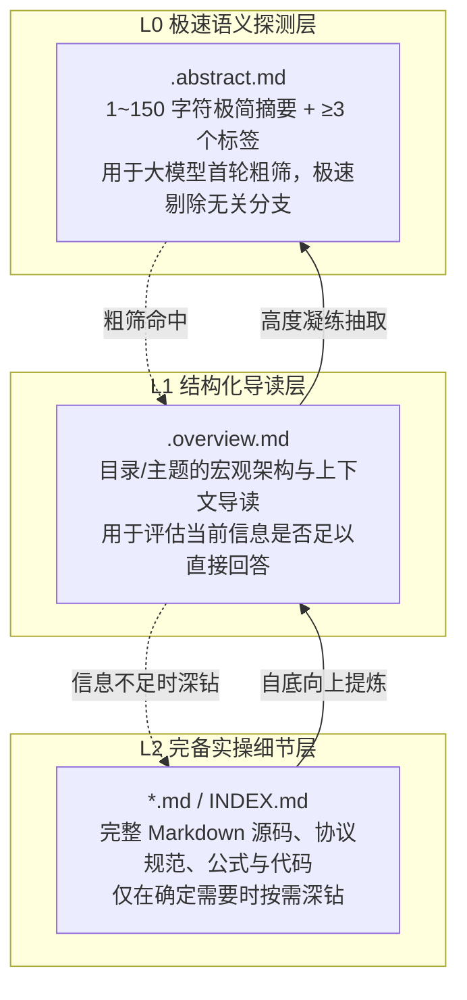
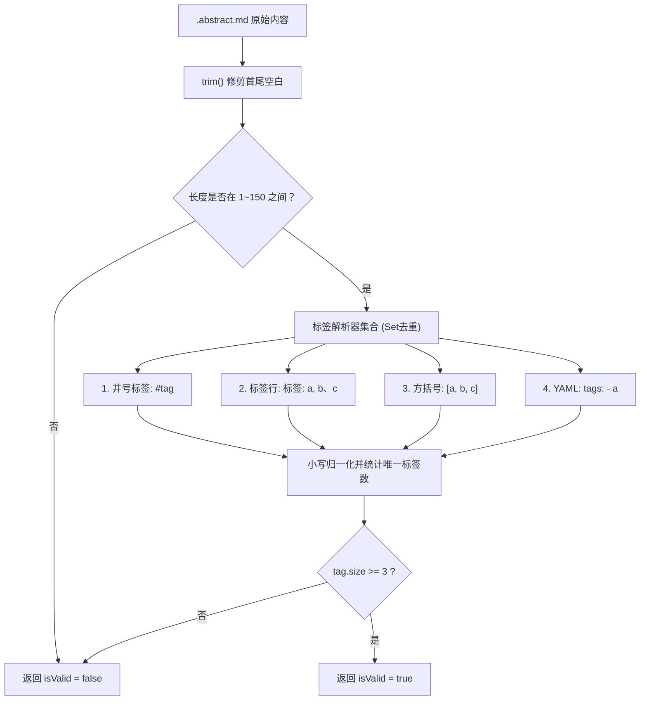

# OpenViking 关系图谱与分层抽象体系

<cite>
**本文引用的文件**
- [cascader.py](file://services/agent-runtime/src/personal_agent/knowledge/cascader.py)
- [relation_graph.py](file://services/agent-runtime/src/personal_agent/knowledge/relation_graph.py)
- [relation_classifier.py](file://services/agent-runtime/src/personal_agent/knowledge/relation_classifier.py)
- [viking-store.ts](file://apps/desktop/src/main/viking/viking-store.ts)
- [viking.ts](file://apps/desktop/src/main/capabilities/plugins/viking.ts)
- [viking.ts](file://packages/protocol/schemas/viking.ts)
</cite>

## 目录
1. [OpenViking 核心定位与分层知识理念](#openviking-核心定位与分层知识理念)
2. [三级抽象体系：L0 / L1 / L2 规范](#三级抽象体系l0--l1--l2-规范)
3. [维基存储内核与目录骨架初始化](#维基存储内核与目录骨架初始化)
4. [L0 极简摘要与 4 种标签语法校验](#l0-极简摘要与-4-种标签语法校验)
5. [语义关系边拓扑引擎：relations.jsonl](#语义关系边拓扑引擎relationsjsonl)
6. [两阶段织网第一阶段：大模型关系断言与清洗](#两阶段织网第一阶段大模型关系断言与清洗)
7. [自底向上级联维护与 DFS 环路防御](#自底向上级联维护与-dfs-环路防御)
8. [桌面端能力插件与路径安全沙箱](#桌面端能力插件与路径安全沙箱)

---

## OpenViking 核心定位与分层知识理念

个人智能体（Personal Agent）不仅需要摄入散落的文件，更需要像人类专家一样构建结构化、体系化且具有高度关联的**个人维基知识网络**。OpenViking 体系专为此而设计：
- **拒绝单层大泥球**：传统的 Wiki 或知识管理系统往往将所有内容平铺存储为 Markdown，导致模型在检索时面对数万字的冗长全文，消耗巨额 Token 且极易迷失；
- **自底向上级联抽象**：遵循“微观叶子事实驱动宏观概览，宏观概览指引微观钻取”的认知规律，将知识拆解为精细的分层抽象层；
- **强语义拓扑关系边**：通过白名单谓词图谱，显式记录概念之间的演进、前置、对比、实现与废弃关系，支持智能体在知识空间中进行多跳关联推理。

**章节来源**
- [viking-store.ts:9-47](file://apps/desktop/src/main/viking/viking-store.ts#L9-L47)
- [cascader.py:1-17](file://services/agent-runtime/src/personal_agent/knowledge/cascader.py#L1-L17)

---

## 三级抽象体系：L0 / L1 / L2 规范

OpenViking 在文件系统层面上严格规定了三级抽象梯队，兼顾极速筛选、全局导读与深度实操：



### 1. L0 极简摘要（.abstract.md）
- **职责**：给智能体提供极度紧凑的“索引卡片”；
- **硬性约束**：文本长度严格在 1 到 150 字符以内（含 150，`trim()` 后非空），且必须包含至少 3 个有效且唯一的特征标签；
- **收益**：智能体在探索大型维基目录树时，可以一次性读取数十个子目录的 L0 摘要（总 Token 不超过数百），快速锁定目标分支。

### 2. L1 概览导读（.overview.md）
- **职责**：阐述当前目录或主题的背景动机、核心设计范式、上下游关系与关键结论；
- **收益**：与 `retrieval_router.py` 联动。当模型查询宏观架构时，L1 概览往往已经提供了足够完整的事实，无需深钻底层长文，节省 80% 以上的上下文空间。

### 3. L2 完备细节（*.md / INDEX.md）
- **职责**：具体的实现文件、底层技术细节、详尽规范或长篇教程；
- **形式**：叶子文档为具体的业务文件（如 `cpu/x86/avx512.md`），目录节点为当前目录的汇总正文（`INDEX.md`）。

**章节来源**
- [viking-store.ts:9-35](file://apps/desktop/src/main/viking/viking-store.ts#L9-L35)
- [viking-store.ts:62-105](file://apps/desktop/src/main/viking/viking-store.ts#L62-L105)
- [packages/protocol/schemas/viking.ts:3-38](file://packages/protocol/schemas/viking.ts#L3-L38)

---

## 维基存储内核与目录骨架初始化

在 `apps/desktop/src/main/viking/viking-store.ts` 中，系统实现了轻量、透明且完全基于文件系统的维基存储内核。

### 1. 存储根目录规约
存储路径遵循严格的优先级探测链：
$$\text{customRoot (显式参数)} > \text{PERSONAL\_AGENT\_VIKING\_ROOT (环境变量)} > \sim/\text{.personal-agent/viking\_store/ (默认基准)}$$

### 2. 5 大内置核心品类骨架 (`DEFAULT_VIKING_CATEGORIES`)
调用 `initVikingStore(storeRoot)` 时，系统会自动初始化 5 大核心品类目录，并预置对应的 `.abstract.md`、`.overview.md` 与 `INDEX.md` 模板：
- `identity`：用户身份画像与偏好（记录用户核心事实、交互风格与长期配置）；
- `relationships`：重要人物与人际关系（记录人际画像、组织协作与上下文实体消歧）；
- `projects`：历史项目与长期任务（沉淀开发背景、技术选型与里程碑脉络）；
- `knowledge`：领域知识与指令集（沉淀计算机体系结构、协议规范与技术指令）；
- `raptor_trees`：RAPTOR 树状递归索引（维护自顶向下的分层聚类抽象树）。

**章节来源**
- [viking-store.ts:16-47](file://apps/desktop/src/main/viking/viking-store.ts#L16-L47)
- [viking-store.ts:111-168](file://apps/desktop/src/main/viking/viking-store.ts#L111-L168)

---

## L0 极简摘要与 4 种标签语法校验

为了确保进入知识网络的 L0 摘要具备高质量的检索元数据，`validateAbstractLengthAndKeywords` 实现了严格的字符级与语法级校验。

### 1. 长度校验
内容经 `trim()` 修整后，长度必须落在区间 $[1, 150]$。超长或纯空白一律判定为无效（`isValid=false`）。

### 2. 4 种标签书写语法解析器
校验器内置 4 组独立的正则表达式提取器，提取所有标签并统一转为小写去重，最终要求 `tag.size >= 3`：
1. **井号标签（HashTag）**：`/#([a-zA-Z0-9_\u4e00-\u9fa5]+)/g`（如 `#身份 #偏好 #画像`）；
2. **中英文标签行**：`/(?:标签|Tags?)[:：]\s*([^\n]+)/gi`，支持逗号或顿号分隔（如 `标签: a, b、c`）；
3. **方括号标签**：`/\[([^\]]+)\]/g`（如 `[tag1, tag2, tag3]`）；
4. **YAML Frontmatter 标签**：`/tags:\s*(?:\[[^\]]*\]|(?:\n\s*-\s*[^\n]+)+)/gi`，支持内联数组或短横线列表。



**章节来源**
- [viking-store.ts:62-105](file://apps/desktop/src/main/viking/viking-store.ts#L62-L105)

---

## 语义关系边拓扑引擎：relations.jsonl

在 OpenViking 体系中，文档不仅是树状目录中的节点，更通过有向图拓扑相互交织。`relation_graph.py` 实现了 `relations.jsonl` 的持久化管理。

### 1. 核心拓扑谓词白名单 (`VALID_PREDICATES`)
系统严格禁止任意臆造谓词，限定 10 个具有明确语义方向的官方谓词：
- `extends` / `extended_by`：演进与扩展（如 `AVX extends SSE`）；
- `precedes` / `succeeded_by`：时序前置与演进自（如 `C precedes C++`）；
- `contrasts_with`：方案对比（如 `RISC-V contrasts_with x86`）；
- `supersedes` / `superseded_by`：替代与废弃（如 `OAuth 2.1 supersedes OAuth 2.0`）；
- `implements` / `implemented_by`：规范实现（如 `Linux implements POSIX`）；
- `related_to`：通用强相关。

### 2. RelationEdge 领域契约与原子落盘
单条关系边包含起始节点 `from`（别名 `from_uri`）、目标节点 `to`（别名 `to_uri`）、谓词 `predicate`、可读标签 `label`、引文证据链 `evidence`、置信度 `confidence`（$0.0 \sim 1.0$）以及 UTC 时间戳。
- **原子保存（Atomic Save）**：写入时先全量输出至同级临时文件 `relations.jsonl.tmp`，完成刷盘后执行原子替换（`replace`），防止在并发或进程异常退出时损坏图谱；
- **双向邻接索引**：内存中维护 `_outgoing` 与 `_incoming` 邻接表，支持 `get_neighbors(uri, direction="out"|"in"|"both", predicate=...)` 极速查询。

**章节来源**
- [relation_graph.py:18-49](file://services/agent-runtime/src/personal_agent/knowledge/relation_graph.py#L18-L49)
- [relation_graph.py:51-155](file://services/agent-runtime/src/personal_agent/knowledge/relation_graph.py#L51-L155)

---

## 两阶段织网第一阶段：大模型关系断言与清洗

当新文档进入维基时，系统如何自动发现其与已有文档的关系？`relation_classifier.py` 实现了两阶段织网中的“关系断言”阶段。

### 1. 结构化断言提示词 (`build_relation_assertion_prompt`)
提示词将当前文档的 URI、正文/摘要，与知识库中检索出的候选文档集合（`[(uri, abstract)]`）组装在一起，显式注入 `VALID_PREDICATES` 允许的谓词清单，并限定模型必须以纯 JSON 数组形式输出断言列表。

### 2. 深度清洗与防御校验 (`parse_relation_assertions`)
大模型输出在送入图谱前必须经受严格的清洗逻辑：
- **Markdown 代码块剥离**：使用正则表达式从文本中提取外层 `[...]` 数组，去除无关解释文字；
- **自环边过滤**：严禁出现 `to == source_uri` 的自指向关系；
- **非法谓词丢弃**：凡未落在 `VALID_PREDICATES` 白名单中的谓词直接剔除；
- **证据与置信度归一化**：确保 `evidence` 规整为字符串列表，`confidence` 截断在 $[0.0, 1.0]$ 区间内，保证下游图谱计算的稳定性。

**章节来源**
- [relation_classifier.py:17-58](file://services/agent-runtime/src/personal_agent/knowledge/relation_classifier.py#L17-L58)
- [relation_classifier.py:60-131](file://services/agent-runtime/src/personal_agent/knowledge/relation_classifier.py#L60-L131)
- [relation_classifier.py:133-144](file://services/agent-runtime/src/personal_agent/knowledge/relation_classifier.py#L133-L144)

---

## 自底向上级联维护与 DFS 环路防御

当某个底层文档（L2）的内容被修改时，其祖先目录的 L1 概览、L0 摘要以及语义上依赖它的下游文档均面临陈旧过期的风险。`cascader.py` 实现了双轨级联调度。

```mermaid
flowchart TD
    Mod["叶子文档变更: cpu/x86/avx.md"] --> Plan["plan_file_change_cascade()"]
    
    subgraph 物理目录级联 (get_directory_cascade_chain)
        Plan --> D1["dir://cpu/x86"]
        D1 --> D2["dir://cpu"]
        D2 --> D3["dir:// (维基根目录)"]
    end

    subgraph 语义图谱级联 (compute_cascade_schedule)
        Plan --> Topo["拓扑下游节点分析: viking://..."]
        Topo --> CycleCheck{"detect_cycles()<br/>DFS 三色染色法"}
        CycleCheck -->|发现反向边| Warn["记录告警并安全破环"]
        CycleCheck -->|无环图 (DAG)| Sort["Kahn 拓扑排序计算传递闭包"]
    end

    D1 & D2 & D3 & Sort --> Schedule["合并去重调度队列 (物理优先，拓扑紧跟)"]
    Schedule --> Exec["execute_cascade()<br/>顺次触发各级 .overview 与 .abstract 刷新"]
```

### 1. 物理目录级联链条 (`get_directory_cascade_chain`)
对相对路径 `cpu/x86/avx.md`，函数计算出其由深到浅的祖先路径序列：`["cpu/x86", "cpu", ""]`（`""` 表示维基根目录）。保证在刷新摘要时，始终先刷新最底层的父目录，再逐级汇聚至根目录。

### 2. DFS 三色染色法环路检测 (`detect_cycles`)
依赖图谱中可能因用户编辑或模型推导出现循环依赖（如 $A \to B \to C \to A$）。为防止级联触发无限死循环，算法采用三色染色机制：
- `WHITE (0)`：未访问节点；
- `GRAY (1)`：正在访问的节点（当前 DFS 递归调用栈中）；
- `BLACK (2)`：已访问完成的节点。
在遍历邻接边时，若遇到状态为 `GRAY` 的节点，说明存在一条反向边，直接截取调用栈输出完整的回路路径并记录告警。

### 3. 拓扑更新队列调度 (`compute_cascade_schedule`)
从初始变更节点出发，计算受影响节点的传递闭包，过滤出有效子图后利用入度表进行 Kahn 拓扑排序，确保被依赖的前置概念始终先于依赖它的后置概念得到更新。

**章节来源**
- [cascader.py:19-42](file://services/agent-runtime/src/personal_agent/knowledge/cascader.py#L19-L42)
- [cascader.py:45-89](file://services/agent-runtime/src/personal_agent/knowledge/cascader.py#L45-L89)
- [cascader.py:92-159](file://services/agent-runtime/src/personal_agent/knowledge/cascader.py#L92-L159)
- [cascader.py:162-207](file://services/agent-runtime/src/personal_agent/knowledge/cascader.py#L162-L207)

---

## 桌面端能力插件与路径安全沙箱

在 Electron 宿主主进程中，OpenViking 体系通过 `apps/desktop/src/main/capabilities/plugins/viking.ts` 注册为自描述插件，与 Python 运行时形成严密的安全闭环。

### 1. 五层安全链与 realpath 根目录守卫
所有维基读写能力（`viking_read_l0`, `viking_read_l1`, `viking_read_l2`, `viking_write_l2`）必须经过 `bindVikingUri`：
- 解析出真实根目录后，调用 `resolveVikingUriWithinRootReal` 执行真实的符号链接（Symlink/Junction）穿透校验；
- 严防 `viking://../../etc/passwd` 等路径逃逸攻击，任一越界尝试立即阻断并返回 `ERROR_CODE.PATH_OUT_OF_ROOT`。

### 2. 不可信数据沙箱边界包裹 (`wrapExternalSource`)
为防止维基正文中潜藏对抗性提示注入，在向智能体返回 L0、L1、L2 文本时，插件统一执行 `wrapExternalSource`，附带特定的不可信隔离标头与注脚：
```
[VIKING_STORE_CONTENT_BEGIN - UNTRUSTED REFERENCE ONLY]
...实际文本内容...
[VIKING_STORE_CONTENT_END]
```

### 3. 预期值审计机制 (`auditExpectedValues`)
在执行 `viking_write_l2` 写操作时，协议支持可选的 `expected_article_exists` 字段。写入执行前自动比对实际文件存在状态，若出现状态竞态不一致，立即拒绝执行，实现严格的操作幂等与事务防护。

**章节来源**
- [viking.ts:30-59](file://apps/desktop/src/main/capabilities/plugins/viking.ts#L30-L59)
- [viking.ts:61-88](file://apps/desktop/src/main/capabilities/plugins/viking.ts#L61-L88)
- [viking.ts:90-117](file://apps/desktop/src/main/capabilities/plugins/viking.ts#L90-L117)
- [viking.ts:119-146](file://apps/desktop/src/main/capabilities/plugins/viking.ts#L119-L146)
- [viking.ts:148-181](file://apps/desktop/src/main/capabilities/plugins/viking.ts#L148-L181)
- [packages/protocol/schemas/viking.ts:40-53](file://packages/protocol/schemas/viking.ts#L40-L53)
