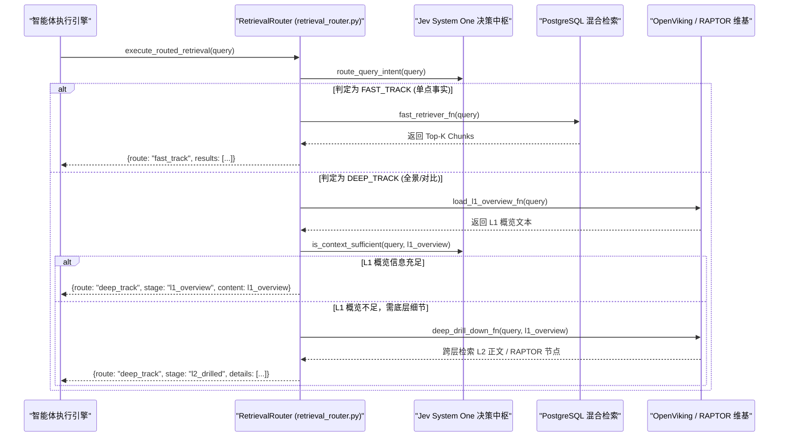

# 混合检索与神经重排序机制

<cite>
**本文引用的文件**
- [retriever.py](file://services/agent-runtime/src/personal_agent/knowledge/retriever.py)
- [reranker.py](file://services/agent-runtime/src/personal_agent/knowledge/reranker.py)
- [retrieval_router.py](file://services/agent-runtime/src/personal_agent/knowledge/retrieval_router.py)
- [raptor.py](file://services/agent-runtime/src/personal_agent/knowledge/raptor.py)
- [embedder.py](file://services/agent-runtime/src/personal_agent/knowledge/embedder.py)
- [knowledge.ts](file://packages/protocol/schemas/knowledge.ts)
</cite>

## 目录
1. [检索系统核心范式与演进动机](#检索系统核心范式与演进动机)
2. [三阶段混合检索管道全景流程](#三阶段混合检索管道全景流程)
3. [第一阶段：并行双路召回 (Dual-Track Recall)](#第一阶段并行双路召回-dual-track-recall)
4. [第二阶段：倒数排名融合算法 (RRF)](#第二阶段倒数排名融合算法-rrf)
5. [第三阶段：Cross-Encoder 神经重排序精排](#第三阶段cross-encoder-神经重排序精排)
6. [智能体双轨意图路由与信息充足性评估](#智能体双轨意图路由与信息充足性评估)
7. [多层级与多领域检索支撑 (RAPTOR & Memory)](#多层级与多领域检索支撑-raptor--memory)
8. [核心协议契约与参数配置规范](#核心协议契约与参数配置规范)

---

## 检索系统核心范式与演进动机

在真实的个人智能体工作负载下，用户查询呈现高度复杂的多样性：
- **精准专有名词与标识符查询**：如函数名 `resolveWithinRootReal`、错误码 `ERR_FILE_NOT_FOUND`、法条编号《刑法》第 234 条，这类查询对字符匹配要求极高；单纯依靠稠密向量检索容易产生“语义漂移”或忽略关键标识符；
- **自然语言模糊提问与泛化意图**：如“上周讨论的跨平台路径兼容方案”、“为什么选用三阶段检索”，这类查询包含丰富的同义词和上下文隐喻，关键词全文检索难以捕获底层语义；
- **时效性与版本冲突**：知识库中并存“已废弃”规范与“现行”草案，普通检索极易误召回过期内容。

为此，PersonalAgent 知识库系统构建了**三阶段混合检索流水线（Hybrid Retrieval Pipeline）**：
1. **并行多路粗排召回**：基于 pgvector 的 1024 维 Dense 语义召回，与基于 pg_jieba 中文分词的 Sparse 全文检索并行触发；
2. **倒数排名融合（RRF）**：摆脱异构模型打分量纲不一致的弊端，纯基于排名次序无参数无偏融合；
3. **神经重排序精排（Neural Reranking）**：将 Top-30 候选块输入 Cross-Encoder 深度交互模型（`bge-reranker-v2-m3`），精准捕捉时效性与字面细微逻辑。

**章节来源**
- [retriever.py:1-68](file://services/agent-runtime/src/personal_agent/knowledge/retriever.py#L1-L68)
- [reranker.py:1-23](file://services/agent-runtime/src/personal_agent/knowledge/reranker.py#L1-L23)

---

## 三阶段混合检索管道全景流程

混合检索端到端流水线（位于 `retriever.py` 中的 `HybridRetriever.search`）完整串联了查询向量化、独立连接池隔离并发检索、RRF 融合与重排序截断。

```mermaid
flowchart TD
    Query["用户查询文本 (query)"] --> Embed["Embedder.embed_query()<br/>(生成 1024 维 Dense 向量)"]
    Query --> Clean["clean_fts_query()<br/>(清洗特殊字符，转义 SQL 语法)"]

    subgraph 阶段一：并行双路召回 (并发度 2)
        Embed --> DenseSearch["search_dense()<br/>PostgreSQL + pgvector (HNSW)<br/>1 - (c.dense_embedding <=> $1::vector)"]
        Clean --> SparseSearch["search_sparse()<br/>PostgreSQL + pg_jieba (GIN)<br/>ts_rank_cd(c.fts_vector, q.query_ts)"]
    end

    DenseSearch -->|Dense Candidates Top-50| RRF["fuse_rrf()<br/>倒数排名融合算法 (k=60)<br/>score = ∑ w / (k + rank)"]
    SparseSearch -->|Sparse Candidates Top-50| RRF

    subgraph 阶段二：无量纲排名融合
        RRF --> FusedList["全量去重与归并列表<br/>(保留 dense_rank / sparse_rank)"]
        FusedList --> Top30["截取前 30 项 (Top-30)"]
    end

    subgraph 阶段三：神经重排序精排
        Top30 --> Reranker["Reranker.rerank()<br/>Cross-Encoder 全文深度自注意力<br/>(bge-reranker-v2-m3 / MockReranker)"]
        Reranker --> MinScoreFilter["minScore 阈值过滤"]
        MinScoreFilter --> FinalTopK["最终 Top-K 结果集<br/>KnowledgeSearchResult"]
    end
```

**图表来源**
- [retriever.py:198-281](file://services/agent-runtime/src/personal_agent/knowledge/retriever.py#L198-L281)
- [retriever.py:35-68](file://services/agent-runtime/src/personal_agent/knowledge/retriever.py#L35-L68)
- [reranker.py:44-55](file://services/agent-runtime/src/personal_agent/knowledge/reranker.py#L44-L55)

---

## 第一阶段：并行双路召回 (Dual-Track Recall)

### 1. 稠密语义检索：pgvector 与 HNSW 索引
在 `search_dense` 方法中：
- 将生成的 1024 维查询向量传入数据库，利用 pgvector 的 `<=>`（余弦距离操作符）进行加速检索：
  $$\text{dense\_similarity} = 1 - (\text{c.dense\_embedding} \Leftrightarrow \$1\text{::vector})$$
- 动态组装元数据过滤条件：支持按 `document_id = ANY($N::uuid[])` 限定特定文档，或按 `file_type = ANY($M)` 限定文档类型；
- 单路召回上限默认为 `denseLimit = 50`。

### 2. 稀疏全文检索：pg_jieba 与动态词条构建
在 `search_sparse` 方法中：
- **特殊字符净化**：调用 `clean_fts_query` 剥离 `[&|!():*<>\\]` 等符号，避免 PostgreSQL 全文语法崩溃；
- **动态 OR 分词组装**：通过 CTE 表达式将中文分词结果展开并使用 ` | `（逻辑或）拼接为 `tsquery`，防止在长问句场景下因个别停用词导致匹配全盘失败：
  ```sql
  WITH q AS (
      SELECT CASE
          WHEN count(lexeme) > 0 THEN to_tsquery('jiebacfg', string_agg(quote_literal(lexeme), ' | '))
          ELSE NULL
      END AS query_ts
      FROM unnest(to_tsvector('jiebacfg', $1))
      WHERE length(trim(lexeme)) > 0
  )
  ```
- **密度打分（ts_rank_cd）**：依据词条在切块正文中的聚集密度计算得分 `ts_rank_cd(c.fts_vector, q.query_ts)`；
- 单路召回上限默认为 `sparseLimit = 50`。

**章节来源**
- [retriever.py:28-33](file://services/agent-runtime/src/personal_agent/knowledge/retriever.py#L28-L33)
- [retriever.py:87-134](file://services/agent-runtime/src/personal_agent/knowledge/retriever.py#L87-L134)
- [retriever.py:136-196](file://services/agent-runtime/src/personal_agent/knowledge/retriever.py#L136-L196)

---

## 第二阶段：倒数排名融合算法 (RRF)

由于 pgvector 的余弦相似度（区间 $[-1, 1]$）与 pg_jieba 的 BM25/密度得分（区间 $[0, +\infty)$）属于完全不同的数学量纲，直接加权求和极易因某一路数值偏大而产生严重偏差。

本系统在 `fuse_rrf` 中实现了标准的倒数排名融合（Reciprocal Rank Fusion）算法：
$$RRF\_Score(d \in D) = \sum_{m \in M} \frac{w_m}{k + r_m(d)}$$

其中：
- $M = \{\text{dense}, \text{sparse}\}$ 为召回通道集合；
- $r_m(d)$ 为切块 $d$ 在通道 $m$ 中的绝对名次（1-indexed，从 1 开始递增）；
- $w_m$ 为通道权重，默认均为 1.0；
- $k$ 为常数平滑衰减因子，工程实现中固定为 60（业界公认的最佳经验值，保证名次靠前的项获得显著加分，同时避免尾部项分值断崖式塌陷）。

`fuse_rrf` 处理逻辑特性：
- **去重合并**：使用切块 ID 作为唯一键，若一个切块同时在 Dense 和 Sparse 命中，其 RRF 得分自动累加；
- **排名回溯标注**：在输出的 `ScoredChunk` 中显式记录 `dense_rank` 与 `sparse_rank`，便于后续审查和可解释性展示。

**章节来源**
- [retriever.py:35-68](file://services/agent-runtime/src/personal_agent/knowledge/retriever.py#L35-L68)

---

## 第三阶段：Cross-Encoder 神经重排序精排

经过 RRF 融合后，两路合并的结果数量可能多达 100 条。为了在推理延迟与检索精度之间取得平衡，系统截取前 30 个候选块（Top-30）送入神经重排序器（`BaseReranker`）。

### 1. BgeReranker（生产模式）
生产环境下加载本地 `BAAI/bge-reranker-v2-m3` 模型：
- 采用 Cross-Encoder 架构，将查询文本与候选分块正文拼接为一个联合序列送入 Transformer：
  $$\text{Input} = \text{[CLS]} \circ \text{Query} \circ \text{[SEP]} \circ \text{Candidate} \circ \text{[SEP]}$$
- 允许查询词与文档词在每一层自注意力（Self-Attention）机制中进行全量交叉交互，准确判定上下文逻辑蕴含度与细粒度因果关系；
- 支持 FP16 半精度推理与 GPU 设备分配。

### 2. MockReranker（测试与时效性加权模拟）
在离线单测或 CPU 轻量环境下，`MockReranker` 提供具备业务语义的重排序模拟：
- 基于查询中英文 Token 与汉字 Bi-gram 特征覆盖率（Coverage）计算基准相关性；
- **时效性与现行状态判别**：
  - 若 `heading_path` 包含“已废弃”或“deprecated”，精排得分直接下挫（$\times 0.35$）；
  - 若 `heading_path` 包含“现行”或“active”，精排得分大幅提振（$\times 1.35$）；
- 将最终计算的精排得分回填至 `chunk.rerank_score` 并按得分降序截取最终 `topK`。

**章节来源**
- [reranker.py:24-42](file://services/agent-runtime/src/personal_agent/knowledge/reranker.py#L24-L42)
- [reranker.py:58-119](file://services/agent-runtime/src/personal_agent/knowledge/reranker.py#L58-L119)
- [reranker.py:121-208](file://services/agent-runtime/src/personal_agent/knowledge/reranker.py#L121-L208)

---

## 智能体双轨意图路由与信息充足性评估

为避免对所有用户问题一律进行重型全量检索，`retrieval_router.py` 引入了基于 Jev（TypeSafe System One 极速决策模型）驱动的双轨意图分流与阶段递进中枢。

### 1. 意图分流：FAST_TRACK 与 DEEP_TRACK
`route_query_intent` 负责动态分流：
- **快速轨（FAST_TRACK）**：针对单点事实、用户个人习惯、配置项、联系方式、具体代码行等明确查询，直连 PostgreSQL 混合检索，返回毫秒级命中结果；
- **深层全景轨（DEEP_TRACK）**：针对技术架构演进、跨文档宏观对比、长篇规范推演等复杂查询，分流至 OpenViking 维基与 RAPTOR 分层树；
- **平滑降级（_route_query_heuristic）**：若 Jev 决策客户端未配置或发生异常，本地关键词规则（如“对比”、“架构”、“演进”、“区别”）自动接管。

### 2. 充足性自适应决策与深钻调度
当命中深层轨时，`execute_routed_retrieval` 调度流：
1. 首先加载 L1 级目录概览（`load_l1_overview_fn`）；
2. 调用 `is_context_sufficient` 评估当前 L1 概览是否足以完整回答问题：
   - 若充足（`sufficient=True`），直接输出 L1 概览，避免引入不必要的底层噪声；
   - 若不足（`sufficient=False`），自动启动第二阶段深钻（`deep_drill_down_fn`），跨层检索底层 L2 正文或 RAPTOR 节点。



**章节来源**
- [retrieval_router.py:18-49](file://services/agent-runtime/src/personal_agent/knowledge/retrieval_router.py#L18-L49)
- [retrieval_router.py:52-102](file://services/agent-runtime/src/personal_agent/knowledge/retrieval_router.py#L52-L102)
- [retrieval_router.py:104-161](file://services/agent-runtime/src/personal_agent/knowledge/retrieval_router.py#L104-L161)
- [retrieval_router.py:163-202](file://services/agent-runtime/src/personal_agent/knowledge/retrieval_router.py#L163-L202)

---

## 多层级与多领域检索支撑 (RAPTOR & Memory)

### 1. RAPTOR 跨层级自适应检索
在长文档场景下，`raptor.py` 中的 `retrieve_raptor_context` 支持跨层打分：
- 遍历 RAPTOR 树的所有节点（包含层级 0 叶子切块与层级 1+ 高阶摘要）；
- 计算节点向量与查询向量的余弦相似度，并乘以层级加权系数 `layer_weights`（如 `{0: 1.0, 1: 1.3}` 可偏向检索概览）；
- 按总分降序截取前 `top_k` 个节点，实现宏观全景与微观细节兼备的检索结果。

### 2. 用户记忆混合检索（UserMemoryRetriever）
在 `retriever.py` 中，`UserMemoryRetriever` 面向长期用户记忆层（`user_memory`）：
- 同样生成查询向量，调用底层的 `search_memories_hybrid` 实现用户习惯、核心事实与过往约定的混合召回；
- 具备向量编码失败自动降级为纯文本检索的容错机制。

**章节来源**
- [raptor.py:120-157](file://services/agent-runtime/src/personal_agent/knowledge/raptor.py#L120-L157)
- [retriever.py:283-328](file://services/agent-runtime/src/personal_agent/knowledge/retriever.py#L283-L328)

---

## 核心协议契约与参数配置规范

跨语言协议契约由 `packages/protocol/schemas/knowledge.ts` 强约束，主要接口参数与返回结构对齐如下：

### 1. 检索输入参数契约 (KnowledgeSearchParams)
```typescript
{
  query: string;               // 检索查询文本 (必填非空)
  topK?: number;              // 最终返回结果数量 (1~50, 默认 5)
  denseLimit?: number;        // Dense 单路初排上限 (1~100, 默认 50)
  sparseLimit?: number;       // Sparse 单路初排上限 (1~100, 默认 50)
  fileTypes?: string[];       // 过滤目标文件后缀 (如 ["pdf", "markdown"])
  documentIds?: string[];     // 限制检索的文档 UUID 集合
  minScore?: number;          // 最终得分截断阈值 (可选)
}
```

### 2. 单项命中文档分块 (KnowledgeChunkItem)
每个命中的分块均附带多维溯源数据：
- `id` / `documentId`：分块与原文档的唯一标识；
- `fileName` / `sourcePath`：来源文件物理路径与文件名；
- `pageNumbers`：来源物理页码数组（如 `[12, 13]`）；
- `headingPath`：结构化标题路径（如 `CPU/缓存体系/L3一致性协议`）；
- `rawText`：分块正文；
- `score`：最终精排得分；
- `denseRank` / `sparseRank`：原始双路召回的名次（可为空）。

**章节来源**
- [knowledge.ts:4-31](file://packages/protocol/schemas/knowledge.ts#L4-L31)
- [knowledge.ts:33-47](file://packages/protocol/schemas/knowledge.ts#L33-L47)
- [retriever.py:250-281](file://services/agent-runtime/src/personal_agent/knowledge/retriever.py#L250-L281)
