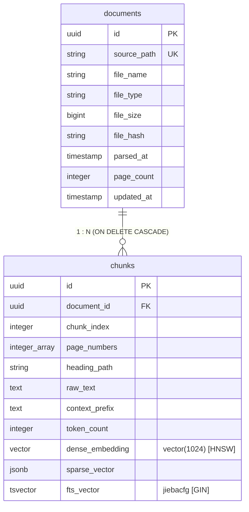
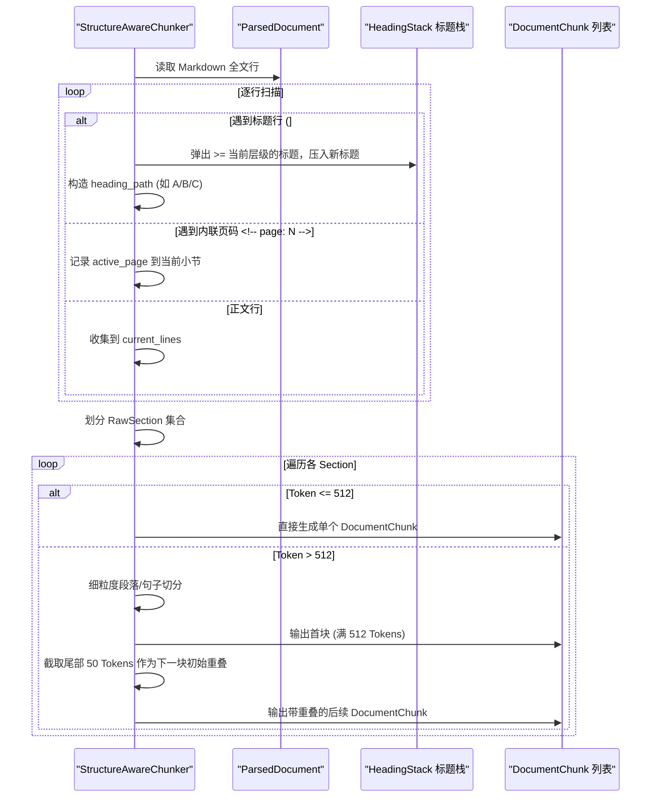
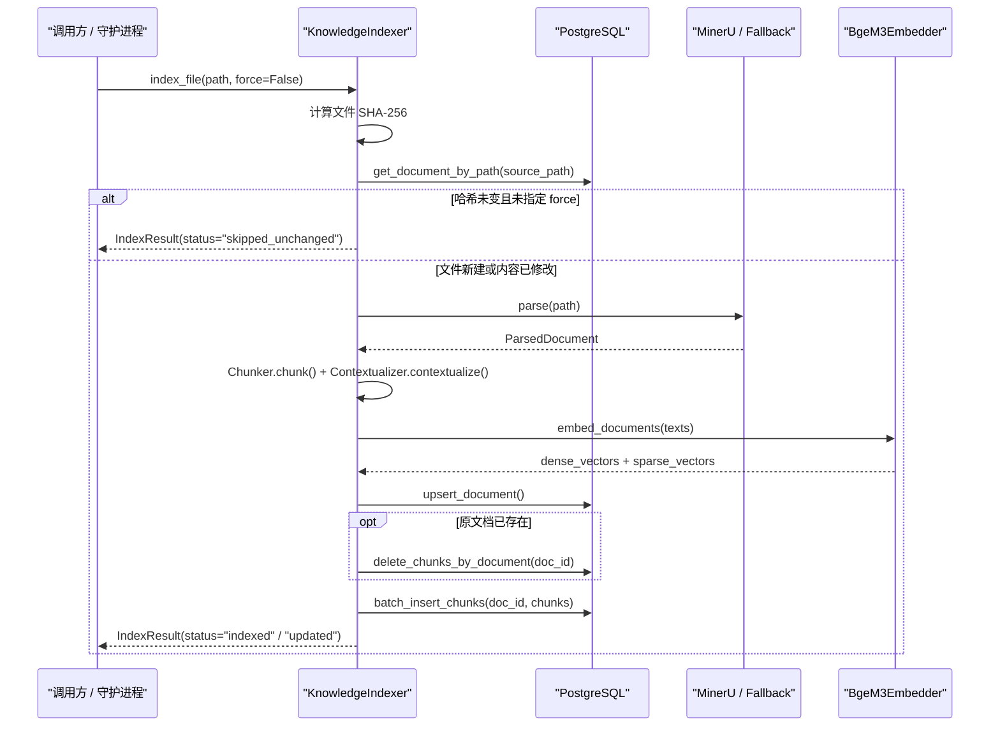

# 知识库系统架构与索引底座

<cite>
**本文引用的文件**
- [repository.py](file://services/agent-runtime/src/personal_agent/knowledge/repository.py)
- [models.py](file://services/agent-runtime/src/personal_agent/knowledge/models.py)
- [environment.py](file://services/agent-runtime/src/personal_agent/knowledge/environment.py)
- [parser.py](file://services/agent-runtime/src/personal_agent/knowledge/parser.py)
- [chunker.py](file://services/agent-runtime/src/personal_agent/knowledge/chunker.py)
- [contextualizer.py](file://services/agent-runtime/src/personal_agent/knowledge/contextualizer.py)
- [embedder.py](file://services/agent-runtime/src/personal_agent/knowledge/embedder.py)
- [raptor.py](file://services/agent-runtime/src/personal_agent/knowledge/raptor.py)
- [indexer.py](file://services/agent-runtime/src/personal_agent/knowledge/indexer.py)
- [knowledge.ts](file://packages/protocol/schemas/knowledge.ts)
</cite>

## 目录
1. [系统概述与设计哲学](#系统概述与设计哲学)
2. [总体系统架构与拓扑](#总体系统架构与拓扑)
3. [存储底座：PostgreSQL + pgvector + pg_jieba](#存储底座postgresql--pgvector--pg_jieba)
4. [文档解析管道：MinerU 异步批处理与平滑降级](#文档解析管道mineru-异步批处理与平滑降级)
5. [结构感知分块与滑动窗口切分](#结构感知分块与滑动窗口切分)
6. [Anthropic 上下文增强前缀生成](#anthropic-上下文增强前缀生成)
7. [双编码向量嵌入与 RAPTOR 树状递归索引](#双编码向量嵌入与-raptor-树状递归索引)
8. [端到端索引编排生命周期与幂等性](#端到端索引编排生命周期与幂等性)
9. [调试与运维考量](#调试与运维考量)

---

## 系统概述与设计哲学

PersonalAgent 的知识库系统（Knowledge Base）旨在支撑个人全能智能体处理长篇技术手册、法律条文、私有知识与上下文材料。传统的轻量级 RAG（检索增强生成）往往依赖简单的定长切块（Chunking）与单纯的稠密向量检索，面临严重的“语义孤岛”、“长距离指代消歧失败”、“复杂版面丢失（表格、公式失真）”以及“宏观全景与微观细节无法兼顾”等痛点。

针对上述挑战，本系统构建了一套工业级的知识摄入与索引流水线：
- **复杂版面深度还原**：依托 MinerU 官方 v4 API 异步批处理云端/本地服务，完整解析 PDF 中的多级标题、LaTeX 公式、Markdown 表格与图文混排，并提取逐页物理页码；在未部署 MinerU 时自动降级至轻量级 `FallbackPdfParser`（基于 `pypdf`）；
- **层级感知与平滑滑动窗口**：通过 `StructureAwareChunker` 跟踪 Markdown 标题层级栈（构造 `heading_path`），按 512 token 阈值递归降级（标题 → 段落 → 句子），并保留 10%（约 50 token）重叠窗口以维护跨边界语义连贯性；
- **上下文感知前缀增强（Contextual Retrieval）**：遵循 Anthropic 方案，利用大模型在全文档（Whole Document）背景下为每一个物理切块生成 1-2 句全局背景前缀，彻底消除碎片化切块脱离上下文后的指代不清与主题漂移；
- **混合向量编码与分层树状抽象**：采用本地 BAAI/bge-m3 双编码模型，同时生成 1024 维稠密单位向量与稀疏词权重；通过 RAPTOR 算法自底向上聚类压缩构建多层递归摘要树；
- **工业级关系型存储底座**：基于 PostgreSQL + pgvector（HNSW 索引）+ pg_jieba（中文全文检索），保证数据 ACID 事务与高并发召回性能。

**章节来源**
- [models.py:1-92](file://services/agent-runtime/src/personal_agent/knowledge/models.py#L1-L92)
- [indexer.py:1-42](file://services/agent-runtime/src/personal_agent/knowledge/indexer.py#L1-L42)

---

## 总体系统架构与拓扑

整个摄入与索引管道涵盖了从文件输入、哈希校验、多源解析、结构感知分块、LLM 前缀增强、多模态向量化、RAPTOR 树聚类到数据库原子入库的全流程。

```mermaid
flowchart TD
    File["输入文档 (PDF / MD / TXT)"] --> Hash["SHA-256 哈希计算与幂等校验<br/>compute_file_sha256"]
    Hash -->|未变更且非 force| Skip["跳过索引 (skipped_unchanged)"]
    Hash -->|新文件或哈希变更| Parser["文档解析器 (get_parser)"]
    
    subgraph 解析层 (parser.py)
        Parser --> MinerU["MinerUParser (官方 v4 API 批处理)"]
        Parser --> Fallback["FallbackPdfParser (pypdf 兜底)"]
        Parser --> TxtParser["TextMarkdownParser (原生文本)"]
        MinerU -->|异常或未配置| Fallback
    end

    Parser --> ParsedDoc["ParsedDocument (Markdown + 物理页码)"]
    
    subgraph 分块与增强层
        ParsedDoc --> Chunker["StructureAwareChunker (chunker.py)<br/>标题栈 + 512 Token + 10% 重叠"]
        Chunker --> RawChunks["DocumentChunk 列表"]
        RawChunks --> Ctx["Contextualizer (contextualizer.py)<br/>Anthropic Contextual Prompt"]
        Ctx --> ContextualizedChunks["带 context_prefix 的 DocumentChunk"]
    end

    subgraph 向量化与抽象层 (embedder.py & raptor.py)
        ContextualizedChunks --> Embedder["BgeM3Embedder / MockEmbedder<br/>1024 维 Dense + Sparse Lexical"]
        ContextualizedChunks --> Raptor["RAPTOR 引擎 (raptor.py)<br/>自底向上余弦聚类 + 递归高层摘要"]
        Raptor --> RaptorTree["RaptorTree (L0 叶子 -> L1/L2 宏观摘要)"]
    end

    subgraph 持久化层 (repository.py)
        Embedder --> PG["PostgreSQL (asyncpg)"]
        PG --> DocTable["documents 表 (元数据与哈希)"]
        PG --> ChunkTable["chunks 表 (pgvector HNSW + pg_jieba fts_vector)"]
    end
```

**图表来源**
- [indexer.py:60-150](file://services/agent-runtime/src/personal_agent/knowledge/indexer.py#L60-L150)
- [parser.py:468-490](file://services/agent-runtime/src/personal_agent/knowledge/parser.py#L468-L490)
- [chunker.py:43-77](file://services/agent-runtime/src/personal_agent/knowledge/chunker.py#L43-L77)
- [contextualizer.py:265-306](file://services/agent-runtime/src/personal_agent/knowledge/contextualizer.py#L265-L306)
- [raptor.py:159-255](file://services/agent-runtime/src/personal_agent/knowledge/raptor.py#L159-L255)

---

## 存储底座：PostgreSQL + pgvector + pg_jieba

知识库底层摒弃了临时性与不透明的黑盒存储，采用经过工业验证的 PostgreSQL 作为统一持久化核心。核心设计包含两张表：`documents` 与 `chunks`。

### 1. 领域模型映射
- `DocumentRecord`：持久化文档元数据，包括路径、文件名、类型、字节大小、SHA-256 哈希、页数以及解析时间戳；
- `DocumentChunk`：持久化分块实体，包含分块序号 `chunk_index`、来源物理页码列表 `page_numbers`、Markdown 标题路径 `heading_path`、上下文前缀 `context_prefix`、分块原始文本 `raw_text`、Token 计数 `token_count`、稠密嵌入向量 `dense_embedding`（1024 维）以及稀疏词权重 `sparse_vector`。

### 2. 数据库表与索引设计
- **外键约束与级联删除**：`chunks.document_id` 关联 `documents.id` 并带有 `ON DELETE CASCADE`。当文档更新或被删除时，数据库引擎自动且原子地清理旧分块，防止产生孤儿分块数据；
- **pgvector 向量索引**：使用 `vector(1024)` 存储稠密向量，并通过 HNSW 索引（余弦距离操作符 `<=>`）实现毫秒级近似最近邻（ANN）查询；
- **pg_jieba 中文全文分词**：`fts_vector` 列通过 PostgreSQL 计算列或表达式绑定中文分词配置 `jiebacfg`，配合 GIN 倒排索引支持极速分词全文匹配。



**章节来源**
- [repository.py:16-147](file://services/agent-runtime/src/personal_agent/knowledge/repository.py#L16-L147)
- [models.py:42-79](file://services/agent-runtime/src/personal_agent/knowledge/models.py#L42-L79)

---

## 文档解析管道：MinerU 异步批处理与平滑降级

解析层负责将异构文件转化为标准化的结构化 Markdown 与逐页信息（`ParsedDocument`）。在 `parser.py` 中，针对不同格式与运行环境提供了多策略实现。

### 1. MinerUParser 批处理流水线
针对富含表格、复杂公式与多栏排版的 PDF，`MinerUParser` 完整对接官方 v4 API 规范：
1. **预签名申请**：向 `/api/v4/file-urls/batch` 提交文件元数据，声明启用 OCR、表格抽取与公式识别（`model_version: "vlm"`），获取 `batch_id` 及对象存储 PUT 预签名直传 URL；
2. **二进制直传**：使用 HTTP PUT 将本地 PDF 流式直传至预签名地址，避免服务端额外代理中转；
3. **异步状态轮询**：每隔 `poll_interval`（默认 2 秒）轮询 `/api/v4/extract-results/batch/{batch_id}`，直至任务状态转变为 `done` 或发生异常；
4. **内存解压与结构提炼**：下载解析结果 ZIP，在内存中直接解压，优先读取 `markdown.md`，并从 `content_list.json`（或 `middle_json.json`）提取每一页的段落与表格文本，组装具有精准页码映射的 `ParsedPage` 列表。

### 2. 平滑降级与原生解析器
- **FallbackPdfParser**：当未配置 `MINERU_API_KEY` 或网络不可达时，平滑降级至基于 `pypdf` 的本地解析器，逐页提取文本并在正文中插入 `<!-- page: N -->` 页码锚点注释；
- **TextMarkdownParser**：原生处理纯文本与 Markdown 文档，通过正则自适应检测内联页码注释，计算文本大小并提取元数据。

**章节来源**
- [parser.py:37-84](file://services/agent-runtime/src/personal_agent/knowledge/parser.py#L37-L84)
- [parser.py:86-129](file://services/agent-runtime/src/personal_agent/knowledge/parser.py#L86-L129)
- [parser.py:131-466](file://services/agent-runtime/src/personal_agent/knowledge/parser.py#L131-L466)
- [parser.py:468-490](file://services/agent-runtime/src/personal_agent/knowledge/parser.py#L468-L490)

---

## 结构感知分块与滑动窗口切分

文档切块的核心矛盾在于：块过小则上下文碎片化，块过大则超出嵌入模型上限且稀释检索精度。`StructureAwareChunker` 实现了基于标题层级树感知的递归切分算法。

### 1. 标题状态栈与小节提取
解析器使用正则表达式 `^(#{1,6})\s+(.+)$` 维护一个标题层级栈 `heading_stack: list[tuple[int, str]]`：
- 当遇到新的标题时，出栈所有层级大于或等于当前层级的旧标题，再将新标题入栈；
- 当前小节的标题路径即为栈中所有标题的路径拼接，如 `计算机系统/CPU架构/SIMD指令集/AVX-512`；
- 同步扫描内联 `<!-- page: N -->` 注释，记录当前小节覆盖的所有物理页码。

### 2. 递归降级与 10% 滑动窗口重叠
每个提取出的小节通过 `tiktoken`（`cl100k_base`）精确计算 Token 数量：
- **小节 <= 512 Token**：完整保留为单个 `DocumentChunk`；
- **小节 > 512 Token**：执行 `_split_section_with_overlap`。首先按双换行切分成自然段落；若单段依然超长，则按标点符号（`。！？\n` 或 `.!?`）细切为句子级单元；
- **滑动窗口重叠（Overlap）**：当当前累积片段即将突破 512 Token 阈值时，落盘当前 Chunk，并从尾部反向选取约 10%（默认 50 Token）的完整片段，作为下一个 Chunk 的起始前缀，保证语义跨块不断裂。



**章节来源**
- [chunker.py:26-77](file://services/agent-runtime/src/personal_agent/knowledge/chunker.py#L26-L77)
- [chunker.py:79-133](file://services/agent-runtime/src/personal_agent/knowledge/chunker.py#L79-L133)
- [chunker.py:135-213](file://services/agent-runtime/src/personal_agent/knowledge/chunker.py#L135-L213)

---

## Anthropic 上下文增强前缀生成

切块完成后，为解决“代词模糊”、“脱离主干难以检索”的问题，系统引入了 `contextualizer.py`，实现 Anthropic Contextual Retrieval 架构。

### 1. 提示词缓存（Prompt Caching）友好的静态结构
在调用 LLM 时，提示词被拆分为两段：
- **静态系统提示（System Message）**：注入整篇文档的标题与正文（`<document>Title: ... Content: ...</document>`）。对于 10 万 Token 以内的文档，全量传入以最大化触发现代推理 API 的 Prompt Caching，大幅降低延迟与调用成本；超过 10 万 Token 时做安全截断；
- **动态用户提示（User Message）**：传入当前切块的 `heading_path` 以及切块原始内容，要求模型输出 1-2 句精炼全局定位背景。

### 2. 生产级并发控制与重试降级
- **并发保护**：使用 `asyncio.Semaphore(5)` 限制并发请求数，避免触发上游模型服务 429 限流；
- **指数退避重试**：单块调用失败时，执行最多 3 次指数退避重试（`0.1 * 2^attempt` 秒）；
- **Fail-Open 确定性保底**：若全部重试耗尽或未配置 API Key，平滑降级为 `DeterministicFallbackContextualizer`，自动根据元数据组装格式化规则前缀：`[文档: filename.pdf | 章节: path | 页码: P1,P2]`。

**章节来源**
- [contextualizer.py:31-131](file://services/agent-runtime/src/personal_agent/knowledge/contextualizer.py#L31-L131)
- [contextualizer.py:148-180](file://services/agent-runtime/src/personal_agent/knowledge/contextualizer.py#L148-L180)
- [contextualizer.py:203-306](file://services/agent-runtime/src/personal_agent/knowledge/contextualizer.py#L203-L306)

---

## 双编码向量嵌入与 RAPTOR 树状递归索引

### 1. Bge-M3 多模态向量嵌入
系统在 `embedder.py` 中抽象了 `BaseEmbedder`。针对生产环境，`BgeM3Embedder` 驱动 BAAI 的 `bge-m3` 模型：
- **稠密向量（Dense Embedding）**：输出 1024 维归一化单位向量，用于余弦语义相似度计算；
- **稀疏向量（Sparse Lexical Weights）**：输出词频与关键 Term 权重字典，用于精细关键词加权；
- **单测模式（MockEmbedder & SemanticMockEmbedder）**：提供基于 SHA-256 或字符 bi-gram 散列的 0 毫秒确定性向量生成，脱离 GPU 依赖且保证测试确定性。

### 2. RAPTOR 树状递归抽象算法
长篇专业文档往往包含宏观架构概念与底层具体细节。`raptor.py` 实现了 RAPTOR（Recursive Abstractive Processing for Tree-Organized Retrieval）分层索引：
1. **L0 叶子节点录入**：将原始切块作为层级 0 节点，计算其稠密向量；
2. **确定性余弦聚类（cluster_chunks_by_similarity）**：在每一层中，根据压缩比例 `reduction_ratio`（默认 0.5）确定目标簇数量，采用余弦相似度进行 K-Means 变种迭代聚合，保证无空簇与无孤儿块；
3. **高层抽象摘要（summarize_fn）**：使用模型将同一聚类簇内的多个子节点文本提炼为高阶摘要，生成下一层节点并建立 `children_ids` 父子关联；
4. **递归直到顶层**：逐层向上聚类与抽象，直至达到最大深度 `max_layers` 或节点数收敛为 1。检索时可通过 `retrieve_raptor_context` 支持跨层级加权检索。

```mermaid
graph BT
    subgraph L2 宏观领域摘要层 (layer 2)
        Root["raptor_root_L2_N0<br/>全书总体架构与体系综述"]
    end

    subgraph L1 章节聚合摘要层 (layer 1)
        C1["raptor_L1_N0<br/>SIMD 指令集架构演进"]
        C2["raptor_L1_N1<br/>内存管理与页表机制"]
    end

    subgraph L0 原始切块叶子层 (layer 0)
        L0_1["chunk_0 (AVX 原理)"]
        L0_2["chunk_1 (AVX-512 寄存器)"]
        L0_3["chunk_2 (分段机制)"]
        L0_4["chunk_3 (四级页表映射)"]
    end

    L0_1 -->|余弦聚类 + LLM 摘要| C1
    L0_2 -->|余弦聚类 + LLM 摘要| C1
    L0_3 -->|余弦聚类 + LLM 摘要| C2
    L0_4 -->|余弦聚类 + LLM 摘要| C2
    C1 -->|再次聚类 + 宏观提炼| Root
    C2 -->|再次聚类 + 宏观提炼| Root
```

**章节来源**
- [embedder.py:27-142](file://services/agent-runtime/src/personal_agent/knowledge/embedder.py#L27-L142)
- [embedder.py:144-243](file://services/agent-runtime/src/personal_agent/knowledge/embedder.py#L144-L243)
- [raptor.py:29-118](file://services/agent-runtime/src/personal_agent/knowledge/raptor.py#L29-L118)
- [raptor.py:159-255](file://services/agent-runtime/src/personal_agent/knowledge/raptor.py#L159-L255)

---

## 端到端索引编排生命周期与幂等性

`KnowledgeIndexer`（位于 `indexer.py`）统筹全流程，向外暴露 `index_file` 与 `index_directory` 接口，提供严格的幂等性与事务保障：
1. **哈希去重探测**：计算输入文件的 SHA-256 哈希值，查询 `documents` 表。若哈希完全一致且 `force=False`，立即返回 `skipped_unchanged`，不产生任何多余的模型与数据库调用；
2. **多阶段处理**：解析文档 → 提取分块 → 注入上下文前缀 → 批量生成稠密/稀疏嵌入；
3. **原子替换持久化**：
   - 调用 `upsert_document` 写入或更新 `documents` 记录；
   - 若属于已有文档重新索引（`updated`），先调用 `delete_chunks_by_document` 清空旧切块；
   - 调用 `batch_insert_chunks` 批量插入带有向量及元数据的新切块。



**章节来源**
- [indexer.py:31-93](file://services/agent-runtime/src/personal_agent/knowledge/indexer.py#L31-L93)
- [indexer.py:94-173](file://services/agent-runtime/src/personal_agent/knowledge/indexer.py#L94-L173)
- [repository.py:16-95](file://services/agent-runtime/src/personal_agent/knowledge/repository.py#L16-L95)

---

## 调试与运维考量

1. **环境与模式控制**：
   - `KNOWLEDGE_EMBEDDER_MODE`：可设为 `local`（必须提供模型路径）、`mock`（极速测试模式）或 `semantic`（用于验证相似度检索的确定性单测模式）；
   - `OPENAI_CONTEXT_MODEL` 与 `OPENAI_CONTEXT_API_KEY`：用于独立配置上下文增强前缀的模型端点，与核心对话模型解耦；
   - `MINERU_API_URL` 与 `MINERU_API_KEY`：用于指向 MinerU v4 服务实例，未配置时安全回退至本地解析。
2. **批处理与并发度调整**：
   - 大规模导入目录时推荐调用 `index_directory`，配合 `StructureAwareChunker` 与批量向量调用，充分发挥 GPU 批处理推理加速；
   - 在高吞吐生产环境下，可通过调整 `LLMContextualizer` 的 `max_concurrency`（默认 5）实现吞吐量与 API 配额之间的最佳平衡。

**章节来源**
- [embedder.py:210-243](file://services/agent-runtime/src/personal_agent/knowledge/embedder.py#L210-L243)
- [contextualizer.py:31-81](file://services/agent-runtime/src/personal_agent/knowledge/contextualizer.py#L31-L81)
- [parser.py:143-200](file://services/agent-runtime/src/personal_agent/knowledge/parser.py#L143-L200)
- [indexer.py:152-173](file://services/agent-runtime/src/personal_agent/knowledge/indexer.py#L152-L173)
