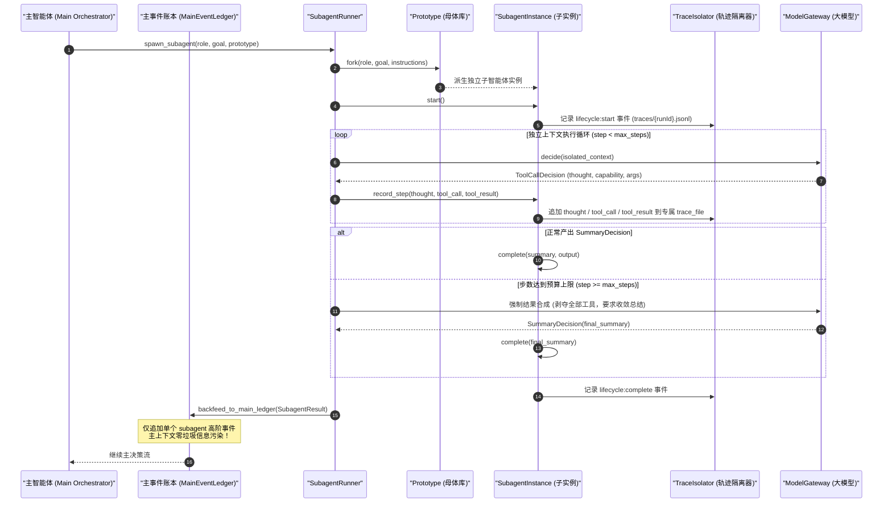
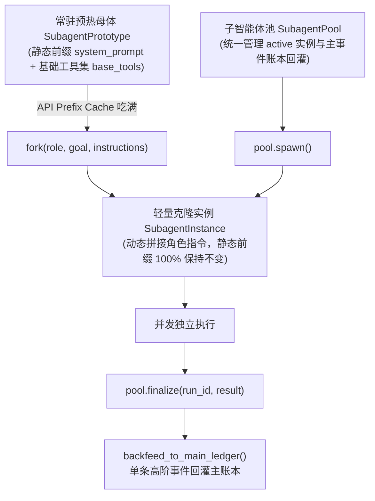
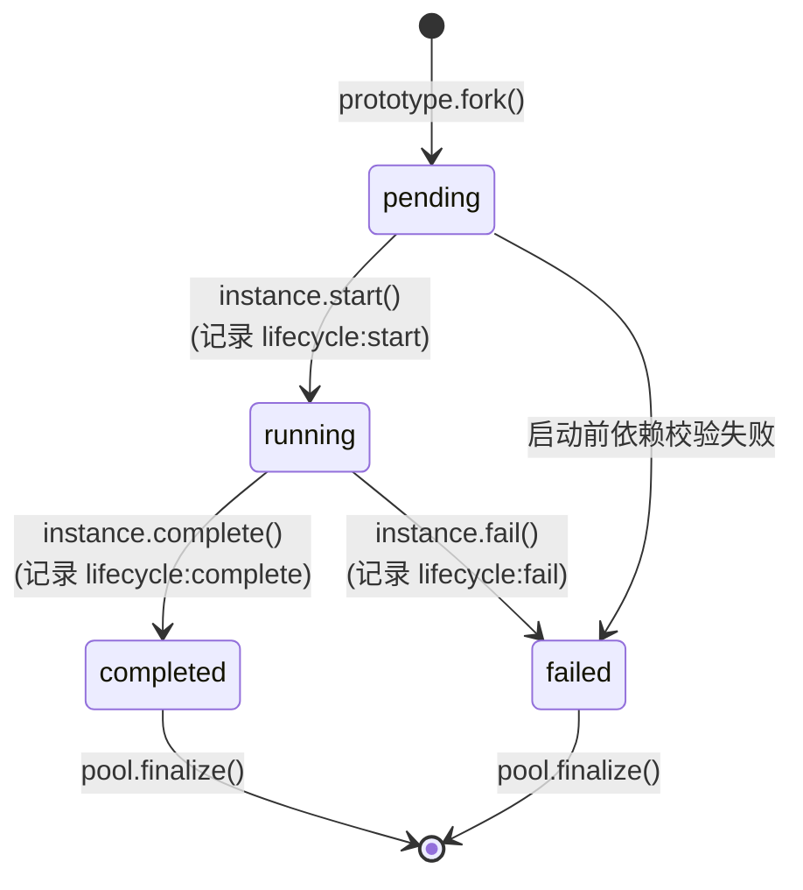

# 子智能体执行体系与轨迹隔离架构

<cite>
**本文引用的文件**
- [runner.py](file://services/agent-runtime/src/personal_agent/conversation/subagent/runner.py)
- [pool.py](file://services/agent-runtime/src/personal_agent/conversation/subagent/pool.py)
- [catalog.py](file://services/agent-runtime/src/personal_agent/conversation/subagent/catalog.py)
- [prototype.py](file://services/agent-runtime/src/personal_agent/conversation/subagent/prototype.py)
- [isolator.py](file://services/agent-runtime/src/personal_agent/conversation/subagent/isolator.py)
- [instance.py](file://services/agent-runtime/src/personal_agent/conversation/subagent/instance.py)
- [backfeed.py](file://services/agent-runtime/src/personal_agent/conversation/subagent/backfeed.py)
- [models.py](file://services/agent-runtime/src/personal_agent/conversation/subagent/models.py)
- [SubagentStepCard.tsx](file://apps/desktop/src/renderer/src/thought-chain/components/SubagentStepCard.tsx)
- [ThoughtChainViewer.tsx](file://apps/desktop/src/renderer/src/thought-chain/components/ThoughtChainViewer.tsx)
- [transformer.ts](file://apps/desktop/src/renderer/src/thought-chain/transformer.ts)
</cite>

## 目录
1. [体系定位与设计范式](#体系定位与设计范式)
2. [可克隆子 Agent 池与常驻母体预热 (SubagentPool & SubagentPrototype)](#可克隆子-agent-池与常驻母体预热-subagentpool--subagentprototype)
3. [SubagentInstance 生命周期状态机](#subagentinstance-生命周期状态机)
4. [SubagentRunner 调度与运行机制](#subagentrunner-调度与运行机制)
5. [内置原型库 Prototype Catalog](#内置原型库-prototype-catalog)
6. [执行轨迹隔离 Trace Isolation](#执行轨迹隔离-trace-isolation)
7. [强制结果合成 Forced Synthesis](#强制结果合成-forced-synthesis)
8. [主账本蒸馏回灌机制 Backfeed (零泄漏铁律)](#主账本蒸馏回灌机制-backfeed-零泄漏铁律)
9. [前端思维流可视化与渲染](#前端思维流可视化与渲染)

---

## 体系定位与设计范式

在处理复杂的工程研发、全代码库调研或长链路任务时，单智能体直接执行往往面临两大核心困境：
1. **主上下文污染 (Context Window Pollution)**：多轮工具探查（如多次搜索、阅读十几个文件、调试命令尝试）会产生数万 Token 的中间日志与观察数据，严重挤占有效上下文，破坏大模型的长程记忆与注意力；
2. **长轨迹决策漂移 (Decision Drift)**：上下文越冗长，智能体越容易受到历史工具输出细节的干扰，进而丢失宏观目标与高阶架构约束。

借鉴 **Dots (OpenAI)** 与 **Pi Agent** 的伴侣心智与分工范式，PersonalAgent 构建了**子智能体执行体系 (Subagent System)**：
- **委托与解耦**：主智能体通过 `spawn_subagent` 声明目标角色（Role）、探查目标（Goal）与指令，分派独立任务；
- **沙盒运行与轨迹隔离**：子智能体运行在完全隔离的模型上下文与生命周期中，其中间思考步骤与工具交互被定向沉淀至独立的轨迹文件；
- **终局蒸馏回灌**：子智能体执行完成后，将详尽的事实验收结论提炼为精炼摘要，以单个事件回灌主账本，确保主智能体心智清晰聚焦。



**图表来源**
- [runner.py:20-101](file://services/agent-runtime/src/personal_agent/conversation/subagent/runner.py#L20-L101)
- [isolator.py:44-74](file://services/agent-runtime/src/personal_agent/conversation/subagent/isolator.py#L44-L74)
- [backfeed.py:5-21](file://services/agent-runtime/src/personal_agent/conversation/subagent/backfeed.py#L5-L21)

**章节来源**
- [runner.py:9-19](file://services/agent-runtime/src/personal_agent/conversation/subagent/runner.py#L9-L19)
- [backfeed.py:5-21](file://services/agent-runtime/src/personal_agent/conversation/subagent/backfeed.py#L5-L21)

---

## 可克隆子 Agent 池与常驻母体预热 (SubagentPool & SubagentPrototype)

在面对高并发、跨领域的多任务探查时，频繁从零构造子智能体会导致高昂的延迟与 Prompt 解析开销。PersonalAgent 实现了可克隆的子 Agent 池与常驻母体预热架构：



### 1. API Prefix Cache 极致优化
- **静态前缀不变量**：`SubagentPrototype` 持有全局基础能力前缀（`base_prefix`），派生子实例时，无论派生多少个 `Explorer` 或 `Auditor`，其 `system_prompt` 开头均绝对保持一致；
- **角色特化后置追加**：特化角色描述（`role`）、任务目标（`goal`）与特定指令（`specific_instructions`）一律追加在静态前缀之后，完美吃满各大云端大模型的 KV 前缀缓存（Prompt Caching），显著降低首字延迟与 Token 成本。

### 2. SubagentPool 并发调度管理
- **实例池化管理**：`SubagentPool` 跟踪所有进行中的实例（`self.active`）与全量生命周期实例（`self.instances`）；
- **动态派生与多原型分流**：支持按原型名称（`explore` / `plan` / `general`）多路派生，支持并发执行与无锁文件落盘；
- **任务终局归口**：子实例完成或失败时调用 `pool.finalize(run_id, result)`，将实例从活跃队列移出并触发主账本事实回灌。

**章节来源**
- [pool.py:8-55](file://services/agent-runtime/src/personal_agent/conversation/subagent/pool.py#L8-L55)
- [prototype.py:10-50](file://services/agent-runtime/src/personal_agent/conversation/subagent/prototype.py#L10-L50)
- [models.py:7-22](file://services/agent-runtime/src/personal_agent/conversation/subagent/models.py#L7-L22)

---

## SubagentInstance 生命周期状态机

每个子智能体实例均具备严格的生命周期状态流转约束（`SubagentStatus`），禁止非法跨状态转移：



- **状态强校验**：处于 `pending` 状态的实例方可执行 `start()`；仅处于 `running` 状态的实例方可调用 `record_step()` 与 `complete()`，任何越界调用均抛出 `ValueError`；
- **全链路生命周期事件**：状态变迁自动通知 `TraceIsolator` 追加 `lifecycle` 结构化事件，供桌面端可视化流式感知。

**章节来源**
- [instance.py:11-102](file://services/agent-runtime/src/personal_agent/conversation/subagent/instance.py#L11-L102)
- [models.py:7-14](file://services/agent-runtime/src/personal_agent/conversation/subagent/models.py#L7-L14)

---

## SubagentRunner 调度与运行机制

`SubagentRunner`（定义在 `services/agent-runtime/src/personal_agent/conversation/subagent/runner.py`）是子智能体调度的总控器，负责实例生成、步数配额监控、模型上下文装配与终局状态流转。

### 核心执行流程

1. **实例孵化**：调用 `pool.spawn(...)` 基于指定的原型（Prototype）创建 `SubagentInstance` 并分配全局唯一 `run_id`；
2. **步数预算控制**：默认设置 `max_steps = 15`，防止子智能体陷入无限死循环或发散探查；
3. **上下文动态装配**：每轮循环基于 `ModelContext` 构造全新的隔离上下文，仅注入当前子智能体的专属目标、限定工具集与角色专用系统提示词；
4. **决策分发与执行记录**：
   - 当模型返回 `ToolCallDecision` 时，核验工具是否在 `allowed_tools` 白名单内，执行后通过 `instance.record_step(...)` 将观察结果落盘；
   - 当模型返回 `SummaryDecision` 或 `StepCompleteDecision` 时，调用 `instance.complete(...)` 终止循环。

**章节来源**
- [runner.py:9-19](file://services/agent-runtime/src/personal_agent/conversation/subagent/runner.py#L9-L19)
- [runner.py:20-73](file://services/agent-runtime/src/personal_agent/conversation/subagent/runner.py#L20-L73)

---

## 内置原型库 Prototype Catalog

`catalog.py` 固化了三大标准子智能体母体（Prototype），覆盖软件工程中最典型的分工诉求：

### 1. `explore`（代码库探索与事实侦察专家）
- **职责定位**：快速扫描仓库结构、检索符号定义与调用关系、定位架构边界；
- **严格只读保护 (Strict Read-Only)**：工具池被严格限定在 `READONLY_BASE_TOOLS`（`file_read`、`file_search`、`filesystem_list`），严禁任何创建、修改、重命名或终端执行操作；
- **输出规范**：要求直接列出精准的文件路径、行号区间（Line Ranges）与符号名称，严禁闲聊废话。

### 2. `plan`（软件架构设计与任务拆解专家）
- **职责定位**：分析复杂工程需求，梳理依赖图谱，制定原子化落地蓝图；
- **三阶段规划范式 (Three-Phase Planning Paradigm)**：
  1. *Requirements & Caller Analysis*：明确用户意图、输入输出契约与边界条件；
  2. *Codebase Survey & Dependency Mapping*：利用只读工具排查受影响模块、上游调用点与破坏性变更；
  3. *Structured Blueprint Formulation*：输出包含架构概述、受影响文件列表、实现步骤时序、防护措施及验证清单的完整蓝图。

### 3. `general`（通用全能执行者）
- **职责定位**：具备全能工具池，用于执行需多步探索、验证与产物生成的综合性子任务，并在本地完成上下文收敛后进行事实蒸馏。

**章节来源**
- [catalog.py:6-25](file://services/agent-runtime/src/personal_agent/conversation/subagent/catalog.py#L6-L25)
- [catalog.py:27-48](file://services/agent-runtime/src/personal_agent/conversation/subagent/catalog.py#L27-L48)
- [catalog.py:50-58](file://services/agent-runtime/src/personal_agent/conversation/subagent/catalog.py#L50-L58)
- [catalog.py:60-64](file://services/agent-runtime/src/personal_agent/conversation/subagent/catalog.py#L60-L64)
- [catalog.py:67-93](file://services/agent-runtime/src/personal_agent/conversation/subagent/catalog.py#L67-L93)

---

## 执行轨迹隔离 Trace Isolation

为了杜绝子智能体运行日志侵蚀主会话存储，系统在 `isolator.py` 中实现了 `TraceIsolator`。

```mermaid
flowchart TD
    EV[执行事件产生: thought / tool_call / tool_result / error] --> LOCK[线程安全锁 lock.acquire]
    LOCK --> SNOW[单调递增 step_id 生成器 (时钟回拨校验 + 序列号)]
    SNOW --> JSON[构造 SubagentTraceEvent 结构体]
    JSON --> DUMP[写入专属 traces/runId.jsonl]
    DUMP --> UNLOCK[释放锁 lock.release]
```

**图表来源**
- [isolator.py:13-43](file://services/agent-runtime/src/personal_agent/conversation/subagent/isolator.py#L13-L43)
- [isolator.py:44-56](file://services/agent-runtime/src/personal_agent/conversation/subagent/isolator.py#L44-L56)

### 轨迹隔离特性

1. **独立存储载体**：每个子智能体分配独立的 `.jsonl` 文件（路径为 `traces/{run_id}.jsonl`）；
2. **时钟回拨保护与序列化**：内部维护类似雪花算法（Snowflake）的时间戳与 12 位序列号机制，在系统时钟发生跳变或并发写入时保证 `step_id` 严格单调自增；
3. **结构化事件类型**：
   - `thought`：子智能体推理思考过程；
   - `tool_call`：发起的工具名称与调用入参；
   - `tool_result`：底层执行返回的真实观察数据；
   - `error`：异常分流与错误详情；
   - `lifecycle`：实例启动、完成或取消的生命周期标记。

**章节来源**
- [isolator.py:13-43](file://services/agent-runtime/src/personal_agent/conversation/subagent/isolator.py#L13-L43)
- [isolator.py:44-74](file://services/agent-runtime/src/personal_agent/conversation/subagent/isolator.py#L44-L74)
- [instance.py:40-68](file://services/agent-runtime/src/personal_agent/conversation/subagent/instance.py#L40-L68)

---

## 强制结果合成 Forced Synthesis

在自主智能体探索中，常见的失控情况是模型反复调用工具耗尽所有步数，最后直接崩溃或抛出超时异常，导致前面探索到的宝贵线索全部丢失。

`SubagentRunner` 实现了关键的**强制结果合成 (Forced Synthesis)** 机制：

```python
finally:
    if result is None:
        final_context = ModelContext(
            taskGoal=goal,
            visibleCapabilities=[],  # 彻底剥夺工具调用权！
            profile=None,
            systemPrompt=instance.system_prompt
            + "\n\n你已达到本次执行的步数预算上限，请综合上述所有步骤探查到的线索与事实，给出最终的结论总结，不再调用任何工具",
        )
        final_decision = self.model.decide(context=final_context)
        # 提取最终结论总结并完成实例...
        result = instance.complete(summary=reply, output=...)
```

### 机制价值

- **工具剥夺**：通过向 `ModelContext` 传入空的 `visibleCapabilities=[]`，从协议层面剥夺模型继续发起任何工具调用的能力；
- **强迫收敛**：通过追加强制总结提示词，迫使大模型将注意力从“继续探索”切换为“综述归纳”，基于前序探索的所有线索合成终局成果；
- **优雅退化**：确保即便达到最大步数预算，主智能体依然能获得一份高价值的事实侦察总结，而不是空手而归。

**章节来源**
- [runner.py:75-101](file://services/agent-runtime/src/personal_agent/conversation/subagent/runner.py#L75-L101)

---

## 主账本蒸馏回灌机制 Backfeed

在子智能体执行完成或完成强制合成后，`backfeed.py` 中的 `backfeed_to_main_ledger` 函数负责将结果回灌进主会话：

```python
def backfeed_to_main_ledger(
    ledger: MainEventLedger, result: SubagentResult
) -> LedgerEvent:
    payload = {
        "subagent_run_id": result.run_id,
        "role": result.role,
        "status": result.status,
        "summary": result.summary,
        "output": result.output,
        "trace_file": str(result.trace_file),
        "artifacts": result.artifacts,
        "total_steps": result.total_steps,
        "duration_ms": result.duration_ms,
        "error": result.error,
    }
    event = ledger.append_event(event_type="subagent", payload=payload)
    return event
```

主事件账本中只新增了一条 `subagent` 事件，中间成百上千行的冗余工具调用留在 `traces/{run_id}.jsonl` 中供按需审查。这实现了真正意义上的**高信息密度、零上下文噪音**。

**章节来源**
- [backfeed.py:5-21](file://services/agent-runtime/src/personal_agent/conversation/subagent/backfeed.py#L5-L21)
- [models.py:24-34](file://services/agent-runtime/src/personal_agent/conversation/subagent/models.py#L24-L34)

---

## 前端思维流可视化与渲染

在桌面端渲染进程中，思维流视图（ThoughtChain）对子智能体进行了专门的一等公民支持。

### 1. 视图规约 (`transformer.ts`)
当主事件流派发 `tool_called` 且 `capability === 'spawn_subagent'` 时，事件转换器将其包装为 `ToolStepView`，携带目标、原型与运行状态。

### 2. 条件分发与渲染 (`ThoughtChainViewer.tsx`)
在 `ThoughtChainViewer` 步骤列表中，对 `spawn_subagent` 进行了特化拦截：
```tsx
if (step.capability === 'spawn_subagent') {
  return (
    <SubagentStepCard
      key={step.id}
      step={step}
      isStreaming={isStreaming}
      onInspectRaw={(s) => setInspectStep(s)}
    />
  )
}
```

### 3. SubagentStepCard 视觉与交互规范 (`SubagentStepCard.tsx`)
- **原型视觉指示**：
  - `explore`：蓝色罗盘图标（Compass）+ 蓝色半透明徽章；
  - `plan`：紫色图层图标（Layers）+ 紫色半透明徽章；
  - `general`：琥珀色机器人图标（Bot）+ 琥珀色半透明徽章；
- **Whisper-light 静默内联手风琴折叠**：
  - 运行中（`running`）：采用呼吸闪烁动画（`TextShimmer`）提示正在探查，默认保持折叠，保持界面的极简与不打扰；
  - 完成后（`completed`）：自动展示格式化的 Markdown 结果摘要，并提供一键复制按钮（Copy）；
  - 失败或报错（`failed`）：展示明确的失败警告红标与耗时指标；
- **抽屉式原始数据检视**：支持点击触发 `RawSpanDialog`，查看完整的底层入参与执行观测原始 JSON。

**章节来源**
- [transformer.ts:57-82](file://apps/desktop/src/renderer/src/thought-chain/transformer.ts#L57-L82)
- [ThoughtChainViewer.tsx:62-71](file://apps/desktop/src/renderer/src/thought-chain/components/ThoughtChainViewer.tsx#L62-L71)
- [SubagentStepCard.tsx:32-96](file://apps/desktop/src/renderer/src/thought-chain/components/SubagentStepCard.tsx#L32-L96)
- [SubagentStepCard.tsx:114-139](file://apps/desktop/src/renderer/src/thought-chain/components/SubagentStepCard.tsx#L114-L139)
- [SubagentStepCard.tsx:148-230](file://apps/desktop/src/renderer/src/thought-chain/components/SubagentStepCard.tsx#L148-L230)
