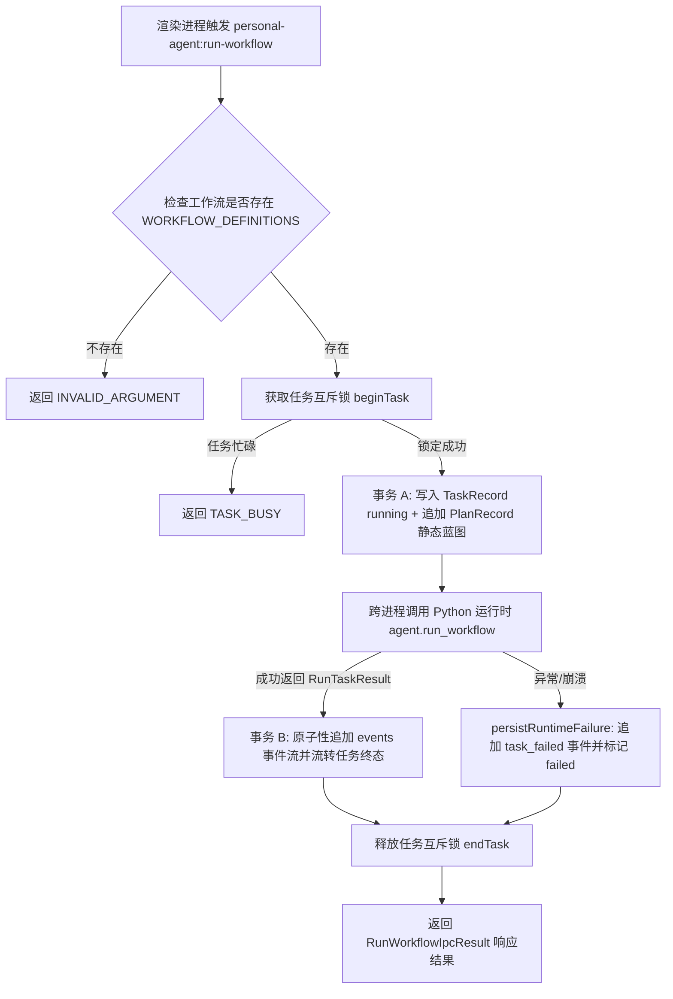
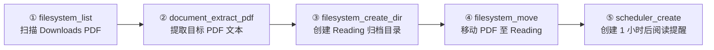
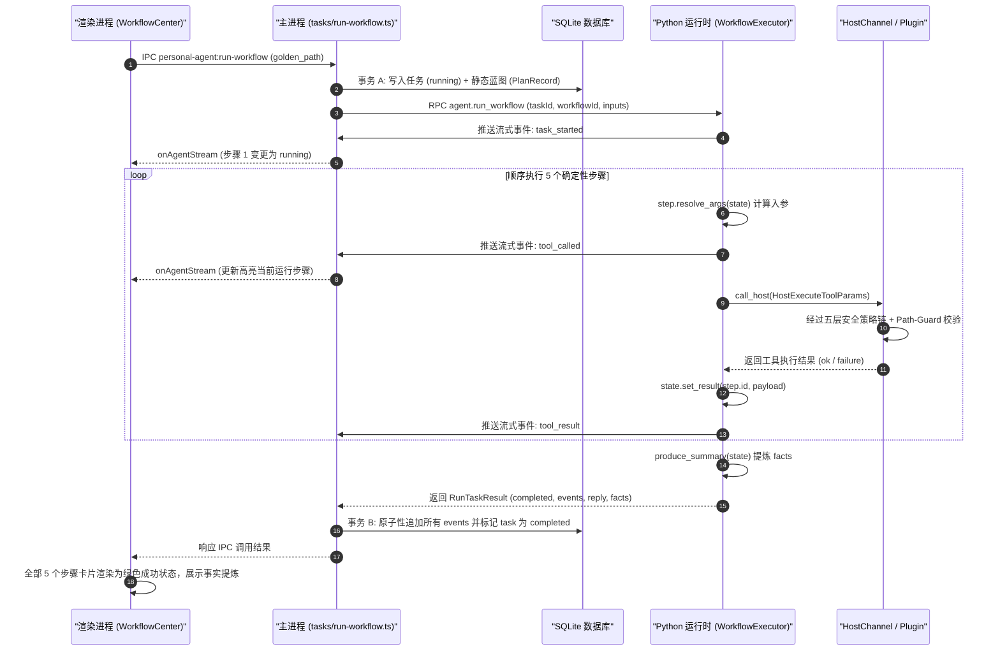

# 确定性工作流系统架构与执行引擎

<cite>
**本文引用的文件**
- [workflow.ts](file://packages/protocol/schemas/workflow.ts)
- [run-workflow.ts](file://apps/desktop/src/main/tasks/run-workflow.ts)
- [index.ts](file://apps/desktop/src/main/index.ts)
- [runtime-host.ts](file://apps/desktop/src/main/runtime/runtime-host.ts)
- [definition.py](file://services/agent-runtime/src/personal_agent/workflow/definition.py)
- [executor.py](file://services/agent-runtime/src/personal_agent/workflow/executor.py)
- [golden_path.py](file://services/agent-runtime/src/personal_agent/workflow/golden_path.py)
- [runtime.py](file://services/agent-runtime/src/personal_agent/runtime.py)
- [WorkflowCenter.tsx](file://apps/desktop/src/renderer/src/components/WorkflowCenter.tsx)
</cite>

## 目录
1. [系统定位与设计动机](#系统定位与设计动机)
2. [跨进程 RPC 契约设计 (agent.run_workflow)](#跨进程-rpc-契约设计-agentrun_workflow)
3. [主进程任务编排与双阶段事务保障](#主进程任务编排与双阶段事务保障)
4. [Python 运行时工作流引擎架构](#python-运行时工作流引擎架构)
5. [Golden Path 经典业务流实现拆解](#golden-path-经典业务流实现拆解)
6. [前端工作流中心视图与流式状态机](#前端工作流中心视图与流式状态机)
7. [全链路执行时序与异常隔离](#全链路执行时序与异常隔离)

---

## 系统定位与设计动机

虽然自主智能体（Autonomous Agent）具备极高的灵活性与复杂推理能力，但在实际工程与固定日常办公场景中，模型决策不可避免地存在以下固有局限：
1. **概率性与非确定性漂移**：大模型存在不可控的幻觉或步骤跳脱，同一个任务在不同时刻可能产生不同的工具调用路径；
2. **高昂的 Token 消耗与网络延迟**：多步 ReAct 循环每走一步都需要调用一次大模型进行决策，单次任务消耗数万 Token 且耗时数十秒；
3. **关键业务不可容忍差错**：例如敏感文件的归档与结构化提取，必须具备 100% 确定性、原子性与可重复审计性。

为了解决这一矛盾，PersonalAgent 构建了**确定性工作流系统 (Deterministic Workflow System)**：
- **确定性编排，零 Token 消耗**：将高频、标准的业务链路（如 Downloads 目录整理与 PDF 要点提取）固化为纯代码编排图，执行全过程无需消耗任何大模型 Token；
- **底层能力无缝复用**：工作流中的每一步直接调用主进程的自描述能力插件（`CapabilityPlugin`），无缝复用五层安全策略拦截链、路径守卫（`Path-Guard`）以及幂等恢复关；
- **同构生命周期与无感监控**：工作流引擎在执行过程中产生与自主 Agent 规范完全一致的标准生命周期事件（`task_started`、`tool_called`、`tool_result`、`task_completed`、`task_failed`），在主进程事件总线和前端 UI 视图中实现统一监控。

**章节来源**
- [definition.py:1-58](file://services/agent-runtime/src/personal_agent/workflow/definition.py#L1-L58)
- [run-workflow.ts:36-50](file://apps/desktop/src/main/tasks/run-workflow.ts#L36-L50)

---

## 跨进程 RPC 契约设计 (agent.run_workflow)

主进程（Electron Node.js）与后台 Python 运行时通过标准 JSON-RPC 2.0 通道进行交互。工作流契约定义在 `packages/protocol/schemas/workflow.ts`：

```typescript
export const AGENT_RUN_WORKFLOW = "agent.run_workflow";

export const RunWorkflowParams = z.object({
  taskId: z.string().min(1),
  workflowId: z.string().min(1),
  inputs: z.record(z.string(), z.unknown()).default({}),
});
```

### 契约特性
1. **统一标识**：方法名为常量 `agent.run_workflow`；
2. **入参结构**：接收全局任务标识 `taskId`、工作流蓝图标识 `workflowId`（如 `golden_path`）以及任意初始上下文参数 `inputs`；
3. **互斥性响应校验**：响应信封使用 Zod `superRefine` 强制保证 `result` 与 `error` 严格互斥，杜绝协议层歧义状态。

**章节来源**
- [workflow.ts:4-12](file://packages/protocol/schemas/workflow.ts#L4-L12)
- [workflow.ts:14-44](file://packages/protocol/schemas/workflow.ts#L14-L44)

---

## 主进程任务编排与双阶段事务保障

主进程作为唯一受信任的核心运行时，在 `apps/desktop/src/main/tasks/run-workflow.ts` 中管理任务的生命周期、并发锁以及 SQLite 数据库事务。



**图表来源**
- [run-workflow.ts:90-119](file://apps/desktop/src/main/tasks/run-workflow.ts#L90-L119)
- [run-workflow.ts:120-167](file://apps/desktop/src/main/tasks/run-workflow.ts#L120-L167)
- [run-workflow.ts:169-218](file://apps/desktop/src/main/tasks/run-workflow.ts#L169-L218)

### 双阶段事务机制

1. **事务 A（执行前准备）**：
   - 插入初始 `TaskRecord`，将状态初始化为 `running`；
   - 根据工作流的静态步骤清单生成初始 `PlanRecord`，使得前端规划视图能够立即渲染出确定性步骤列表；
2. **并发互斥控制**：调用 `beginTask(taskId, goal, steps)` 建立当前任务上下文，防止多个任务交叉并发导致状态污染；
3. **事务 B（执行后结算）**：
   - 接收 Python 运行时汇总的完整事件流（`result.events`）；
   - 在单一 SQLite 事务内完成两项原子操作：遍历写入所有事件至 `event_records` 表，并将任务状态原子流转为终态（`completed` 或 `failed`）；
4. **清理与释放**：无论执行成功还是崩溃，`finally` 块内强制调用 `endTask()` 清理互斥锁。

**章节来源**
- [run-workflow.ts:52-60](file://apps/desktop/src/main/tasks/run-workflow.ts#L52-L60)
- [run-workflow.ts:90-119](file://apps/desktop/src/main/tasks/run-workflow.ts#L90-L119)
- [run-workflow.ts:120-167](file://apps/desktop/src/main/tasks/run-workflow.ts#L120-L167)
- [run-workflow.ts:169-218](file://apps/desktop/src/main/tasks/run-workflow.ts#L169-L218)
- [index.ts:506-521](file://apps/desktop/src/main/index.ts#L506-L521)
- [runtime-host.ts:224-226](file://apps/desktop/src/main/runtime/runtime-host.ts#L224-L226)

---

## Python 运行时工作流引擎架构

在 Python 运行时内部，确定性工作流引擎包含三大核心抽象（位于 `services/agent-runtime/src/personal_agent/workflow/`）：

### 1. 数据模型与黑板上下文 (`definition.py`)
- **`WorkflowState`**：执行上下文黑板。记录初始 `inputs` 字典，并提供 `set_result(step_id, result)` 与 `get_result(step_id)` 接口，供后续步骤动态消费前序步骤产出的物理数据（如前一步扫描出的 PDF 路径）；
- **`WorkflowStep`**：声明单个步骤，包含步骤 ID、能力标识（`CapabilityId`）、中文描述以及参数动态解析器 `resolve_args: Callable[[WorkflowState], dict[str, Any]]`；
- **`WorkflowDefinition`**：完整蓝图定义，包含步骤序列与可选的终局摘要生成器 `produce_summary`。

### 2. 执行引擎驱动 (`executor.py`)
`WorkflowExecutor` 是驱动步骤顺序执行的核心引擎：
1. **步数预算校验**：比对当前执行步骤与 `Budget` 限制，超限则发射 `budget_exhausted` 并优雅失败；
2. **参数动态推导**：调用 `step.resolve_args(state)` 计算本次调用的实际入参；
3. **生命周期事件发射**：在调用前后分别向实时流和结果列表发射 `tool_called` 和 `tool_result` 事件；
4. **反向调用宿主**：通过 `channel.call_host(HostExecuteToolParams(...))` 触发主进程执行真实的自描述插件；
5. **产物黑板入库**：当步骤执行成功（`result.ok == True`）后，将输出数据写入 `state.set_result(step.id, payload)`；若任意一步失败，立即执行短路截断，返回 `RunTaskFailed`。

### 3. 请求调度接入 (`runtime.py`)
在 `runtime.py` 的 `handle_run_workflow` 中，请求经过校验后，从全局注册表 `WORKFLOW_REGISTRY` 检索对应的构建器，传入当前可见的能力列表 `visible_capabilities` 动态构建工作流实例并提交执行。

**章节来源**
- [definition.py:13-24](file://services/agent-runtime/src/personal_agent/workflow/definition.py#L13-L24)
- [definition.py:32-44](file://services/agent-runtime/src/personal_agent/workflow/definition.py#L32-L44)
- [definition.py:46-58](file://services/agent-runtime/src/personal_agent/workflow/definition.py#L46-L58)
- [executor.py:35-46](file://services/agent-runtime/src/personal_agent/workflow/executor.py#L35-L46)
- [executor.py:48-124](file://services/agent-runtime/src/personal_agent/workflow/executor.py#L48-L124)
- [executor.py:126-164](file://services/agent-runtime/src/personal_agent/workflow/executor.py#L126-L164)
- [runtime.py:371-412](file://services/agent-runtime/src/personal_agent/runtime.py#L371-L412)

---

## Golden Path 经典业务流实现拆解

`golden_path.py` 是确定性工作流的标杆实现，涵盖了经典的**“两读三写”**闭环链路：扫描 Downloads 目录、提取 PDF 关键内容、新建分类目录、将文件移动归档并创建后续阅读提醒。



### 步骤实现与依赖数据流

1. **`list_files` (`filesystem_list`)**：
   - 扫描 `downloads` 授权根目录下的所有条目；
2. **`extract_pdf` (`document_extract_pdf`)**：
   - 利用 `_find_target_pdf(state)` 从第 1 步产物中检索第一份 `.pdf` 文件，提取每页文本；
3. **`create_dir` (`filesystem_create_dir`)**：
   - 动态计算目标 PDF 所在同级的 `Reading` 目录绝对路径，调用插件安全创建；
4. **`move_pdf` (`filesystem_move`)**：
   - 将原 PDF 路径作为 `source`，`Reading/文件名` 作为 `target`，完成物理归档；
5. **`create_reminder` (`scheduler_create`)**：
   - 动态推算未来 1 小时的时间戳，创建定时阅读提醒；
6. **`produce_summary`（事实提炼）**：
   - 提取 PDF 解析出的所有页面文本的第一行要点，封装为 `SummaryFact` 结构数组并生成终局 Markdown 总结。

**章节来源**
- [golden_path.py:20-45](file://services/agent-runtime/src/personal_agent/workflow/golden_path.py#L20-L45)
- [golden_path.py:47-129](file://services/agent-runtime/src/personal_agent/workflow/golden_path.py#L47-L129)
- [golden_path.py:131-156](file://services/agent-runtime/src/personal_agent/workflow/golden_path.py#L131-L156)

---

## 前端工作流中心视图与流式状态机

前端通过专用组件 `WorkflowCenter.tsx`（位于 `apps/desktop/src/renderer/src/components/`）提供一键执行与直观的可视化体验。

### 1. 静态流水线定义 (`GOLDEN_PATH_STEPS`)
组件内置定义了 Golden Path 的 5 个步骤卡片，分别对应扫描、提取、建目录、归档和提醒，并配有语义化图标（`FileCheck2`、`Sparkles`、`FolderPlus`、`FolderCheck`、`CalendarClock`）。

### 2. 实时事件流订阅与状态机流转
组件挂载时监听主进程的 Agent 流式推送通道：
```typescript
const unsubscribe = window.personalAgent.onAgentStream((notice) => {
  if (notice.kind === 'event') {
    const ev = notice.event
    if (ev.type === 'task_started') {
      setStepStatuses(['running', 'pending', 'pending', 'pending', 'pending'])
    } else if (ev.type === 'tool_called') {
      // 根据 tool_called.capability 动态将前序步骤翻转为 completed，当前步骤标为 running
    } else if (ev.type === 'task_completed') {
      setStepStatuses(['completed', 'completed', 'completed', 'completed', 'completed'])
    } else if (ev.type === 'task_failed') {
      // 标记失败状态并记录失败原因
    }
  }
})
```

### 3. 一键触发与日志追踪
用户点击“立即运行工作流”按钮后，通过受限的 Preload 桥接调用 `window.personalAgent.runWorkflow('golden_path', { rootId: 'downloads' })`。界面底部同时提供实时控制台日志面板，高亮展示每个步骤的实际进展与耗时。

**章节来源**
- [WorkflowCenter.tsx:34-70](file://apps/desktop/src/renderer/src/components/WorkflowCenter.tsx#L34-L70)
- [WorkflowCenter.tsx:74-124](file://apps/desktop/src/renderer/src/components/WorkflowCenter.tsx#L74-L124)
- [WorkflowCenter.tsx:126-162](file://apps/desktop/src/renderer/src/components/WorkflowCenter.tsx#L126-L162)
- [WorkflowCenter.tsx:177-230](file://apps/desktop/src/renderer/src/components/WorkflowCenter.tsx#L177-L230)

---

## 全链路执行时序与异常隔离



**图表来源**
- [WorkflowCenter.tsx:126-162](file://apps/desktop/src/renderer/src/components/WorkflowCenter.tsx#L126-L162)
- [run-workflow.ts:120-197](file://apps/desktop/src/main/tasks/run-workflow.ts#L120-L197)
- [executor.py:48-124](file://services/agent-runtime/src/personal_agent/workflow/executor.py#L48-L124)

### 异常分流机制
- **步骤失败自动短路**：当任意步骤底层工具返回 `ok == false` 或网络断开时，`WorkflowExecutor` 立即中断后续步骤，发射 `task_failed` 并返回结构化失败信息；
- **崩溃自动落库**：若 Python 运行时进程发生崩溃退出（`RuntimeError`），主进程 `persistRuntimeFailure` 捕获异常，将任务状态落盘为 `failed`，绝不导致主界面无限挂起；
- **幂等性保障**：即便工作流因意外中途重试，底层的写入插件（如 `filesystem_create_dir`、`filesystem_move`）均受 Executor 幂等机制保护，杜绝重复副作用。

**章节来源**
- [executor.py:116-121](file://services/agent-runtime/src/personal_agent/workflow/executor.py#L116-L121)
- [run-workflow.ts:62-88](file://apps/desktop/src/main/tasks/run-workflow.ts#L62-L88)
- [run-workflow.ts:163-167](file://apps/desktop/src/main/tasks/run-workflow.ts#L163-L167)
