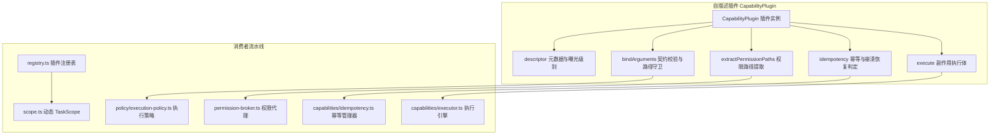
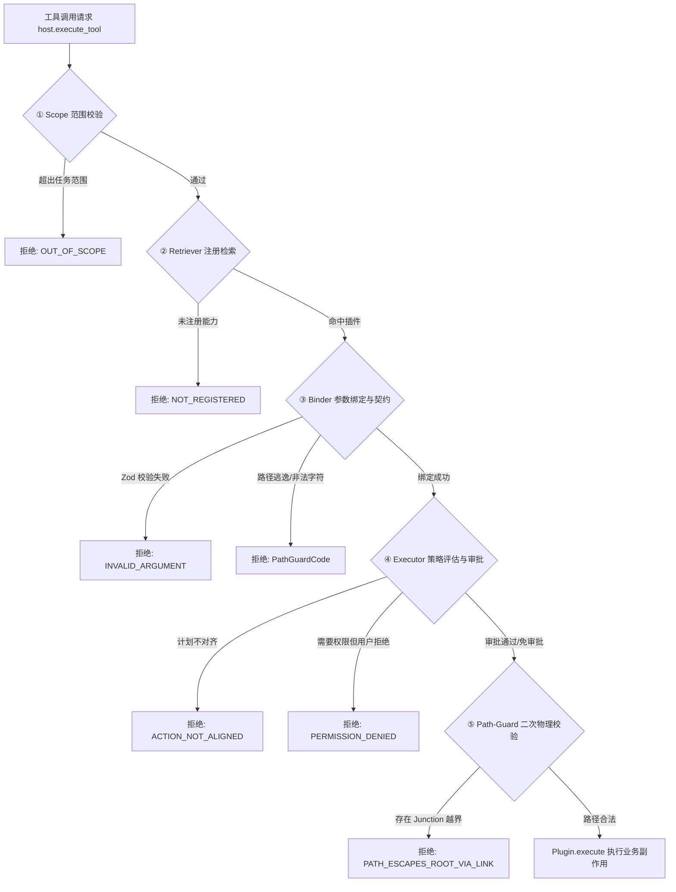

# 自描述能力插件架构与安全策略链

<cite>
**本文引用的文件**
- [plugin.ts](file://apps/desktop/src/main/capabilities/plugin.ts)
- [registry.ts](file://apps/desktop/src/main/capabilities/registry.ts)
- [scope.ts](file://apps/desktop/src/main/capabilities/scope.ts)
- [binder.ts](file://apps/desktop/src/main/capabilities/binder.ts)
- [executor.ts](file://apps/desktop/src/main/capabilities/executor.ts)
- [path-guard.ts](file://apps/desktop/src/main/capabilities/path-guard.ts)
- [execution-policy.ts](file://apps/desktop/src/main/policy/execution-policy.ts)
- [plugins/index.ts](file://apps/desktop/src/main/capabilities/plugins/index.ts)
- [plugins/filesystem.ts](file://apps/desktop/src/main/capabilities/plugins/filesystem.ts)
- [plugins/document.ts](file://apps/desktop/src/main/capabilities/plugins/document.ts)
- [plugins/terminal.ts](file://apps/desktop/src/main/capabilities/plugins/terminal.ts)
- [plugins/web-search.ts](file://apps/desktop/src/main/capabilities/plugins/web-search.ts)
- [tool_schema_generator.py](file://services/agent-runtime/src/personal_agent/conversation/model/tool_schema_generator.py)
</cite>

## 目录
1. [架构背景与设计原则](#架构背景与设计原则)
2. [CapabilityPlugin 核心契约抽象](#capabilityplugin-核心契约抽象)
3. [插件注册表与集中注册机制](#插件注册表与集中注册机制)
4. [动态 TaskScope 与单一事实来源](#动态-taskscope-与单一事实来源)
5. [跨语言契约与反射 Tool Schemas 生成](#跨语言契约与反射-tool-schemas-生成)
6. [五层安全策略拦截链](#五层安全策略拦截链)
7. [Path-Guard 物理路径守卫机制](#path-guard-物理路径守卫机制)
8. [核心能力插件深度实现拆解](#核心能力插件深度实现拆解)
9. [幂等性控制与崩溃恢复保障](#幂等性控制与崩溃恢复保障)

---

## 架构背景与设计原则

在早期版本中，智能体能力的元数据声明、参数校验、路径提取、权限检查、幂等处理以及实际执行逻辑散落在主进程的多个分发模块中（如 `argument-binders.ts`、`executor.ts`、`idempotency.ts` 等），存在大量的硬编码 `switch-case`。这种散落设计带来了严峻的维护挑战：每新增一个工具能力，必须跨越 4~5 个文件同步修改分发分支，极易产生逻辑遗漏或孤岛代码。

为了彻底遵循面向对象设计的**开闭原则 (Open-Closed Principle, OCP)**，系统重构并推行了**自描述能力插件 (CapabilityPlugin)** 架构：
- **自描述与高内聚**：将工具元数据、Zod 参数契约校验、授权路径规范化、权限提取、幂等与崩溃恢复策略、副作用执行体完整收敛在单个插件对象中；
- **单一事实来源 (Single Source of Truth)**：消除硬编码工具白名单，所有任务作用域（`TaskScope`）与可用能力列表动态由插件注册表直接派生；
- **跨端自动反射**：Python 运行时利用反射生成器根据 Pydantic 模型动态派生 OpenAI Function Calling 标准 Schema，杜绝手动同步 300+ 行 JSON 字典。



**图表来源**
- [plugin.ts:58-78](file://apps/desktop/src/main/capabilities/plugin.ts#L58-L78)
- [registry.ts:140-158](file://apps/desktop/src/main/capabilities/registry.ts#L140-L158)
- [executor.ts:64-112](file://apps/desktop/src/main/capabilities/executor.ts#L64-L112)

**章节来源**
- [plugin.ts:58-78](file://apps/desktop/src/main/capabilities/plugin.ts#L58-L78)
- [registry.ts:140-158](file://apps/desktop/src/main/capabilities/registry.ts#L140-L158)

---

## CapabilityPlugin 核心契约抽象

`CapabilityPlugin` 接口是整个能力体系的基石，定义在 `apps/desktop/src/main/capabilities/plugin.ts` 中。

```typescript
export interface CapabilityPlugin {
  readonly name: string
  readonly descriptor: CapabilityDescriptor | CapabilityPluginDescriptor

  /** 契约校验与路径规范化 (Path-Guard) */
  bindArguments(args: Record<string, unknown>): Promise<BindResult>

  /** 权限路径提取（供 permission-broker 使用） */
  extractPermissionPaths?(bound: BoundArgs): PermissionPaths

  /** 幂等与崩溃恢复策略（供 idempotency 使用） */
  readonly idempotency?: CapabilityPluginIdempotency

  /** 副作用执行体 */
  execute(call: AuthorizedCall, context: CapabilityPluginContext): Promise<CapabilityOutcome>
}
```

### 契约组成与职责

1. **`name` & `descriptor`**：声明能力唯一标识（如 `file_write`、`terminal_execute`）、读写属性（`READ` 或 `WRITE`）以及曝光策略（如 `exposure: 'internal'` 表示仅限内部调用）；
2. **`bindArguments`**：负责对未经信任的模型入参执行强类型校验（通常借助 Zod），并在包含文件路径时，调用底层的 `resolveWithinRootReal` 守卫逻辑，将相对路径或符号链接安全解析并规范化为授权根内的绝对物理路径；
3. **`extractPermissionPaths`**：提取该能力涉及的输入源路径（`sourcePaths`）与输出目标路径（`targetPath`），供上层权限决策引擎与用户审批对话框展示；
4. **`idempotency`**：针对具有持久化副作用的 `WRITE` 类能力，声明其副作用路径提取与崩溃恢复判定函数（`resolveRecovery`）；
5. **`execute`**：纯业务执行体，接收已通过五层检验的 `AuthorizedCall` 与外部注入上下文（如定时器调度器、知识库检索器、记忆检索器），执行实际的文件读写、系统调用或外部网络请求。

为了大幅简化参数绑定过程，系统提供了工厂函数 `defineBinder`（位于 `binder.ts`），以声明式方式配置字段与授权根目录映射规则，由工厂内部自动串联 Zod 解析与 `resolveWithinRootReal` 路径校验。

**章节来源**
- [plugin.ts:16-56](file://apps/desktop/src/main/capabilities/plugin.ts#L16-L56)
- [plugin.ts:58-78](file://apps/desktop/src/main/capabilities/plugin.ts#L58-L78)
- [binder.ts:12-61](file://apps/desktop/src/main/capabilities/binder.ts#L12-L61)

---

## 插件注册表与集中注册机制

所有内置能力插件集中存放在 `apps/desktop/src/main/capabilities/plugins/` 目录中，并在 `plugins/index.ts` 中进行自引导注册。

```mermaid
flowchart LR
    FS[filesystem.ts] --> REG[BUILTIN_PLUGINS]
    DOC[document.ts] --> REG
    TERM[terminal.ts] --> REG
    WEB[web-search.ts] --> REG
    KNOW[knowledge.ts] --> REG
    VIK[viking.ts] --> REG
    CODE[code-interpreter.ts] --> REG
    SKILL[skills.ts] --> REG
    A2UI[a2ui.ts] --> REG

    REG --> MAP[registry Map<string, CapabilityPlugin>]
    MAP --> GET[getCapabilityPlugin(name)]
    MAP --> LIST[listCapabilityPlugins()]
```

在 `registry.ts` 中，`listCapabilities()`、`listByKind()` 和 `findCapability()` 优先从插件注册表 `listCapabilityPlugins()` 中获取真实插件的描述符，确保任何新增插件只要注册进 `BUILTIN_PLUGINS`，即可自动对整个系统可见。

**章节来源**
- [plugins/index.ts:39-81](file://apps/desktop/src/main/capabilities/plugins/index.ts#L39-L81)
- [registry.ts:140-158](file://apps/desktop/src/main/capabilities/registry.ts#L140-L158)

---

## 动态 TaskScope 与单一事实来源

任务权限范围（`TaskScope`）定义了特定任务生命周期内允许调用的能力集合。

过去，开发者常常在 `scope.ts` 中硬编码一个包含工具名称的静态数组白名单，导致每次新增插件时都必须手动同步白名单。PersonalAgent 彻底废除了这种反模式，推行基于动态派生的**单一事实来源**机制：

```typescript
export const AGENT_TASK_CAPABILITIES: readonly CapabilityName[] = listCapabilities()
  .filter((c) => c.exposure !== 'internal' && c.name !== 'notification_send')
  .map((c) => c.name as CapabilityName)

export function agentTaskScope(taskId: string): TaskScope {
  return { taskId, capabilities: AGENT_TASK_CAPABILITIES }
}
```

此外，系统还支持从规划蓝图动态推导作用域（`deriveScopeFromPlan`），将任务基础能力与规划步骤中显式要求的额外能力进行求并，实现最小权限原则（Principle of Least Privilege）。

**章节来源**
- [scope.ts:3-25](file://apps/desktop/src/main/capabilities/scope.ts#L3-L25)
- [scope.ts:44-59](file://apps/desktop/src/main/capabilities/scope.ts#L44-L59)

---

## 跨语言契约与反射 Tool Schemas 生成

跨语言契约采用三步同步规范：
1. **TypeScript 侧**：在 `packages/protocol/schemas/` 中使用 Zod 定义参数契约；
2. **Python 运行时侧**：在 `protocol/models.py` 中使用 Pydantic 镜像定义，并配置 `ConfigDict(extra="allow")`；
3. **反射生成器**：在 `tool_schema_generator.py` 中，通过调用 Pydantic 模型的 `model_json_schema()` 动态反射生成符合 OpenAI Function Calling 标准的规范字典。

```python
def generate_tool_schema(
    capability: str, description: str | None = None
) -> dict[str, Any]:
    model_cls = TOOL_PARAM_MODELS.get(capability)
    desc = description or TOOL_DESCRIPTIONS.get(capability, "")
    if model_cls is None:
        return {
            "type": "function",
            "function": {
                "name": capability,
                "description": desc,
                "parameters": {"type": "object", "properties": {}},
            },
        }

    schema = model_cls.model_json_schema()
    schema.pop("title", None)
    schema.pop("description", None)
    schema.pop("additionalProperties", None)

    prop_descs = PROPERTY_DESCRIPTIONS.get(capability, {})
    properties = schema.get("properties", {})
    # 注入 ACI 目标导向参数说明与边界约束...
```

这种机制完全消除了手动手写与维护巨型 JSON Schema 字典的冗余，当 TypeScript 协议变更时，Python 侧仅需同步 Pydantic 字段，对外暴露的 Tool Schema 即可全自动重新生成。

**章节来源**
- [tool_schema_generator.py:46-70](file://services/agent-runtime/src/personal_agent/conversation/model/tool_schema_generator.py#L46-L70)
- [tool_schema_generator.py:238-285](file://services/agent-runtime/src/personal_agent/conversation/model/tool_schema_generator.py#L238-L285)

---

## 五层安全策略拦截链

任何来自 AI 智能体或外部调用的工具执行请求，必须在主进程中通过五层纵深拦截链。任何一层拒绝，调用立即终止并返回标准化错误码。



**图表来源**
- [execution-policy.ts:88-155](file://apps/desktop/src/main/policy/execution-policy.ts#L88-L155)
- [executor.ts:83-111](file://apps/desktop/src/main/capabilities/executor.ts#L83-L111)

### 五层纵深职责

| 层级 | 负责模块 | 核心职责 |
| :--- | :--- | :--- |
| **① Scope** | `capabilities/scope.ts` | 确定当前任务（TaskId）可用的能力边界，拦截越界调用。 |
| **② Retriever** | `capabilities/retriever.ts` | 从插件注册表中检索能力描述符，校验能力是否注册。 |
| **③ Binder** | `capabilities/binder.ts` | 执行 Zod `safeParse` 参数契约校验，并提取待操作路径。 |
| **④ Executor** | `capabilities/executor.ts` & `execution-policy.ts` | 核对计划对齐状态（`checkAlignment`）、评估风险等级（`assessRisk`）、驱动权限审批（`permission-broker`）与幂等锁判定。 |
| **⑤ Path-Guard** | `capabilities/path-guard.ts` | 调用 `resolveWithinRootReal` 进行物理级真实路径解析，防范符号链接与保留名逃逸。 |

**章节来源**
- [execution-policy.ts:88-155](file://apps/desktop/src/main/policy/execution-policy.ts#L88-L155)
- [executor.ts:64-112](file://apps/desktop/src/main/capabilities/executor.ts#L64-L112)

---

## Path-Guard 物理路径守卫机制

在 Windows 和跨平台环境中，字符串层面的路径校验无法抵御符号链接（Symlink）、目录联接（Directory Junction）以及 Windows 专用保留设备名逃逸。`path-guard.ts` 实现了严密的物理路径防护网：

1. **UNC 与设备路径拦截**：严禁以 `//` 或 `\\\\` 开头的网络 UNC 共享路径（`PATH_UNC_NOT_ALLOWED`）；
2. **保留设备名过滤**：利用正则表达式 `WINDOWS_DEVICE_NAME_REGEX` 拦截包含 `CON`、`PRN`、`AUX`、`NUL`、`COM1-9`、`LPT1-9` 的文件名（`PATH_DEVICE_NAME_FORBIDDEN`）；
3. **非法控制字符拦截**：严格拦截 ASCII 控制字符及 `<>:"|?*`（`PATH_INVALID_CHAR`）；
4. **祖先解构解析 (`splitExisting`)**：当写入目标文件尚未创建时，`realpath` 会抛出 `ENOENT`。系统向上递归寻找最近的已存在祖先目录执行 `realpath`，再拼装未创建的子路径；
5. **双重真实路径比对 (`resolveWithinRootReal`)**：
   - 将根目录与目标路径均解开为物理真实路径；
   - 识别 8.3 短文件名与长文件名的别名等价性；
   - 侦测利用符号链接将授权根内文件指向授权根外部的非法穿透，直接阻断并抛出 `PATH_ESCAPES_ROOT_VIA_LINK`。

**章节来源**
- [path-guard.ts:7-17](file://apps/desktop/src/main/capabilities/path-guard.ts#L7-L17)
- [path-guard.ts:48-63](file://apps/desktop/src/main/capabilities/path-guard.ts#L48-L63)
- [path-guard.ts:65-67](file://apps/desktop/src/main/capabilities/path-guard.ts#L65-L67)
- [path-guard.ts:77-150](file://apps/desktop/src/main/capabilities/path-guard.ts#L77-L150)

---

## 核心能力插件深度实现拆解

### 1. 文件系统插件 (`plugins/filesystem.ts`)
- **`filesystem_list`**：安全扫描指定根目录，支持后缀通配符模式匹配（`*.pdf`），按修改时间倒序排列，返回文件与目录的结构化元数据；
- **`filesystem_create_dir`**：在授权根内创建子目录，内置审计比对预期父目录是否存在；
- **`filesystem_move`**：在授权根内跨目录安全移动或重命名文件，具备完整的幂等性检查与源/目标物理存在性审计。

### 2. 文档读取插件 (`plugins/document.ts`)
- **`document_extract_pdf`**：基于 `pdfjs-dist` 提取 PDF 逐页纯文本与页码，严格处理零字节、密码加密与损坏文件等异常；
- **`read_document`**：统一多格式文档读取器（支持 PDF/Word/Markdown/Text），支持 `pageStart`、`pageEnd` 分页提取与 `maxCharsPerPage` 单页字符截断控制，防止过量文本击穿模型上下文；并受控允许读取 Sidecar 生成的本地临时工具产物。

### 3. 终端执行插件 (`plugins/terminal.ts`)
- **`terminal_execute`**：受限命令行执行引擎。工作目录被强制锁定在工作区或下载目录内；
- **会话级 cwd 记忆**：内置拦截独立 `cd` 指令，在主进程会话状态中维护当前工作目录，防止子进程执行完毕后目录回弹；
- **安全截断与审计**：执行输出经 `truncateOutput` 双端保护，防止巨量控制台日志导致主进程内存耗尽。

### 4. 实时网络搜索插件 (`plugins/web-search.ts`)
- **`web_search`**：集成 Tavily 搜索引擎官方 REST API；
- **参数控制**：支持 `query`、`maxResults`、`searchDepth`（'basic' / 'advanced'）与 `includeAnswer`；
- **结构化输出**：返回由标题、URL、清洗后的网页片段（Snippet）及 AI 提炼答案组成的结构化结果，为 Agent 提供精准外部事实输入。

**章节来源**
- [plugins/filesystem.ts:48-77](file://apps/desktop/src/main/capabilities/plugins/filesystem.ts#L48-L77)
- [plugins/filesystem.ts:207-254](file://apps/desktop/src/main/capabilities/plugins/filesystem.ts#L207-L254)
- [plugins/filesystem.ts:256-324](file://apps/desktop/src/main/capabilities/plugins/filesystem.ts#L256-L324)
- [plugins/document.ts:52-90](file://apps/desktop/src/main/capabilities/plugins/document.ts#L52-L90)
- [plugins/document.ts:232-289](file://apps/desktop/src/main/capabilities/plugins/document.ts#L232-L289)
- [plugins/terminal.ts:15-31](file://apps/desktop/src/main/capabilities/plugins/terminal.ts#L15-L31)
- [plugins/terminal.ts:33-145](file://apps/desktop/src/main/capabilities/plugins/terminal.ts#L33-L145)
- [plugins/web-search.ts:49-109](file://apps/desktop/src/main/capabilities/plugins/web-search.ts#L49-L109)
- [plugins/web-search.ts:111-130](file://apps/desktop/src/main/capabilities/plugins/web-search.ts#L111-L130)

---

## 幂等性控制与崩溃恢复保障

对于具有文件系统副作用的 `WRITE` 类插件，`executor.ts` 在执行前后集成了幂等状态锁：

1. **执行前登记 (`beginAttempt`)**：以任务 ID、调用 ID 及规范化参数哈希为唯一键，在 SQLite `tool_executions` 表中登记 `attempting` 态；
2. **重复调用决策**：
   - 若记录已处于 `succeeded` 终态，直接跳过副作用执行并返回历史缓存产物（`skip`）；
   - 若记录处于 `attempting` 异常未决态（如上次进程意外崩溃），触发插件自描述的 `resolveRecovery` 判定函数；
3. **物理状态复查 (`resolveRecovery`)**：
   - 插件根据实际磁盘状态（如文件是否已移至目标路径、目录是否已成功生成）判定上次执行是实际完成（`done`）还是未发生（`not-done`）；
4. **终态翻转 (`afterExecute`)**：实际执行成功后，将状态翻转为 `succeeded` 或 `failed`。

这种机制从根源上杜绝了网络重试、模型偶发重复发包或主机重启导致的重复文件覆盖与目录重复操作。

**章节来源**
- [executor.ts:98-111](file://apps/desktop/src/main/capabilities/executor.ts#L98-L111)
- [plugins/filesystem.ts:225-237](file://apps/desktop/src/main/capabilities/plugins/filesystem.ts#L225-L237)
- [plugins/filesystem.ts:281-297](file://apps/desktop/src/main/capabilities/plugins/filesystem.ts#L281-L297)
