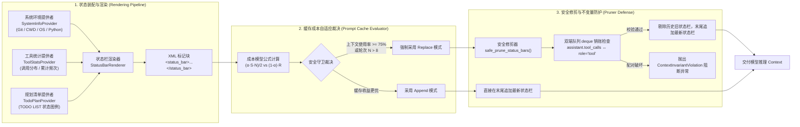

# 上下文工程与状态栏

<cite>
**本文引用的文件**
- [strategy.py](file://services/agent-runtime/src/personal_agent/conversation/status/strategy.py)
- [pruner.py](file://services/agent-runtime/src/personal_agent/conversation/status/pruner.py)
- [renderer.py](file://services/agent-runtime/src/personal_agent/conversation/status/renderer.py)
- [providers.py](file://services/agent-runtime/src/personal_agent/conversation/status/providers.py)
- [tracker.py](file://services/agent-runtime/src/personal_agent/conversation/status/tracker.py)
- [manager.py](file://services/agent-runtime/src/personal_agent/conversation/status/manager.py)
- [invariants.py](file://services/agent-runtime/src/personal_agent/conversation/compression/invariants.py)
- [models.py](file://services/agent-runtime/src/personal_agent/conversation/compression/models.py)
- [strategy.py](file://services/agent-runtime/src/personal_agent/conversation/compression/strategy.py)
- [distiller.py](file://services/agent-runtime/src/personal_agent/conversation/compression/distiller.py)
- [document.py](file://services/agent-runtime/src/personal_agent/conversation/compression/document.py)
- [manager.py](file://services/agent-runtime/src/personal_agent/conversation/context/manager.py)
</cite>

## 目录
1. [状态栏工程设计总览](#状态栏工程设计总览)
2. [可扩展 Provider 流水线与环境感知](#可扩展-provider-流水线与环境感知)
3. [Prompt Cache 成本模型与自适应注入策略](#prompt-cache-成本模型与自适应注入策略)
4. [状态栏安全修剪与工具配对防御机制](#状态栏安全修剪与工具配对防御机制)
5. [5W1H 语义完整性守卫](#5w1h-语义完整性守卫)
6. [生命周期分层与递归观察提炼流](#生命周期分层与递归观察提炼流)
7. [持久化认知工作台 (ProgressDocumentManager)](#持久化认知工作台-progressdocumentmanager)

---

## 状态栏工程设计总览

在长程复杂交互中，智能体极易出现“环境失明”、“工具迷航”与“任务偏航”。为了让 Agent 始终保有清晰的自我认知与情境感知，PersonalAgent 构建了结构化的**状态栏工程（Status Bar Engineering）**：
- **认知中枢统一外化**：在每轮上下文消息的末尾，通过专用的 XML 边界标记 `<status_bar> ... </status_bar>` 注入轻量、紧凑的高密度情境摘要；
- **三位一体的信息拓扑**：集成了“🖥️ 系统宿主环境”、“🛠️ 工具调用分布”以及“📋 任务规划清单 (TODO LIST)”；
- **Prompt Cache 极致亲和**：通过自适应数学决策模型在“纯追加（Append）”与“安全替换（Replace）”之间动态裁决，最大化利用现代大模型（如 Claude / OpenAI）的前缀缓存，大幅削减 API 费用与端到端延迟。



**图表来源**
- [renderer.py:17-57](file://services/agent-runtime/src/personal_agent/conversation/status/renderer.py#L17-L57)
- [strategy.py:17-60](file://services/agent-runtime/src/personal_agent/conversation/status/strategy.py#L17-L60)
- [pruner.py:35-61](file://services/agent-runtime/src/personal_agent/conversation/status/pruner.py#L35-L61)
- [manager.py:100-140](file://services/agent-runtime/src/personal_agent/conversation/status/manager.py#L100-L140)

---

## 可扩展 Provider 流水线与环境感知

状态栏渲染器采用插件化架构，支持多模块按 `priority` 优先级链式装配：

### 内置三大区块提供者
1. **`SystemInfoProvider` (Priority = 10)**：
   - 提取真实宿主操作系统内核、当前工作区目录、Shell 环境（PowerShell / Bash / CMD）及 Python 运行时版本；
   - 包含轻量 Git 状态探查器 `detect_git_status`：利用轻量子进程探测当前 Git 分支名与修改摘要，严格设定 2 秒超时时间，遭遇未初始化仓库或系统缺 git 命令时平滑退避为 `None`，绝不阻塞主循环；
2. **`ToolStatsProvider` (Priority = 20)**：
   - 由 `ToolCallTracker` 实时统计各能力被调用的累计频次与分布矩阵，便于模型识别是否存在反复调用同一工具的停滞死循环；
3. **`TodoPlanProvider` (Priority = 30)**：
   - 渲染带有状态符号的动态账本条目：`[✓]` completed, `[▶]` in_progress, `[ ]` pending, `[✗]` cancelled。

**章节来源**
- [providers.py:16-48](file://services/agent-runtime/src/personal_agent/conversation/status/providers.py#L16-L48)
- [providers.py:61-137](file://services/agent-runtime/src/personal_agent/conversation/status/providers.py#L61-L137)
- [providers.py:139-199](file://services/agent-runtime/src/personal_agent/conversation/status/providers.py#L139-L199)
- [renderer.py:17-57](file://services/agent-runtime/src/personal_agent/conversation/status/renderer.py#L17-L57)
- [tracker.py:1-81](file://services/agent-runtime/src/personal_agent/conversation/status/tracker.py#L1-L81)

---

## Prompt Cache 成本模型与自适应注入策略

现代大模型广泛支持前缀缓存（Prompt Caching）。如果在历史对话中间修改或删除状态栏，会导致后续缓存全部失效；但如果一味追加（Append），历史多个版本的状态栏不仅白白浪费 Token，还会引发模型对过时 TODO 状态的注意力混淆。

`evaluate_injection_strategy` 实现了严密的数学模型与工程守卫结合的自适应决策：

### 成本分界点数学模型
设：
- $S$: 状态栏单次渲染产生的 Token 数量（通常约 100~200 tokens）；
- $R$: 排除状态栏后，其余对话历史的累计 Token 总量；
- $N$: 交互推进的轮次数；
- $\alpha$: 缓存折扣率（主流前缀缓存模型默认取 `0.5`）；

两种模式的成本对比：
- **替换模式成本**：$C_{\text{replace}} \approx (N - 1)(1 - \alpha) R$ （旧状态栏被修剪，缓存前缀发生变更，需重新计算未命中惩罚）；
- **追加模式成本**：$C_{\text{append}} \approx \alpha S \frac{N(N - 1)}{2}$ （缓存前缀保持完全命中，但多份旧状态栏产生累积计费）；

因此，判定分界条件为：
$$\frac{\alpha \cdot S \cdot N}{2} < (1 - \alpha) \cdot R$$
当满足上述不等式时，追加模式更经济，策略选择 `"append"`；反之选择 `"replace"`。

### 双重刚性工程守卫
1. **上下文天花板守卫**：当 `context_used_ratio >= 0.75` 时，强制切换为 `"replace"`，优先防御上下文溢出；
2. **陈旧状态歧义守卫**：当轮次 `N > 8` 时，强制切换为 `"replace"`，清除过多历史 TODO 版本，防范模型注意力漂移。

**章节来源**
- [strategy.py:17-60](file://services/agent-runtime/src/personal_agent/conversation/status/strategy.py#L17-L60)

---

## 状态栏安全修剪与工具配对防御机制

在选择 `"replace"` 策略时，必须将所有历史状态栏消息剔除，仅在末尾注入最新状态栏。然而在 OpenAI / Anthropic 协议规范中，大模型如果发起了包含 `tool_calls` 的 `assistant` 消息，后续必须紧跟相同数量且 `tool_call_id` 严格一一对应的 `role="tool"` 消息，中间绝不允许插入错位消息，更不允许出现悬空工具调用。

`safe_prune_status_bars` 在修剪历史状态栏的同时，内置了基于双端队列的**工具配对不变量守护（Tool-Pairing Invariant Guard）**：
1. **精准定位状态栏**：`is_status_bar_message` 严格限定角色仅为 `user` 或 `system` 且包含 `<status_bar>` 标签，绝不误伤 `assistant` 或 `tool` 消息；
2. **双端队列追踪**：
   - 遇到 `assistant` 提出工具调用时，将内部所有 `call["id"]` 入队（天然兼容 1:N 并行工具调用）；
   - 遇到 `role="tool"` 时，出队匹配 `tool_call_id`。若队列为空、ID 不匹配或遍历结束后仍有待销账 ID，立即抛出 `ContextInvariantViolation` 异常，阻断畸形消息外发。

**章节来源**
- [pruner.py:11-28](file://services/agent-runtime/src/personal_agent/conversation/status/pruner.py#L11-L28)
- [pruner.py:30-61](file://services/agent-runtime/src/personal_agent/conversation/status/pruner.py#L30-L61)

---

## 5W1H 语义完整性守卫

在进行长上下文主动压缩与事实浓缩时，极易发生“语义残缺”，例如模型提炼出“已重构该文件”、“修复了报错”等丢失主体、时间或关键客体的无用碎片。

`validate_semantic_integrity` 在压缩准入层设置了 **5W1H 语义完整性准则**：
```python
def validate_semantic_integrity(fact: DistilledFact) -> tuple[bool, str]:
    if fact.subject.strip() == "":
        return False, "缺少事实主体 (subject)"
    if fact.predicate.strip() == "":
        return False, "缺少事实动作或谓词 (predicate)"
    if fact.object.strip() == "" and (fact.temporal is None or fact.temporal.strip() == ""):
        return False, "事实语义残缺：缺少时间锚点与关联客体"
    if fact.object.strip() == "":
        return False, "缺少关联客体或作用对象 (object)"
    return True, "ok"
```
只有同时满足**主体 (Who/What)**、**谓词 (Action)**、**客体 (Target)** 与**时间锚点 (When)** 约束的事实，才被允许沉淀至持久化事实库中。

**章节来源**
- [invariants.py:6-16](file://services/agent-runtime/src/personal_agent/conversation/compression/invariants.py#L6-L16)
- [models.py:24-35](file://services/agent-runtime/src/personal_agent/conversation/compression/models.py#L24-L35)

---

## 生命周期分层与递归观察提炼流

不同工具调用产生的观察结果具有完全不同的时效性与价值密度。系统引入了 `LifecycleTier` 分层处理：

### 三级生命周期定义
- **`EPHEMERAL_L0`（瞬时执行细节）**：包括 `terminal_execute`、`filesystem_create_dir`、`filesystem_move` 等命令行与动作型工具。执行成功后其原始输出不再需要长期占用空间，`ObservationDistiller` 将其快速折叠为高密度凭证标签（如 `[filesystem_move: ok] 归档旧日志`）；
- **`TASK_SCOPED_L1`（任务级深度事实）**：包括 PDF 提取、代码读取与多格式文档解析。由提炼模型组装上下文感知提示词（`build_context_aware_prompt`），在保留原 `callId` 的前提下，提炼结构化事实清单与高密度自然语言摘要；
- **`PERSISTENT_L2`（长期跨会话记忆）**：交由长期记忆流水线沉淀。

**章节来源**
- [models.py:16-22](file://services/agent-runtime/src/personal_agent/conversation/compression/models.py#L16-L22)
- [strategy.py:116-127](file://services/agent-runtime/src/personal_agent/conversation/compression/strategy.py#L116-L127)
- [distiller.py:39-66](file://services/agent-runtime/src/personal_agent/conversation/compression/distiller.py#L39-L66)
- [distiller.py:104-180](file://services/agent-runtime/src/personal_agent/conversation/compression/distiller.py#L104-L180)

---

## 持久化认知工作台 (ProgressDocumentManager)

在复杂任务执行过程中，Agent 往往需要维持一份连续更新的“草稿本”。`ProgressDocumentManager` 负责管理外化的持久化工作文档状态（`ProgressDocumentState`）：
- **事实增量去重归并 (`merge_facts`)**：根据 `(subject, predicate, object, temporal)` 四元组哈希去重，并自动合并新出现的页码引用 `pageRefs`；
- **工作台 Markdown 渲染 (`render`)**：生成被 `<progress_document>` 标签包裹的工作区，系统包含“已确认的核心事实”、“执行进展与里程碑”以及“洞察与工作笔记”三大板块，与上下文底层的原始观察历史形成完美的双轨互补。

**章节来源**
- [document.py:15-111](file://services/agent-runtime/src/personal_agent/conversation/compression/document.py#L15-L111)
- [context/manager.py:258-320](file://services/agent-runtime/src/personal_agent/conversation/context/manager.py#L258-L320)
