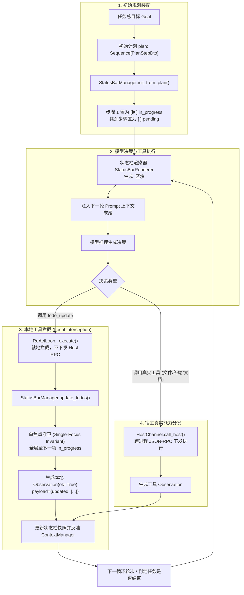
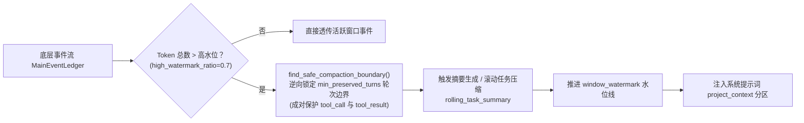

# 动态任务账本

<cite>
**本文引用的文件**
- [models.py](file://services/agent-runtime/src/personal_agent/conversation/status/models.py)
- [manager.py](file://services/agent-runtime/src/personal_agent/conversation/status/manager.py)
- [react_loop.py](file://services/agent-runtime/src/personal_agent/conversation/loop/react_loop.py)
- [strategy.py](file://services/agent-runtime/src/personal_agent/conversation/loop/strategy.py)
- [engine.py](file://services/agent-runtime/src/personal_agent/conversation/loop/engine.py)
- [tool_schema_generator.py](file://services/agent-runtime/src/personal_agent/conversation/model/tool_schema_generator.py)
- [manager.py](file://services/agent-runtime/src/personal_agent/conversation/context/manager.py)
- [providers.py](file://services/agent-runtime/src/personal_agent/conversation/status/providers.py)
- [sliding.py](file://services/agent-runtime/src/personal_agent/conversation/windows/sliding.py)
- [gatekeeper.py](file://services/agent-runtime/src/personal_agent/conversation/windows/gatekeeper.py)
- [models.py](file://services/agent-runtime/src/personal_agent/conversation/windows/models.py)
</cite>

## 目录
1. [动态任务账本设计背景与范式革新](#动态任务账本设计背景与范式革新)
2. [任务项数据契约与状态流转体系](#任务项数据契约与状态流转体系)
3. [本地内置工具 todo_update 与反射模式](#本地内置工具-todo_update-与反射模式)
4. [单回路 ReAct 循环与本地调用就地拦截](#单回路-react-循环与本地调用就地拦截)
5. [单焦点规划流转状态机约束 (Single-Focus Invariant)](#单焦点规划流转状态机约束-single-focus-invariant)
6. [遇错动态排错闭环 (Self-Remediation Ledger)](#遇错动态排错闭环-self-remediation-ledger)
7. [滑动窗口裁剪与真实时钟门卫 (SlidingWindowLedger & TimeGateKeeper)](#滑动窗口裁剪与真实时钟门卫-slidingwindowledger--timegatekeeper)
8. [DynamicLedgerStrategy 运行时执行流分析](#dynamicledgerstrategy-运行时执行流分析)

---

## 动态任务账本设计背景与范式革新

在传统的 Agent 架构设计中（如初代 Plan-and-Execute 模式），静态规划与动态执行严重脱节：
1. **外层刚性切片导致认知碎片化**：任务规划系统生成固定步骤后，由外部循环将步骤逐一切片塞入子循环，步骤间历史观察被机械裁剪，模型难以纵览全局；
2. **遇错打断成本极其高昂**：当某一中间步骤遭遇文件缺失或命令报错时，模型要么机械重试直至步数预算耗尽，要么必须发起重规划请求打碎重构整个 Plan；
3. **缺乏主动任务自知与进度感知**：智能体无法自主标记“我正在做第 2 步”、“第 2 步已完成，开始推进第 3 步”。

借鉴 **Claude Code / Codex 桌面端动态任务账本（Dynamic Ledger / TodoWrite）范式**，PersonalAgent 实现了**统一单回路 ReAct + 动态任务账本**：
- **全局单主循环贯通推进**：不再由外层调度器对 Plan 进行外部物理切片，单个 `ReActLoop` 贯穿整个任务生命周期；
- **Prompt Cache 友好型动态账本**：将任务规划列表以 Markdown 形式集成进状态栏（Status Bar），模型在上下文末尾始终能清晰感知当前任务全貌与进度；
- **模型主动推进与动态编排**：模型通过本地内置能力 `todo_update` 自主勾选完成状态、激活下一项、甚至在报错时就地追加排错临时步骤，形成高度自治的闭环。



**图表来源**
- [manager.py:58-73](file://services/agent-runtime/src/personal_agent/conversation/status/manager.py#L58-L73)
- [manager.py:141-173](file://services/agent-runtime/src/personal_agent/conversation/status/manager.py#L141-L173)
- [react_loop.py:739-754](file://services/agent-runtime/src/personal_agent/conversation/loop/react_loop.py#L739-L754)
- [providers.py:120-137](file://services/agent-runtime/src/personal_agent/conversation/status/providers.py#L120-L137)

---

## 任务项数据契约与状态流转体系

动态任务账本的所有核心数据结构收敛于 `services/agent-runtime/src/personal_agent/conversation/status/models.py`，采用 Pydantic 强类型严格校验：

### 状态枚举定义 (`TodoStatus`)
```python
class TodoStatus(str, Enum):
    PENDING = "pending"          # 待执行，标记为 [ ]
    IN_PROGRESS = "in_progress"  # 进行中，标记为 [▶]
    COMPLETED = "completed"      # 已完成，标记为 [✓]
    CANCELLED = "cancelled"      # 已跳过/废弃，标记为 [✗]
```

### 任务数据结构 (`TodoItem` 与 `TodoUpdateParams`)
- **`TodoItem`**：账本单个规划步骤，包含唯一标识 `id`（如 `todo-1`）、具体任务内容 `content`、状态 `status` 以及带时区的时间戳 `timestamp`；
- **`TodoUpdateItemDto` 与 `TodoUpdateParams`**：作为入参传输对象，支持模型缺省传入 `id`（系统自动补齐递增编号）或缺省时间戳，具有极强的入参容错弹性。

**章节来源**
- [models.py:10-31](file://services/agent-runtime/src/personal_agent/conversation/status/models.py#L10-L31)
- [models.py:88-105](file://services/agent-runtime/src/personal_agent/conversation/status/models.py#L88-L105)
- [providers.py:112-117](file://services/agent-runtime/src/personal_agent/conversation/status/providers.py#L112-L117)

---

## 本地内置工具 todo_update 与反射模式

为了让模型能够像调用常规文件或系统工具一样自如地操控账本，系统将 `todo_update` 声明为**本地内置内部工具**：

### 动态 Schema 反射生成
在 `tool_schema_generator.py` 中：
- `LOCAL_TOOL_PARAM_MODELS` 映射 `"todo_update": TodoUpdateParams`；
- `LOCAL_TOOL_DESCRIPTIONS` 声明描述为：`"用于维护任务规划账本状态，支持完成勾选与动态追加排错步骤、全局至多一项处于进行中状态"`；
- 模型网关初始化工具列表（`build_tools`）时，通过动态内省自动将本地工具与宿主工具聚合输出为标准 OpenAI Tool Schemas，确保完全符合单一事实来源原则。

### 提示词指导语注入
在系统提示词渲染管线中，显式注入提示：
`"本轮计划规划（可通过 todo_update 工具动态维护执行状态，按需推进、勾选或追加排错步骤）："`，引导模型主动在推进阶段调用工具。

**章节来源**
- [tool_schema_generator.py:75-90](file://services/agent-runtime/src/personal_agent/conversation/model/tool_schema_generator.py#L75-L90)
- [tool_schema_generator.py:220-235](file://services/agent-runtime/src/personal_agent/conversation/model/tool_schema_generator.py#L220-L235)

---

## 单回路 ReAct 循环与本地调用就地拦截

当模型发起 `ToolCallDecision(capability="todo_update", ...)` 时，执行流并不会跨进程向桌面宿主（Electron Main）发送 JSON-RPC，而是在 `ReActLoop._execute` 内部被直接就地拦截与消费：

```python
if decision.capability == "todo_update":
    # todo_update 是内部协议，不下发给宿主
    raw_todos = decision.arguments.get("todos", [])
    updated = self._context.status_bar_manager.update_todos(raw_todos)
    obs = Observation(
        callId=decision.callId,
        capability=decision.capability,
        ok=True,
        payload={"updated": [t.model_dump() for t in updated]},
        arguments=decision.arguments,
    )
    return obs
```

### 拦截架构优势
1. **零进程通信时延**：进程内内存操作，耗时 < 1ms；
2. **状态原子更新**：直接修改 `ContextManager` 内嵌的 `StatusBarManager` 状态快照；
3. **上下文无缝反哺**：返回成功的 `Observation`，让模型获知“账本更新已生效”，并在紧接着的下一轮思考中看到渲染后的最新任务状态栏。

**章节来源**
- [react_loop.py:739-754](file://services/agent-runtime/src/personal_agent/conversation/loop/react_loop.py#L739-L754)

---

## 单焦点规划流转状态机约束 (Single-Focus Invariant)

在长时间运行的多步复杂任务中，如果模型不慎将多个步骤同时置为 `in_progress`，会造成严重的注意力分散与执行竞态。

为此，`StatusBarManager.update_todos` 内置了严格的 **单焦点不变量守卫（Single-Focus Invariant）**：
```python
in_progress_todo = None
for item in reversed(todo_items):
    if item.status == TodoStatus.IN_PROGRESS:
        if in_progress_todo:
            item.status = TodoStatus.COMPLETED
            continue
        in_progress_todo = item
```

### 流转逻辑保障
- **倒序扫描优先原则**：以模型意图推进到的最新一项为准，保持其为唯一的 `in_progress`；
- **历史自动闭环**：若发现之前存在尚未标记完成的更早步骤，系统自动平滑地将其纠正标记为 `completed`；
- **全局唯一聚焦**：确保整个规划列表中有且仅有一个进行中的当前焦点，彻底根绝任务推进歧义。

**章节来源**
- [manager.py:141-173](file://services/agent-runtime/src/personal_agent/conversation/status/manager.py#L141-L173)

---

## 遇错动态排错闭环 (Self-Remediation Ledger)

传统 Agent 在工具报错（如 `FileNotFoundError` 或 `SyntaxError`）时往往束手无策。PersonalAgent 的动态任务账本赋予了智能体自我修复能力：
1. **原地感知报错**：工具返回 `ok=False` 与具体错误信息；
2. **动态插入排错步骤**：模型无需打断整体流程，调用 `todo_update` 传入新的步骤列表：
   - 将当前原步骤保留或调整；
   - 插入临时步骤，如 `todo-err-1: 检查目录权限与依赖`、`todo-err-2: 修复缺失的配置文件`，并将其置为 `in_progress`；
   - 保留后续原定目标步骤为 `pending`；
3. **完成修复后恢复主线**：排错步骤执行完毕后，模型再次调用 `todo_update` 标记修复步骤为 `completed`，并重新激活原定主线步骤。

**章节来源**
- [manager.py:141-173](file://services/agent-runtime/src/personal_agent/conversation/status/manager.py#L141-L173)
- [models.py:88-105](file://services/agent-runtime/src/personal_agent/conversation/status/models.py#L88-L105)

---

## 滑动窗口裁剪与真实时钟门卫 (SlidingWindowLedger & TimeGateKeeper)

为了彻底解决单主循环长期运行过程中上下文无限膨胀与长程推理成本高昂的问题，PersonalAgent 引入了基于物理时钟与动态水位的滑动窗口机制：



### 1. 安全截断边界不变量 (Safe Compaction Boundary)
- **拒绝粗暴行截断**：严禁任意切分单轮交互。`find_safe_compaction_boundary` 逆向扫描用户轮次（`user` 事件），确保活跃窗口保留至少 `min_preserved_turns`（默认 6 轮）；
- **工具成对调用保护**：绝对不切断 `assistant` 发起的 `tool_call` 与对应的 `tool_result`，避免产生孤立悬空消息导致大模型 API 校验失败；
- **滚动任务摘要沉淀**：被截断的早期事件由摘要器提炼为 `rolling_task_summary`，无缝挂载入系统提示词的 `project_context` 区块，确保全局长期目标不丢失。

### 2. 真实物理时钟看门狗 (TimeGateKeeper)
- **消除时间幻觉**：智能体缺乏真实时间感知，`TimeGateKeeper` 注入真实墙上物理时钟，并在每次交互时记录 `last_interaction_timestamp`；
- **跨会话冷启动与超时归档**：当两次交互间隔超过 `inactivity_threshold_seconds`（默认 5 小时）时，自动触发超时归档机制：
  1. 将上一代纪的活跃窗口与摘要打包持久化为 `epoch_{id}_summary.md`；
  2. 递增代际编号（`epoch_id + 1`）并重置水位线；
  3. 生成醒目的跨会话提示语（如 `[系统提示：距离上次交互已过去 N 小时，旧任务上下文已归档...]`），指导模型平滑唤醒或快速聚焦新任务。

**章节来源**
- [sliding.py:10-63](file://services/agent-runtime/src/personal_agent/conversation/windows/sliding.py#L10-L63)
- [gatekeeper.py:18-70](file://services/agent-runtime/src/personal_agent/conversation/windows/gatekeeper.py#L18-L70)
- [models.py:8-22](file://services/agent-runtime/src/personal_agent/conversation/windows/models.py#L8-L22)
- [manager.py:266-287](file://services/agent-runtime/src/personal_agent/conversation/context/manager.py#L266-L287)

---

## DynamicLedgerStrategy 运行时执行流分析

在运行时策略分流中，`DynamicLedgerStrategy` 实现了标准的 `AgentStrategy` 协议：
- **单层循环自驱动推进**：`loop = ReActLoop(...)`，通过 `loop.run(goal, visible_capabilities, stop_on_step_complete=False)` 驱动任务从头到尾平滑前进；
- **透传底座日志与滑动窗口**：工具调用的发起与结果实时同步至底层 `MainEventLedger` 与 `SlidingWindowLedger`，保证物理账本与内存状态栏的严密对齐；
- **预算衰竭安全熔断**：当步数或工具调用达到 `Budget` 上限时，安全退出并触发 `_settle_usage` 结算 Token 开销，向外发射标准失败或完成事件。

**章节来源**
- [strategy.py:132-195](file://services/agent-runtime/src/personal_agent/conversation/loop/strategy.py#L132-L195)
- [context/manager.py:155-158](file://services/agent-runtime/src/personal_agent/conversation/context/manager.py#L155-L158)
- [context/manager.py:224-228](file://services/agent-runtime/src/personal_agent/conversation/context/manager.py#L224-L228)
- [loop/engine.py:47-55](file://services/agent-runtime/src/personal_agent/conversation/loop/engine.py#L47-L55)
