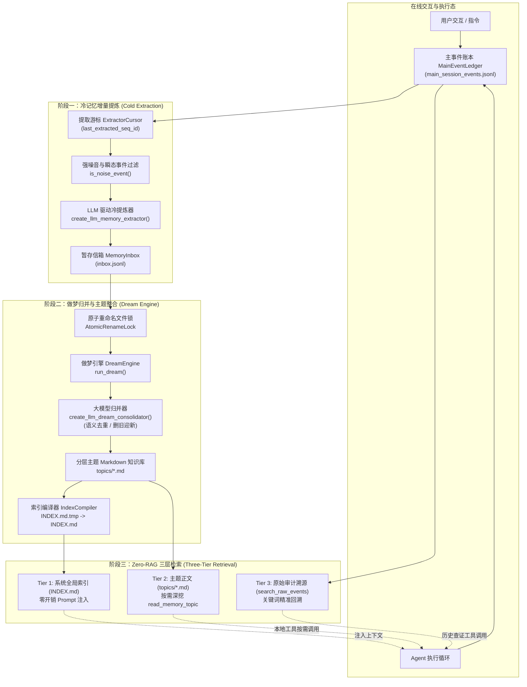
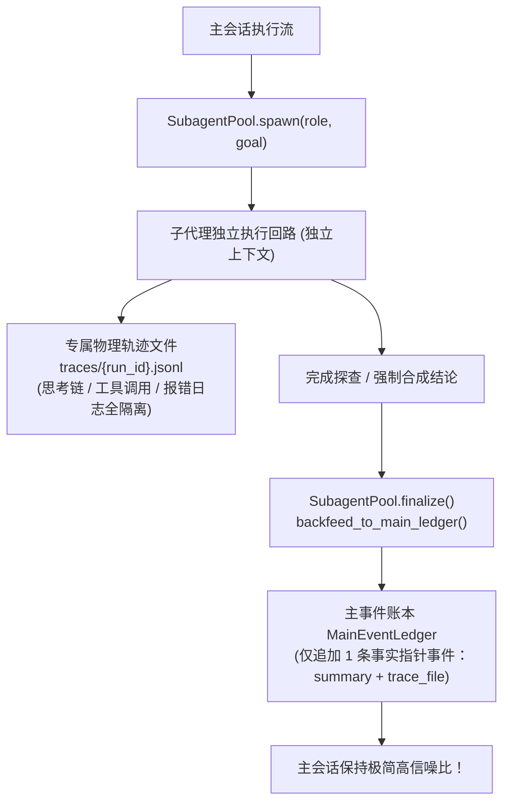

# 长程记忆与任务账本

<cite>
**本文引用的文件**
- [llm_extractor.py](file://services/agent-runtime/src/personal_agent/conversation/extractor/llm_extractor.py)
- [extractor.py](file://services/agent-runtime/src/personal_agent/conversation/extractor/extractor.py)
- [inbox.py](file://services/agent-runtime/src/personal_agent/conversation/extractor/inbox.py)
- [cursor.py](file://services/agent-runtime/src/personal_agent/conversation/extractor/cursor.py)
- [filter.py](file://services/agent-runtime/src/personal_agent/conversation/extractor/filter.py)
- [models.py](file://services/agent-runtime/src/personal_agent/conversation/extractor/models.py)
- [pipeline.py](file://services/agent-runtime/src/personal_agent/conversation/pipeline.py)
- [engine.py](file://services/agent-runtime/src/personal_agent/conversation/dream/engine.py)
- [llm_consolidator.py](file://services/agent-runtime/src/personal_agent/conversation/dream/llm_consolidator.py)
- [indexer.py](file://services/agent-runtime/src/personal_agent/conversation/dream/indexer.py)
- [models.py](file://services/agent-runtime/src/personal_agent/conversation/dream/models.py)
- [lock.py](file://services/agent-runtime/src/personal_agent/conversation/dream/lock.py)
- [retriever.py](file://services/agent-runtime/src/personal_agent/conversation/topics/retriever.py)
- [storage.py](file://services/agent-runtime/src/personal_agent/conversation/ledger/storage.py)
- [pool.py](file://services/agent-runtime/src/personal_agent/conversation/subagent/pool.py)
- [backfeed.py](file://services/agent-runtime/src/personal_agent/conversation/subagent/backfeed.py)
- [memory.ts](file://packages/protocol/schemas/memory.ts)
</cite>

## 目录
1. [架构定位与 Zero-RAG 设计范式](#架构定位与-zero-rag-设计范式)
2. [底层基座：主事件物理账本 (MainEventLedger)](#底层基座主事件物理账本-maineventledger)
3. [多子代理并发隔离与主账本回灌 (SubagentPool & Backfeed 零泄漏铁律)](#多子代理并发隔离与主账本回灌-subagentpool--backfeed-零泄漏铁律)
4. [冷记忆提炼流水线 (Cold Memory Extractor)](#冷记忆提炼流水线-cold-memory-extractor)
5. [深度睡眠与做梦整合引擎 (DreamEngine)](#深度睡眠与做梦整合引擎-dreamengine)
6. [三层记忆检索模型 (Three-Tier Memory Architecture)](#三层记忆检索模型-three-tier-memory-architecture)
7. [跨语言记忆协议契约](#跨语言记忆协议契约)
8. [任务结束一键提炼流水线编排](#任务结束一键提炼流水线编排)

---

## 架构定位与 Zero-RAG 设计范式

PersonalAgent 在构建长程记忆（Long-Term Memory）系统时，没有盲目采用传统的“全量切块入向量库 + Top-K 相似度检索”的黑盒 RAG 方案。传统 RAG 在面向个人助理与 Coding Agent 场景时存在致命缺陷：
1. **语义断章取义与注意力污染**：向量相似度匹配容易召回孤立、过时或局部冲突的代码片段，打乱模型当前的推理心智；
2. **重型依赖与冷启动高成本**：向量数据库、专用 Embedding 模型与索引管理引入沉重的运行时开销与多进程依赖；
3. **不可解释与不可审计**：黑盒向量空间难以被用户直接查看、手工纠错或安全剪裁。

因此，系统创新提出了 **Zero-RAG 本地长程记忆与知识整合范式**（融合 Mem0、Generative Agents 记忆做梦与 Claude/OpenAI 状态流转机制）：
- **全生命周期可读、可管、可审计**：以纯文本 JSONL 与人类可直接编辑的 Markdown 文件作为底层持久化介质；
- **分层沉淀与渐进式披露（Progressive Disclosure）**：由轻量常驻索引（`INDEX.md`）提供宏观概览，按需读取分类正文（`topics/*.md`），保留原始事件历史（`main_session_events.jsonl`）用于精准溯源；
- **异步解耦的双阶段运转**：在线任务专注执行并追加写入主事件账本，后台在任务结束或空闲时触发“冷记忆提取（Extraction）”与“做梦整合（Dreaming）”，实现认知自我净化与持续演进。

**图表来源**
- [pipeline.py:28-72](file://services/agent-runtime/src/personal_agent/conversation/pipeline.py#L28-L72)
- [extractor.py:35-91](file://services/agent-runtime/src/personal_agent/conversation/extractor/extractor.py#L35-L91)
- [engine.py:34-98](file://services/agent-runtime/src/personal_agent/conversation/dream/engine.py#L34-L98)
- [retriever.py:15-38](file://services/agent-runtime/src/personal_agent/conversation/topics/retriever.py#L15-L38)

---

## 底层基座：主事件物理账本 (MainEventLedger)

主事件物理账本是整个 Agent 运行时的单一事实来源（Single Source of Truth）。所有的对话交互、工具调用参数、工具执行结果、状态流转与环境事件，均以不可变事件（`LedgerEvent`）格式原子写入。

### 核心特性设计
1. **单调自增序号与时钟回退防御**：采用类 Snowflake 的自增 ID 生成算法（`_next_id`），包含毫秒级时间戳与 12 位序列号位（`sequence_bits = 12`），并在检测到系统时钟回退时主动拒绝生成并抛出异常；
2. **Epoch 任务代际划分**：支持通过 `set_epoch_id` 设置代际 ID，支持按会话生命周期对事件进行分段检索与裁剪；
3. **倒序快读恢复**：启动时通过 `reverse_read` 从文件尾部高效倒序读取最后一条具备 `seq_id` 的行，瞬间恢复 `latest_seq_id`，避免全量文件扫描；
4. **Token 实时计算与敏感信息剥离**：在写入磁盘前，主动移除瞬态冗余字段（如 `thinking`），并利用 `tiktoken` 实时编码计算载荷的真实 token 消耗（`token_count`）。

**章节来源**
- [storage.py:40-144](file://services/agent-runtime/src/personal_agent/conversation/ledger/storage.py#L40-L144)

---

## 多子代理并发隔离与主账本回灌 (SubagentPool & Backfeed 零泄漏铁律)

在全生命周期记忆架构中，长程任务最大的污染源往往来自子任务中探索产生的海量低阶日志（如反复搜索、尝试读取错误文件、终端错误输出等）。若将这些细节全部写入主事件账本，上下文很快会被垃圾数据撑爆。

为此，系统确立了**零泄漏铁律 (Zero Noise Leakage)** 与 **单事实指针回灌 (Single Fact Pointer Backfeed)** 机制：

### 核心机制设计
1. **多代理并发池化 (SubagentPool)**：主智能体通过 `SubagentPool` 并发派生多个子代理实例，每个实例持有独立生命周期与最小化权限工具白名单；
2. **轨迹物理隔离 (TraceIsolator)**：子代理所有的中间思考、工具调用与观测输出，全部定向写入本地专属的 `traces/{run_id}.jsonl` 文件中，绝对不流入主事件账本；
3. **浓缩结论单条回灌 (Distilled Result Backfeed)**：子代理终局结算时，由 `backfeed_to_main_ledger` 向主事件账本（`main_session_events.jsonl`）**写入且仅写入 1 条 `event_type="subagent"` 的高阶事件**，载荷仅包含浓缩摘要（`summary`）、总步数（`total_steps`）与底层轨迹指针（`trace_file`），从源头上彻底根绝了长程记忆的注意力污染。

**章节来源**
- [pool.py:8-55](file://services/agent-runtime/src/personal_agent/conversation/subagent/pool.py#L8-L55)
- [backfeed.py:5-21](file://services/agent-runtime/src/personal_agent/conversation/subagent/backfeed.py#L5-L21)

---

## 冷记忆提炼流水线 (Cold Memory Extractor)

在线任务交互中充斥着临时调试、编译报错、客套寒暄以及瞬态中间态。冷记忆提炼器的职责是充当“过滤器与提炼炉”，在后台将无序的历史流水提炼为具有持久沉淀价值的候选记忆条目（`CandidateMemoryItem`）。

### 游标管理与防重提 (ExtractorCursor & MemoryInbox)
- **断点记录与单调递进**：`ExtractorCursor` 持久化记录 `last_extracted_seq_id` 于 `extractor_cursor.json`。每次读取增量批次后单调推进，服务重启不丢进度、不重提历史；
- **纯追加暂存信箱**：提炼出的候选记忆以 JSONL 格式追加写入 `inbox.jsonl`，完全与后续的归并阶段解耦。

### 防归因漂移与 7 大正交分类
`create_llm_memory_extractor` 遵循严格的防归因漂移（Anti-Attribution Drift）准则：
- **真实归因原则**：仅允许从用户的明确陈述、硬性要求或纠偏指示中提炼记忆，严禁将智能体自身的建议或推断误归因于用户；
- **7 大正交分类体系**：
  1. `user_preferences`: 用户交互偏好、输出风格；
  2. `coding_standards`: 编程规范、类型安全约束；
  3. `project_architecture`: 项目拓扑、分层架构事实；
  4. `tool_experience`: CLI 工具与参数陷阱经验；
  5. `business_rules`: 业务领域逻辑与权限边界；
  6. `environmental_specs`: 运行环境与版本规格；
  7. `other`: 具备明确长期价值的其他客观事实；
- **噪音硬过滤与 NO_OP 机制**：结合 `is_noise_event` 前置过滤高频系统日志与空轮次，并在模型决策层对瞬态执行赋予 `NO_OP` 动作，拦截低置信度条目落盘。

**章节来源**
- [extractor.py:14-100](file://services/agent-runtime/src/personal_agent/conversation/extractor/extractor.py#L14-L100)
- [llm_extractor.py:28-158](file://services/agent-runtime/src/personal_agent/conversation/extractor/llm_extractor.py#L28-L158)
- [cursor.py:1-37](file://services/agent-runtime/src/personal_agent/conversation/extractor/cursor.py#L1-L37)
- [inbox.py:1-41](file://services/agent-runtime/src/personal_agent/conversation/extractor/inbox.py#L1-L41)
- [filter.py:1-46](file://services/agent-runtime/src/personal_agent/conversation/extractor/filter.py#L1-L46)
- [models.py:1-29](file://services/agent-runtime/src/personal_agent/conversation/extractor/models.py#L1-L29)

---

## 深度睡眠与做梦整合引擎 (DreamEngine)

人类大脑在睡眠阶段会对海量海马体暂存记忆进行去重、强化与冲突解决。PersonalAgent 的 `DreamEngine` 引入了**记忆做梦归并机制**，定期或受触发地处理 `inbox.jsonl` 中的待办项。

### 并发安全与原子锁 (AtomicRenameLock)
为了防止后台提炼与做梦并发冲突，`DreamEngine` 采用操作系统级文件原子重命名锁机制（`AtomicRenameLock`）：
1. 将 `inbox.jsonl` 原子重命名为 `inbox.lock.jsonl`（`os.replace` 在 POSIX 与 Windows 上均为原子行为）；
2. 独占处理锁定文件中的所有候选条目；
3. 处理完成后删除锁定文件并释放锁，若失败则支持回滚。

### 语义去重与删旧迎新 (LLM Consolidator)
`create_llm_dream_consolidator` 读取分类对应的主题文档（`topics/{category}.md`），与最新提炼的事实一同交由 LLM 进行归并：
- **语义去重**：合并表述相近的事实为精准定义；
- **删旧迎新**：若新事实与旧文档存在冲突（如用户修正了编码规范缩进要求），以最新事实为准覆盖旧规则，淘汰陈旧事实；
- **规范排版**：生成结构规范的 Markdown 正文，并通过 `.tmp` 文件与 `os.replace` 原子覆写磁盘。

### 索引自编译 (IndexCompiler)
当任一主题文档更新后，`IndexCompiler` 自动扫描 `topics/*.md`，提取每个主题的首行标题与前 80 字符摘要，原子生成全局索引文件 `INDEX.md`。

**章节来源**
- [engine.py:12-106](file://services/agent-runtime/src/personal_agent/conversation/dream/engine.py#L12-L106)
- [llm_consolidator.py:21-93](file://services/agent-runtime/src/personal_agent/conversation/dream/llm_consolidator.py#L21-L93)
- [indexer.py:5-26](file://services/agent-runtime/src/personal_agent/conversation/dream/indexer.py#L5-L26)
- [lock.py:1-37](file://services/agent-runtime/src/personal_agent/conversation/dream/lock.py#L1-L37)
- [models.py:1-16](file://services/agent-runtime/src/personal_agent/conversation/dream/models.py#L1-L16)

---

## 三层记忆检索模型 (Three-Tier Memory Architecture)

`ThreeTierRetriever` 提供了无缝贯通三层存储的检索接口：

| 层级 | 介质载体 | 检索方式 | 消耗与时延 | 适用场景 |
| :--- | :--- | :--- | :--- | :--- |
| **Tier 1: 系统全局索引** | `memory/INDEX.md` | `get_system_index()` 直接注入系统上下文 | 0 开销（< 300 tokens） | 会话冷启动，让模型纵览已知规则全局 |
| **Tier 2: 领域主题知识** | `memory/topics/*.md` | `read_memory_topic(topic_name)` 本地工具 | 极小开销（按需加载单文档） | 任务深入涉及特定模块（如编码规范）时按需展开 |
| **Tier 3: 原始事件历史** | `logs/main_session_events.jsonl` | `search_raw_events(query, limit)` 审计工具 | 按行扫描关键词过滤 | 追溯特定时间点的原始用户输入或执行报错细节 |

**章节来源**
- [retriever.py:10-38](file://services/agent-runtime/src/personal_agent/conversation/topics/retriever.py#L10-L38)

---

## 跨语言记忆协议契约

在 monorepo 顶层契约中，`packages/protocol/schemas/memory.ts` 定义了跨语言共享的长期记忆卡片与检索规范：

### 核心 Schema 定义
- **`UserMemoryCard` (Advanced JSON Card)**：高价值结构化记忆卡片，包含 `memoryType`（semantic/episodic/procedural）、`category`、`subject`、`confidence`、`validFrom`、`supersededBy`（冲突废弃链）以及 `accessCount`；
- **`UserMemoryNote` (Simple Note)**：轻量级自然语言笔记；
- **`UserMemorySearchParams` 与 `UserMemorySearchResult`**：统一的记忆检索契约，支持关键词过滤、分类限制、时间区间裁剪与混合重排打分。

**章节来源**
- [memory.ts:4-117](file://packages/protocol/schemas/memory.ts#L4-L117)

---

## 任务结束一键提炼流水线编排

在任务完成或运行时调度器收到终止指令时，`run_task_memory_pipeline` 提供了一站式闭环函数：
1. 装配提炼基础设施（`MainEventLedger`, `MemoryInbox`, `ExtractorCursor`）；
2. 驱动 `ColdMemoryExtractor.drain_all()` 抽干所有未提炼历史事件；
3. 触发 `DreamEngine.run_dream(DreamRequest(force=...))` 自动归并并重编译 `INDEX.md`；
4. 返回提炼条目统计与做梦执行结果指标字典。

**章节来源**
- [pipeline.py:28-72](file://services/agent-runtime/src/personal_agent/conversation/pipeline.py#L28-L72)
