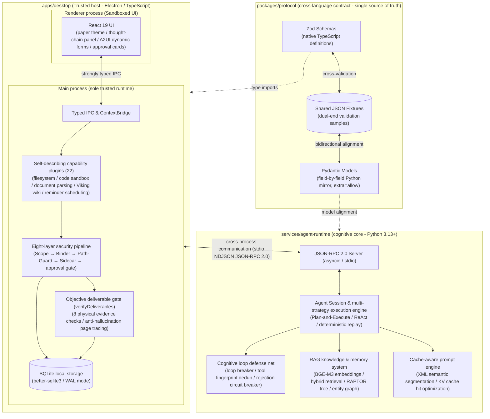
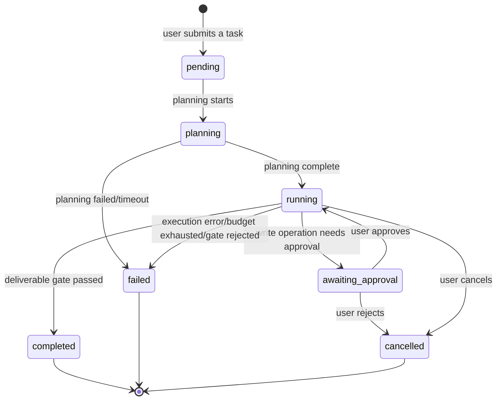

<p align="center">
  
</p>

<h1 align="center">PersonalAgent</h1>

<p align="center">
  <strong>A local-first AI personal assistant with defense-in-depth security</strong><br/>
  <sub>Electron · TypeScript · Python · LLM Agentic Loop · RAG · Cross-language Protocol</sub>
</p>

<p align="center">
  <b>English</b> | <a href="README.zh-CN.md">简体中文</a>
</p>

<p align="center">
  
  <a href="https://github.com/Azusa010/personal-agent/actions/workflows/ci.yml"></a>
  
  
  
  
  
  
  
</p>

---

## Overview

PersonalAgent is a **local-first AI personal assistant** that runs on the Windows desktop. Natural-language requests drive a complete agent workflow — plan, execute, verify, summarize — so the assistant can autonomously handle document processing, file management, code execution, knowledge retrieval, and scheduled reminders, strictly within the filesystem scope the user has authorized.

**Core design principle: Electron (TypeScript) is the only trusted runtime.** All path validation, permission decisions, and side effects happen in the Electron main process. Python only owns the agent loop and model interaction; the two communicate over stdio NDJSON JSON-RPC. Even if the LLM emits a malicious tool call, it cannot breach the TypeScript-side security boundary.

### Highlights

- 🏗️ **Dual-language monorepo** — TypeScript + Python collaboration with a bidirectional Zod ↔ Pydantic mirrored protocol
- 🛡️ **Eight-layer security pipeline** — Scope → Retriever → Context → Alignment → Binder/PathGuard → Sidecar → Permission → Idempotency
- 🧠 **RAG knowledge system** — vector embeddings + hybrid retrieval + RAPTOR tree aggregation + automatic memory extraction
- 📊 **Evaluation framework** — GAIA and τ-bench benchmarks plus a hand-built 20-case end-to-end eval suite
- 🔌 **Self-describing plugin architecture** — adding a capability means adding one file, with zero changes to dispatch logic
- 🎨 **Agent-to-UI rendering** — the agent can dynamically generate interactive UI components and push them to the frontend

---

## Quick Start

### Prerequisites

| Tool    | Version      |
| ------- | ------------ |
| Node.js | ≥ 22.13      |
| pnpm    | ^11.17       |
| Python  | ≥ 3.13       |
| uv      | latest stable |

### Run from source

```powershell
# Install dependencies
pnpm install
uv sync --project services/agent-runtime --locked

# Development mode (hot reload)
pnpm --dir apps/desktop dev

# Full verification (required before committing)
pnpm verify
```

### Packaging

```powershell
pnpm package:dir   # Portable build → apps/desktop/dist/win-unpacked/PersonalAgent.exe
pnpm package:win   # NSIS installer
```

### Demo

```powershell
powershell -File scripts/demo/start-demo.ps1   # Prepare assets and launch
```

See [docs/DEMO.md](docs/DEMO.md) for the full walkthrough.

---

## Project Structure

```
personal-agent/
├── apps/desktop/                    # Electron desktop app
│   ├── src/main/                    # Main process
│   │   ├── capabilities/            # Capability system
│   │   │   ├── plugins/             # 22 self-describing capability plugins
│   │   │   ├── path-guard.ts        # 6 classes of path boundary checks
│   │   │   ├── scope.ts             # Dynamic permission boundary
│   │   │   ├── retriever.ts         # Capability retrieval
│   │   │   └── executor.ts          # Capability executor
│   │   ├── policy/                  # Security policy (argument binding, approval)
│   │   ├── product-state/           # Persistence layer (SQLite + migrations)
│   │   ├── runtime/                 # Python subprocess lifecycle management
│   │   ├── scheduler/               # Persistent reminder scheduler
│   │   ├── viking/                  # Viking wiki storage engine
│   │   ├── verification/            # Execution evidence collection and verification
│   │   ├── permission/              # User approval management
│   │   └── tasks/                   # Task state machine + session history
│   ├── src/renderer/                # Renderer process (React SPA)
│   │   ├── components/              # UI components
│   │   │   ├── a2ui/                # Agent-to-UI dynamic rendering components
│   │   │   └── ui/                  # Base UI components
│   │   └── thought-chain/           # Thought-chain visualization
│   ├── src/preload/                 # Secure bridge (contextIsolation)
│   └── tests/                       # TS tests (unit + E2E + eval)
├── services/agent-runtime/          # Python agent runtime
│   ├── src/personal_agent/
│   │   ├── conversation/            # Conversation management
│   │   │   ├── compression/         # Context compression
│   │   │   ├── context/             # Context assembly
│   │   │   ├── instructions/        # Dynamic system instructions
│   │   │   ├── loop/                # Agent loop
│   │   │   ├── model/               # LLM interaction
│   │   │   ├── sidecar/             # Sidecar processing
│   │   │   ├── status/              # Status management
│   │   │   └── verification/        # Summary verification (anti-fabrication)
│   │   ├── knowledge/               # RAG knowledge retrieval system
│   │   ├── workflow/                # Workflow engine
│   │   ├── eval/                    # Evaluation framework
│   │   └── protocol/                # Pydantic protocol mirror
│   └── tests/                       # Python tests
└── packages/protocol/               # Cross-language protocol contract
    ├── schemas/                     # Zod schema definitions
    └── fixtures/                    # JSON cross-validation samples
```

---

## Architecture

<p align="center">
  
</p>

<p align="center">
  <sub>🌐 Built and automatically validated with <a href="https://github.com/tt-a1i/archify">Archify</a> · dark/light adaptive · open <a href="docs/architecture.html"><code>docs/architecture.html</code></a> locally for interactive exploration and node tracing</sub>
</p>

<details>
<summary><b>View the Mermaid source diagram</b></summary>



</details>

### Three-package monorepo

| Package                  | Language              | Responsibility                                                                 |
| ------------------------ | --------------------- | ------------------------------------------------------------------------------ |
| `apps/desktop`           | TypeScript (Electron) | Trusted runtime: security pipeline, capability execution, persistence, UI      |
| `services/agent-runtime` | Python 3.13+          | Agent loop: planning, tool orchestration, summary verification, RAG, eval      |
| `packages/protocol`      | TypeScript (Zod)      | Cross-language contract: schema definitions, fixture cross-validation          |

**Dependency direction is strictly one-way:** `apps/desktop` → `packages/protocol` ← `services/agent-runtime`. Cross-process communication only happens over stdio NDJSON JSON-RPC; direct code imports are forbidden.

---

## Capability Plugin System

Every agent capability is implemented as a **self-describing plugin** (`CapabilityPlugin`) that bundles its own schema definition, argument binding, risk level, idempotency policy, and execution body. Adding a capability means adding one file — no dispatch logic needs to change.

### 22 built-in capabilities

| Category              | Capabilities                                        | Description                                                     |
| --------------------- | --------------------------------------------------- | --------------------------------------------------------------- |
| **Filesystem**        | `fs.list_directory` `fs.create_directory` `fs.move` | Directory browsing, creation, move/rename                       |
| **File I/O**          | `file_read` `file_write` `file_edit` `file_search`  | Full-file CRUD + structured search                              |
| **Documents**         | `read_document`                                     | Unified multi-format document reading (PDF pages, text, pagination) |
| **Code execution**    | `code_interpreter` `terminal_execute`               | Python sandbox execution, terminal commands (session-scoped cwd) |
| **Knowledge**         | `knowledge_search` `user_memory_search`             | Vector semantic search + keyword full-text search + user memory  |
| **Wiki storage**      | `viking_read_l0/l1/l2` `viking_write_l2`            | Three-tier wiki abstraction (summary / overview / full text) R/W |
| **Skills**            | `skill_search` `skill_read`                         | Built-in and user-defined skill retrieval and loading           |
| **Web**               | `web_search`                                        | Tavily real-time web search                                     |
| **Planning & completion** | `planning.make_plan` `task.complete`            | Structured plan generation, task termination signal             |
| **Scheduling & notifications** | `scheduler.create` `notification.send`      | Persistent reminders (replayed after restart), desktop notifications |
| **UI rendering**      | `a2ui_render`                                       | Agent-generated interactive frontend components (A2UI protocol)  |

---

## Defense-in-Depth Security

Every tool call passes through the following eight layers in order; a rejection at any layer aborts execution:

```
user request → Scope → Retriever → Context → Alignment → Binder+PathGuard → Sidecar → Permission → Idempotency → execute
                 ①        ②          ③          ④              ⑤                ⑥          ⑦            ⑧
```

| Layer                         | Module                                  | Responsibility                                                                                                                                                    |
| ----------------------------- | --------------------------------------- | ----------------------------------------------------------------------------------------------------------------------------------------------------------------- |
| ① **Scope**                   | `capabilities/scope.ts`                 | Derives the task-level permission boundary dynamically from registered plugins (no static allowlist)                                                              |
| ② **Retriever**               | `capabilities/retriever.ts`             | Verifies the capability is registered and inside the current scope                                                                                                |
| ③ **Task Context**            | `task-context.ts`                       | Ensures a valid, running task context exists                                                                                                                      |
| ④ **Alignment**               | `alignment.ts`                          | Checks step ordering in scripted mode; relaxed to scope checks in everyday mode                                                                                   |
| ⑤ **Binder + Path-Guard**     | `argument-binders.ts` + `path-guard.ts` | Zod `safeParse` argument validation + 6 classes of path defenses (symlink/junction escape, UNC paths, Windows reserved device names, control characters, drive escape, case sensitivity) |
| ⑥ **Sidecar Safety**          | `sidecar.ts`                            | Regex plus a lightweight model screen for prompt injection, credential theft, and dangerous commands (`rm -rf /`, reverse shells); fail-closed on low confidence    |
| ⑦ **Permission Gate**         | `permission-broker.ts`                  | Write operations suspend for user approval; after approval a **6-step Anti-TOCTOU check** runs (permission record + status + TTL + callId + argument hash + realpath re-check) |
| ⑧ **Idempotency**             | `idempotency.ts`                        | Registers `attempting` before execution, flips to `succeeded`/`failed` afterwards; identical-argument retries return the cached result                            |

**Design notes:**

- Security validation functions always accept `string` arguments — never enums or branded types, because values coming from callers are untrusted
- `resolveWithinRoot` performs string-only arithmetic; anything involving symlinks/junctions must additionally go through `resolveWithinRootReal` for a realpath double-check
- The permission gate performs a **second realpath check** between approval and execution, so the underlying file cannot be swapped for a malicious symlink in that window
- A model's completion claim (`task_completed`) never flips state directly — the main process gathers evidence independently and decides the terminal state (fail-closed)

---

## RAG Knowledge Retrieval

The Python side ships a complete RAG (Retrieval-Augmented Generation) pipeline:

| Module                 | Responsibility                                              |
| ---------------------- | ----------------------------------------------------------- |
| `chunker.py`           | Document chunking with semantic boundary awareness         |
| `embedder.py`          | Vector embeddings (FlagEmbedding)                          |
| `indexer.py`           | Vector index construction and updates (pgvector)           |
| `retriever.py`         | Base vector retrieval                                      |
| `reranker.py`          | Second-stage re-ranking                                    |
| `raptor.py`            | RAPTOR recursive tree aggregation summarization             |
| `agentic_search.py`    | Agent-style multi-step retrieval strategy                  |
| `retrieval_router.py`  | Retrieval routing (picks the best strategy)                |
| `cascader.py`          | Cascaded retrieval (multi-source fusion)                   |
| `contextualizer.py`    | Contextualization processing                               |
| `memory_extractor.py`  | Automatic long-term memory extraction from interactions    |
| `memory_repository.py` | Memory persistence and retrieval                           |
| `consolidator.py`      | Knowledge deduplication and consolidation                  |
| `relation_graph.py`    | Knowledge entity relation graph                            |
| `source_tagger.py`     | Source provenance tagging                                  |

### Viking wiki storage

A local wiki system with three abstraction tiers (L0 summary → L1 overview → L2 full text), protected by path-isolated sandbox validation and readable/writable by the agent.

---

## Agent Execution Flow



### Multi-strategy execution engine

| Strategy                   | Use case                        | Characteristics                                                      |
| -------------------------- | ------------------------------- | -------------------------------------------------------------------- |
| **ClassicStrategy**        | Deterministic scripts / CI      | Replays a predefined step sequence                                    |
| **ReActStrategy**          | Autonomous work without a plan  | Dynamic reason–act–observe loop                                      |
| **PlanAndExecuteStrategy** | Hierarchical plan execution     | Plan first, then advance step by step; up to 2 dynamic re-plans      |

### ReAct loop defenses

The agent loop has multiple robustness guards against runaway behavior:

- **QueryLoopDetector** — breaks infinite query loops in knowledge retrieval where arguments stop making progress
- **ToolFingerprintDetector** — fingerprints tool calls and blocks repeated calls with identical arguments
- **DeathSpiralProtector** — detects deadlock spirals of consecutive failures
- **StreamWatchdog** — monitors stalls and timeouts in streamed model output
- **RejectionCircuitBreaker** — trips when the user repeatedly denies authorization
- **Budget Guard** — dual caps on token usage and tool-call count

### Objective deliverable gate

A `task_completed` from the agent is **only a claim**; the task stays `running`. The main process independently runs an 8-item, table-driven physical evidence check:

1. Page numbers cited in the summary exist in the set of pages actually read from the PDF
2. The target directory physically exists
3. The target file was physically moved and the source directory has no leftovers
4. 100% of unauthorized files remain untouched
5. The scheduled reminder is registered with correct parameters
6. Every write operation has a legitimate approval record and argument hash
7. Timeline events are complete and contiguous
8. Tool budget compliance

Only when all checks pass does the task flip to `completed`; any failure marks it `failed` (fail-closed).

### Cache-aware segmented system prompt

The prompt uses structured XML segments (`<preamble>`, `<tools>`, `<rules>`, `<skills>`, `<environment>`), with static instructions at the top and dynamic context at the bottom to maximize LLM prefix-cache hit rates. Incremental diffs are emitted only when the environment changes.

### Session management

- Multi-turn history windowing with dual budgets (message count + character count), always starting on a user message
- Conversation context compression (`distiller.py`) that preserves invariants
- Dynamic system instruction injection tailored to the task type and available capabilities

---

## Cross-Language Protocol Sync

The cross-language contract uses **three-step sync**: Zod schema → Pydantic mirror → JSON fixture cross-validation:

```
packages/protocol/schemas/*.ts          ← single source of truth (Zod)
services/agent-runtime/.../models.py    ← field-by-field mirror (Pydantic, extra="allow")
packages/protocol/fixtures/*.json       ← shared samples; each side parses them to verify agreement
```

Covered protocol domains include `envelope`, `filesystem`, `host`, `document`, `agent`, `systems`, `scheduler`, `errors`, `viking`, `knowledge`, `code-interpreter`, `a2ui`, and more.

---

## Evaluation

### Built-in eval suites

| Suite                | Description                                                                                                             |
| -------------------- | ----------------------------------------------------------------------------------------------------------------------- |
| **Scripted 20-Case** | Deterministic scripts: real Python subprocess + real SQLite + real security pipeline; each case runs Plan → Execute → Verify end to end |
| **GAIA Level 1/2**   | Integrates the [GAIA](https://arxiv.org/abs/2311.12983) benchmark: multimodal general-assistant evaluation             |
| **τ-bench**          | Integrates the τ-bench benchmark: tool-augmented agent evaluation                                                       |
| **Knowledge Eval**   | Knowledge retrieval quality (vector retrieval + re-ranking accuracy)                                                    |
| **Memory Eval**      | User memory extraction and recall evaluation                                                                            |
| **Live Eval**        | Real-model evaluation (requires an API key); not part of CI                                                             |

### End-to-end tests

| Test                   | Coverage                                                                              |
| ---------------------- | ------------------------------------------------------------------------------------- |
| **Golden Path**        | Full 20-turn run: real Python + real approvals + real file operations + real reminders + on-time notification |
| **Failure Regression** | Corrupt PDF / rejected approval / killed process / out-of-plan calls / budget exhaustion / notification failure |
| **Packaged Smoke**     | Smoke test of the PyInstaller-frozen artifact                                          |

### Metrics

- Pass@k / Pass^k evaluation
- Per-type breakdown metrics
- Stateful verdicts (filesystem end-state validation)
- Paired report comparison (`pnpm eval:compare`)

---

## Engineering Practices

### Verification gates and test status — `pnpm verify`

Every change must pass all gates through a single command before committing (three-sided static checks + 2,750+ automated tests):

```
pnpm verify = typecheck + lint:ts + lint:py + test:pack + test:ts + test:py
```

| Gate                 | Tool / Framework        | Test files | Cases             | Status           | Scope                                                                                                 |
| -------------------- | ----------------------- | ---------- | ----------------- | ---------------- | ----------------------------------------------------------------------------------------------------- |
| **Type check**       | TypeScript (node + web) | —          | —                 | ✅ Passing       | Full strict type checking across both tsconfigs                                                       |
| **TS style**         | ESLint + Prettier       | —          | —                 | ✅ Passing       | Code style and quality gate                                                                           |
| **Python style**     | Ruff                    | —          | —                 | ✅ Passing       | Python lint and style rules                                                                           |
| **Protocol contract**| Vitest                  | 11         | 296 Passed        | ✅ 100%          | Cross-language schema, bidirectional contract, fixture cross-validation                                |
| **Desktop app**      | Vitest                  | 117        | 1,571 Passed      | ✅ 100%          | Unit tests, eight-layer security pipeline, Path-Guard, SQLite state machine, Golden Path E2E, failure regression, GAIA/τ-bench |
| **Agent runtime**    | Pytest                  | 79         | 899 Passed        | ✅ 100%          | Agent cognitive loop, multi-strategy planning engine, RAG vector retrieval, RAPTOR tree, anti-hallucination summary verification, trajectory defense net |
| **Total gates**      | **Combined**            | **207+**   | **2,766+ Passed** | **✅ All Green** | **Full-stack type safety and all multilingual automated tests green**                                  |

### Code quality

- **Dead code detection**: Knip (TS production entry scanning) + AST deep probing for unmounted JSX components + Vulture (Python)
- **Island audit**: `pnpm check:islands` scans the full stack; `--strict` mode is used as a release gate
- **Dynamic schema generation**: `tool_schema_generator.py` reflects OpenAI tool schemas from capability plugin definitions at runtime — no hand-written redundant dictionaries

### Packaging and distribution

```
pnpm package:py   → PyInstaller freezes the Python runtime (~33 MB)
pnpm package:dir  → electron-builder --dir (portable build)
pnpm package:win  → NSIS installer
```

Runtime resolution order: `packaged (frozen artifact shipped with the app)` > `development (repo .venv)` > `environment variable override`. If nothing is found, the app lands in `crashed` with a readable reason rather than degrading silently.

---

## Tech Stack

| Layer                | Technology                                                              |
| -------------------- | ----------------------------------------------------------------------- |
| **Desktop framework**| Electron 39 + electron-vite                                             |
| **Frontend**         | React 19, TanStack Query v5, Radix UI, Tailwind CSS 4, Lucide Icons     |
| **Backend (main)**   | Node.js, better-sqlite3 (SQLite), Zod 4                                 |
| **Agent runtime**    | Python 3.13+, OpenAI SDK, Pydantic v2, asyncio                          |
| **RAG**              | FlagEmbedding, pgvector, RAPTOR                                         |
| **Document handling**| pypdf, pdfjs-dist                                                       |
| **Search**           | Tavily API                                                              |
| **Token counting**   | tiktoken                                                                |
| **Build**            | pnpm workspace, uv, PyInstaller, electron-builder                       |
| **Testing**          | Vitest, Pytest, GAIA, τ-bench                                           |
| **Code quality**     | ESLint, Prettier, Ruff, Knip, Vulture                                   |
| **IPC**              | stdio NDJSON JSON-RPC (cross-process), Electron IPC + contextBridge (cross-renderer) |

---

## Environment Variables

| Variable                       | Purpose                                                                  |
| ------------------------------ | ------------------------------------------------------------------------ |
| `PERSONAL_AGENT_WORKSPACE_DIR` | Workspace knob: where the agent works (terminal cwd, skill discovery, relative-path base). NOT a security boundary — reads are free, writes go through approval cards. Defaults to `~/.saki-bot` (configurable in-app) |
| `PERSONAL_AGENT_SCRIPT`        | Path to a deterministic script JSON (for demos and CI, replacing the real model) |
| `OPENAI_MODEL`                 | Real model name (when set, the OpenAI Responses API is used)             |
| `OPENAI_API_KEY`               | API key (read only by the openai SDK; never logged)                      |
| `PERSONAL_AGENT_RUNTIME`       | Overrides the runtime command to point at an executable (for troubleshooting) |

---

## Data Storage

| Content                                | Location                                   |
| -------------------------------------- | ------------------------------------------ |
| Tasks / events / permissions / reminders | `%APPDATA%\PersonalAgent\product-state.db` |
| Viking wiki                            | `%APPDATA%\PersonalAgent\viking/`          |
| Python logs                            | Forwarded to terminal stderr in dev mode   |

---

## Known Limitations

- Windows 10/11 only
- PDF support is limited to extractable text (no OCR)
- No auto-update mechanism

---

## License

Released under the [MIT License](LICENSE).
